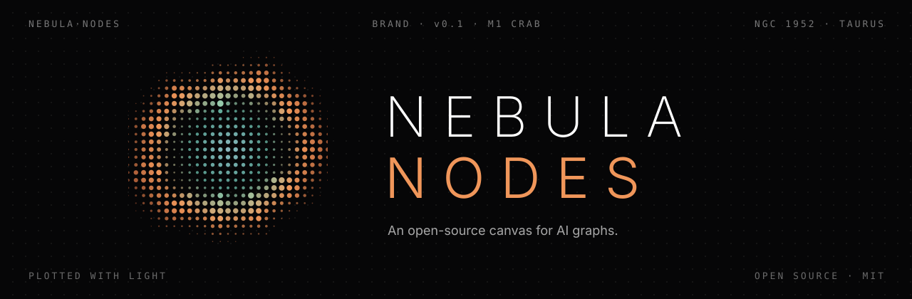
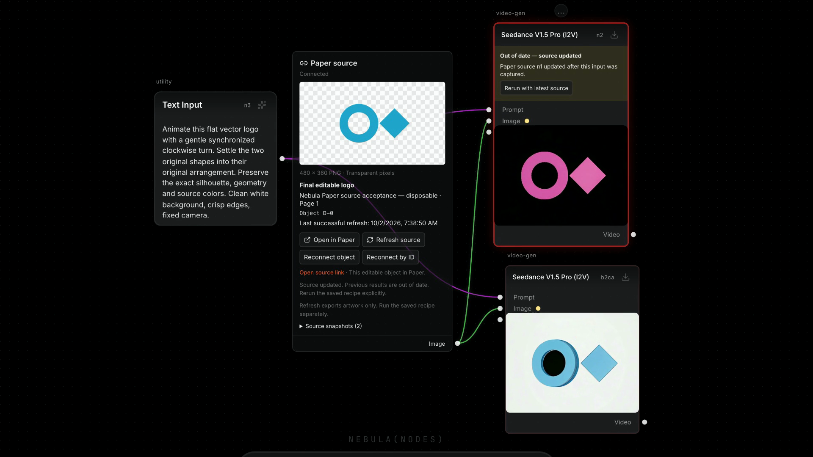

<div align="center">
  
</div>

# Nebula Nodes

**A local AI creation studio. Connect models, media, and editable artwork on one canvas.**

Drop nodes, connect their inputs and outputs, and run a creative pipeline using your own provider keys. Generate images, video, audio, text, 3D assets, and worlds; keep the graph and its outputs on your machine.

[Quickstart](#quickstart) · [Recently added](#recently-added) · [Documentation](#documentation) · [Contributing](CONTRIBUTING.md)

## Recently added

### Jev decision nodes (TypeSafe)

Put a judge between your generators. **Jev Decide** asks one typed question about text or images (yes/no, pick one option, or a score) and returns the answer with its probability and confidence, or *unsure* when Jev isn't confident enough. It is also a gate: wire anything into **Through** and it comes out of **On Pass** or **On Fail**, and the nodes on the branch it didn't take are skipped and cost nothing. **Jev Pick Best** picks the best of up to 10 candidate images. **Jev Box** (experimental) finds one thing in an image and returns its box, a crop and an inpainting mask. The Video QC nodes have a Jev mode too. Bring your own TypeSafe key (`TYPESAFE_API_KEY`); a request costs at most $0.0027 ($0.011 with Long context). TypeSafe marks image input as experimental. [Jev guide](docs/api-guides/typesafe.md).

### Projects home

Start at **Projects** to create a blank canvas or reopen recent work. Projects autosave their canvas, outputs, run history and Creator Studio draft locally. Use the home button in any workspace to return to the project list. Rename or delete a project from its card. Deleted projects go to **Recently deleted** for 30 days, where you can restore them (or use Undo right away); generated files always stay in your outputs folder. Existing canvases are preserved as **Recovered canvas**.

### Krea models and workspace

Connect your Krea account in Settings or use a Krea API token for **108 Krea models: 34 image, 41 video, 5 audio, 18 enhance and 10 3D**, including GPT Image 2, Nano Banana, Veo, Kling, Seedance, ElevenLabs Music, Topaz and Magnific. Choose **Krea** in Create's provider filter or search the node library. Saved recipes keep their account/API-token choice. Workspace nodes cover the rest of Krea: styles and moodboards, 3D export, job history, node apps, Krea Files, Krea Nodes, the Krea Agent, desktop apps and usage ([what each supports](docs/model-providers/krea/krea-workspace.md)). [Connect Krea with MCP](docs/KREA-MCP.md) · [Model workflows](docs/api-guides/krea.md).

### Paper Source

Link an editable logo or asset from **[Paper](https://paper.design)** to a canvas node and use its exported artwork downstream. **Open in Paper** takes you back to the original; edit it, return to Nebula, and **Refresh source** to capture the new artwork.

When the artwork changes, refresh marks previous results **out of date**. Choose **Rerun with latest source** to run the saved recipe again. Your connections, earlier snapshots, and run history stay intact. **Refresh alone never triggers generation.**

<div align="center">
  
</div>

Requires Paper Desktop running on the same computer as the Nebula backend, signed in to your own Paper account. [Paper setup and workflow](docs/PAPER-SOURCE.md) · [Watch the 40-second demo](videos/paper-linked-source/renders/paper-linked-source-demo.mp4)

## What you can do

- **Build visual pipelines** with typed ports for images, video, audio, text, SVG, 3D, and reusable references.
- **Choose provider nodes or universal nodes** for FAL, Replicate, OpenRouter, and Nous Portal. Browse the [node catalog](docs/MODEL_REFERENCE.md) and [provider guides](docs/api-guides/README.md).
- **Iterate on part of a graph** with partial execution, caching, and streaming previews.
- **Work across Canvas, Create, Cinema, Character, and Moodboard**, then assemble clips in the Video or Remotion editor.
- **Keep your work** with saved JSON graphs, local media outputs, and run history.
- **Build with an agent** using your local Claude Code or Codex login. Choose the model and thinking effort in Chat. [Chat setup](docs/CHAT-SETUP.md).
- **Bring your own agent.** Chat with your own Claude Code, Codex or Gemini setup (your hooks, MCP servers and memory), or any agent that speaks the Agent Client Protocol. Nebula adds its canvas tools, shows the agent's plan and tool calls, and turns its permission requests into Allow once / Deny cards. These agents aren't sandboxed; read the notice first. [Personal agents](docs/PERSONAL-AGENTS.md).
- **Watch agents work live.** Each agent that edits the canvas gets its own named cursor that glides to the node it touches, pulls wires port to port and narrates in one line. Agents read the canvas with `nebula look` instead of taking screenshots, and `nebula watch` tells them when you change something. Pin a short note to a node ("warmer", "redo this one") and agents see it in `nebula look` and answer it on the pin. Before a paid run or a bigger change, agents can propose it instead: you see ghost nodes and dashed wires, drag them where you want, and Accept or Reject. [Agent cursors](docs/MCP-SETUP.md#agent-cursors-nebula-look-and-nebula-watch), [pins](docs/MCP-SETUP.md#pins), [proposals](docs/MCP-SETUP.md#proposals).
- **Work in Nebula from any MCP client.** Claude Desktop, Cursor, Claude Code or Codex can find models, build a graph in one all-or-nothing edit, run it and see the results inline, under the same spending limits as the CLI. [Building and running over MCP](docs/MCP-SETUP.md#building-and-running-over-mcp).
- **Connect your own agent.** Settings > Preferences > Connect your agent gives Hermes, OpenClaw, Claude Desktop, Claude Code, Cursor or Codex a token, a cursor name and color, a daily limit, and the exact config to paste. `nebula mcp connect <app>` applies it from the terminal. [Connect your agent](docs/MCP-SETUP.md#connect-your-agent).
- **Set what agents may spend.** In Settings > Preferences, cap an agent run, a whole chat session, what every agent outside Nebula's chats spends together over 24 hours (restarts don't reset it), runs billed to your Krea plan (10 until you pick a number), or one model per run and per session. Give an outside agent like Hermes or Claude Desktop its own token to see and cap its share ([Connect your agent](docs/MCP-SETUP.md#connect-your-agent)). Over a limit, or for a node with no list price (a Video QC node in vision-llm mode, a multi-shot Kling run), the agent has to propose the run and you decide. Your own runs are never capped. [Spending limits](docs/MCP-SETUP.md#spending-limits).

## Quickstart

Use **Python 3.12** and **Node.js 24**. Install **FFmpeg** (`ffmpeg` and `ffprobe` on your PATH) for video processing and QC.

```bash
git clone https://github.com/JustinPerea/nebula-nodes.git
cd nebula-nodes
```

**Terminal 1 — backend**, from the repository root:

```bash
python3.12 -m venv backend/.venv
backend/.venv/bin/python -m pip install -r backend/requirements.txt
backend/.venv/bin/python backend/devserver.py --port 8000
```

It prints a link like `http://localhost:5173/#nebula-person=…&backend=http://127.0.0.1:8000` (add `--open` to open it in your browser instead). That link connects the canvas as you: only a tab opened from it can change Settings, keys and connections, accept agent proposals and start agent chats. The token lasts until the backend stops, and survives code reloads. A tab opened without it still works for building and running, with those actions locked. Agents that reach Nebula only through its MCP server, CLI or API don't get the token, so they stay held to the spending limits. That covers the in-app agents: Claude and Codex (its shell has no network; it reaches Nebula through the Nebula MCP server). Personal agents get a per-session token in the shared outside budget instead ([docs/PERSONAL-AGENTS.md](docs/PERSONAL-AGENTS.md)). Anything with its own unsandboxed shell can still read the token from your browser's storage (see [docs/MCP-SETUP.md](docs/MCP-SETUP.md#who-counts-as-the-person) and [In-app agents use this server](docs/MCP-SETUP.md#in-app-agents-use-this-server)).

**Terminal 2 — frontend**, from the repository root:

```bash
npm --prefix frontend ci
npm --prefix frontend run dev -- --host 127.0.0.1 --port 5173
```

To run a second copy next to this one (for tests or screenshots), see [Running a second, isolated dev instance](CONTRIBUTING.md#running-a-second-isolated-dev-instance); otherwise it can find and write to the backend on port 8000.

Open the link from Terminal 1, then add the provider keys you need in **Settings** (the gear at the top right of Projects, or the bottom of the left rail inside a project). Provider usage is billed to your accounts. Browser mode stores keys in the gitignored, plaintext `settings.json`; the macOS desktop app uses Keychain encryption. Neither reads keys from your shell: `devserver.py` and the app both drop provider key variables like `OPENAI_API_KEY` from the backend's environment, and `devserver.py` prints the names it ignored.

Try a **Text Input → GPT Image 2 → Preview** graph and hit **Run**. Generated files go to `output/` by default; change the location in **Settings → Storage**.

**Prefer an app?** On an Apple silicon Mac, build Nebula.app once and open it from Applications or the Dock; it starts the backend itself and stops it when you quit:

```bash
cd desktop && npm install && npm run package && npm run install-app
```

It runs this checkout (so `git pull` updates it; rebuild the renderer with `cd frontend && npm run build:desktop` after frontend changes) and keeps its own data in `~/Library/Application Support/Nebula Nodes/`. The first launch copies your browser-dev data and API keys there (copy only, nothing is deleted), but only when that folder has no `migration-state.json` yet. If an earlier desktop run already left one, the copy is skipped: the app opens with that older data and asks for your API keys again, so add them in **Settings** (they go to the Keychain). To start fresh from browser dev instead, quit Nebula and move `~/Library/Application Support/Nebula Nodes` aside (rename it, say to `Nebula Nodes.old`; don't delete it), then open Nebula again. After the first launch the app and browser dev have separate projects, outputs and settings. The two terminals above stay the way to develop. Details, signing and Gatekeeper notes: [desktop/README.md](desktop/README.md#nebulaapp-everyday-use). Agent chat and Paper are optional; configure them when you need them.

## Documentation

| Guide | What it covers |
| --- | --- |
| [Paper Source](docs/PAPER-SOURCE.md) | Link artwork, edit, refresh, and rerun |
| [Node catalog](docs/MODEL_REFERENCE.md) | Nodes, parameters, ports, and endpoints |
| [Model pricing](docs/MODEL-PRICING.md) | Run cost estimates, the cost confirm, and keeping prices current |
| [Provider guides](docs/api-guides/README.md) | Example pipelines and API coverage |
| [Desktop app](desktop/README.md) | Nebula.app, launch, local backend, migration, and Keychain |
| [External-agent MCP](docs/MCP-SETUP.md) | Build and run from any MCP client (`find_nodes`, `describe_node`, `edit_canvas`, `run_nodes`, `view_output` with inline previews, spending limits), canvas selection, `look_at_canvas`, agent cursors, `wait_for_canvas_change`, `resolve_pin` and proposals |
| [Provider contracts](docs/contracts/README.md) | Maintained API contracts and verification |
| [Contributing](CONTRIBUTING.md) | Development checks and adding nodes |

## Contributing and support

[Issues](https://github.com/JustinPerea/nebula-nodes/issues) and pull requests are welcome. Read the [contribution guide](CONTRIBUTING.md) before adding a node or changing a provider integration.

Built with React Flow and FastAPI. Licensed under [AGPL-3.0](LICENSE).
