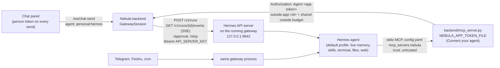

# Hermes in the chat panel, through its running gateway (plan)

Status: plan only, no code yet. Written 2026-10-14. Hermes facts were checked against
`NousResearch/hermes-agent` at `0e427d788d253630d38a3a51cd76849e73cd6925` (default-branch HEAD,
2026-10-13), and against `05df0382a5db0c637422daa97e61989eb171b65a`, the commit Justin's install runs
(`hermes --version`: v0.21.6+155.g05df038). The API server files differ between the two only in type
annotations, and `api-server.md` is identical. Sources are listed at the end; `[S1]` and so on point there.



## Why this route

- Hermes says never point two agent processes at one profile: both write memory and each loads the
  other's writes [S8]. Justin's default profile already runs a gateway, and his `memory.provider` is
  empty (no Honcho), so a second profile for Nebula would be a copied soul with forked memory.
- The API server runs inside the gateway process that already owns his profile. Nebula talks to it over
  HTTP, so there is still one writer, and Nebula chats see the same memory, skills and soul as Telegram.
- Cost: Nebula can't hand Hermes its MCP server per request (unlike ACP `session/new`). The `nebula`
  MCP server has to live in Hermes' own `config.yaml`, with a Connect-your-agent app token.

## What Justin's machine looks like today (read-only checks, 2026-10-14)

- Hermes v0.21.6+155 at `05df038`. Gateway pid 95143, up about 5 days, state `degraded`.
- Platforms: Telegram and Feishu connected, Discord paused, **`api_server` fatal**:
  `api_server_key_invalid` since 2026-10-09 ("missing, placeholder/too short"). Nothing listens on 8642.
- `platforms.api_server` in `config.yaml`: `enabled: true`, `host: 127.0.0.1`, `port: 8642`.
  `gateway.api_server.max_concurrent_runs: 10`.
- `approvals.mode: manual`, `approvals.timeout: 60`. `memory.provider: ''`.
- `mcp_servers`: only `paper`. Nebula isn't connected yet.
- No key or token was printed or read for this.

## One-time setup

### What Justin does (outside Nebula)

1. Put a strong key in `~/.hermes/.env`: `API_SERVER_KEY=` followed by the output of
   `openssl rand -hex 32`. The startup guard refuses a missing key, a placeholder, or one under 16
   characters, even on loopback [S2 `_api_key_passes_startup_guard`].
2. Restart the gateway: `hermes gateway restart` (it drains running turns first, then starts fresh)
   [S15]. Don't use `/platform resume api_server`, even though the guard's error suggests it. A key
   failure is marked non-retryable, so the adapter never enters the retry queue and resume answers
   "api_server is not in the retry queue — nothing to resume." The key is also read only when the
   adapter is built [S2 l.1196, l.4462-4478; S16]. Then
   `curl -s http://127.0.0.1:8642/health` should print `{"status": "ok"}` [S1 "GET /health"].
3. Settings > Connect your agent > Hermes: name it (say "Hermes"), pick a color and a daily limit,
   Connect. Paste the printed `mcp_servers.nebula` entry into `~/.hermes/config.yaml`. It sets
   `trust: untrusted`, so every Nebula tool without `readOnlyHint` asks first [S10]. With the
   token-file branch merged, the entry carries `NEBULA_APP_TOKEN_FILE` instead of the raw token.
4. The running gateway picks up a new `mcp_servers` entry within about a minute, no restart [S9 "Reloading"].
5. In Nebula: Settings > Personal agents > Hermes: paste the API key, keep the address
   `http://127.0.0.1:8642`, pick the Connect app from step 3, press **Check**, switch it on.

### What Nebula does

- **Stores the key, never shows it again.**
  - Desktop app: in the encrypted credential store Electron already has (`desktop/credentials.mjs`,
    `safeStorage`, macOS Keychain-backed), under a new name `HERMES_API_SERVER_KEY`, handed to the
    sidecar on the launch-secrets stdin line (`services/launch_secrets.py`), held in memory only.
  - Browser dev: `settings.json` `apiKeys.HERMES_API_SERVER_KEY`, beside the provider keys.
  - **Not** in `CREDENTIAL_PROVIDERS`. That set must equal the frontend `providerCatalog.ts` keys and
    `settings.example.json` `apiKeys` (`test_settings_api.py`), so adding it there would make Settings
    show Hermes as a model-provider key row. And it has no field to mark a key "not a provider".
  - Instead, `services/credential_catalog.py` gets a second set, `NON_PROVIDER_CREDENTIALS =
    {"HERMES_API_SERVER_KEY"}`, and `ALL_CREDENTIALS = CREDENTIAL_PROVIDERS | NON_PROVIDER_CREDENTIALS`.
    - Scrubs switch to `ALL_CREDENTIALS`: `acp_session._AGENT_ENV_DROP`, `devserver.py`
      `INHERITED_CREDENTIAL_ENV_KEYS`, and the desktop sidecar env strip.
    - The desktop credential allowlist (`desktop/credentials.mjs`) gets a matching
      `NON_PROVIDER_CREDENTIALS` export; its mirror test checks both sets.
    - `_CREDENTIAL_PROVIDER_ALLOWLIST`, `providerCatalog.ts` and `settings.example.json` stay
      providers only, so the generic `/api/settings/api-keys/{provider}` routes refuse the Hermes name.
      It is written and deleted only through the personal-agents route, behind `require_person`.
  - `GET /api/settings` has no person check (agents read it) and masks every `apiKeys` entry as
    `***` plus the last 4. It must drop every `NON_PROVIDER_CREDENTIALS` name from `apiKeys` before
    masking. The personal-agents routes return only `keySet: true|false`. Test: the key's tail never
    appears in either response.
- **Keeps the address**, not secret, in `personal-agents.json` on the agent row: `url` (default
  `http://127.0.0.1:8642`) and `appId` (the Connect app it uses).
  - v1 accepts only `http` on `127.0.0.1`, `localhost` or `::1`, the same rule
    `services/backend_address.py` applies to Nebula's own address.
- **Checks health** (Settings "Check" button, and once before each new chat):
  1. `GET /health`, no key. Fails: "Hermes isn't answering at 127.0.0.1:8642."
  2. `GET /v1/capabilities` with the key. 401: "Hermes rejected the key." Missing
     `features.run_submission`, `run_events_sse`, `run_stop` or `endpoints.run_approval`: "Update Hermes."
     [S1 "GET /v1/capabilities", S2 `_CAPABILITY_ENDPOINTS`]
  3. `GET /v1/toolsets` with the key, looking for tools named `mcp_nebula_*` [S1 "Skills and toolsets",
     S9 "How Hermes registers MCP tools"]. None: a warning, not a block: "Hermes doesn't have Nebula's
     tools yet. Finish Connect your agent."
- **HTTP client**: `httpx` (already pinned, 0.28.1), `trust_env=False` so no proxy ever sees the key
  (same reason as the MCP server), `follow_redirects=False` so the key never goes to a second host.

## Transport

### Endpoints Nebula uses (all with `Authorization: Bearer <key>`)

| Call | When | Notes |
|---|---|---|
| `POST /v1/runs` | each send | 202 `{run_id, status, replayed}` [S3 `_handle_runs`] |
| `GET /v1/runs/{run_id}/events` | right after | SSE; `Last-Event-ID` to resume [S3 `_handle_run_events`] |
| `POST /v1/runs/{run_id}/approval` | person answers a card | `{"choice": "once"\|"deny", "request_id": ...}` [S3 `_handle_run_approval`] |
| `POST /v1/runs/{run_id}/stop` | Stop, /clear, close | returns `{"status": "stopping"}` at once [S3 `_handle_stop_run`] |
| `GET /v1/runs/{run_id}` | after a lost stream | status, `output`, `usage` [S3 `_handle_get_run`] |
| `GET /health`, `/v1/capabilities`, `/v1/toolsets` | Check | see above |

Not used in v1: `/v1/chat/completions` and `/v1/responses` (no approval or stop control),
`/api/sessions/{id}/chat/stream` (fine, but runs give resumable events and idempotency),
`/v1/runs/{id}/steer` (maybe later).

### Request body for `POST /v1/runs`

```json
{
  "input": "<selection context>\n\n<message>",
  "session_id": "nebula-<32 hex>",
  "instructions": "<NEBULA_MCP_PRIMER + gateway tail>"
}
```

Headers: `Idempotency-Key: <uuid4 per send>` and `X-Hermes-Session-Key: nebula:personal:hermes`.

- `session_id`: when it names an existing Hermes session and no history is sent, the run loads that
  session's transcript, and "session turn leases serialize concurrent writers" [S1 "POST /v1/runs",
  S3 `_handle_runs`]. A new id starts an empty session under that id.
- `instructions` is an ephemeral system prompt layered on Hermes' own; tools, memory and skills stay
  [S1 "System Prompt Handling"]. It isn't stored with the session, so Nebula sends it on every run.
- `Idempotency-Key`: a retry after a dropped POST gets the same `run_id` back, not a second run [S1].
- `X-Hermes-Session-Key` only scopes an external memory provider (Honcho) [S1 "Long-term memory
  scoping"]. No effect for Justin today; harmless and right for a Honcho user.
- No `model` or `provider`: Hermes uses his own model, as with ACP agents.
- Text only. Runs take a string `input`; images and files wait.

### Event stream

Frames are `id: <seq>` plus `data: <json>`; the event name is the JSON `event` field, not an SSE
`event:` line. Comment lines (`: open`, `: keepalive` every 10 s, `: stream closed`) must be skipped
[S1 line 111, S2 `_sse_frame`, S3 `_handle_run_events`].

| Hermes event | Fields | Nebula chat event |
|---|---|---|
| `message.delta` | `delta` | `text` |
| `message.interim` | `text`, `already_streamed` | skip if `already_streamed`, else `text` |
| `reasoning.available` | `text` (cut to 500 chars by Hermes [S6]) | `thought` |
| `tool.started` | `tool`, `preview` (args, display-redacted by Hermes [S7]) | `tool_use` with a Nebula-made `toolUseId` |
| `tool.completed` | `tool`, `duration`, `error`, `preview` (redacted, 500 chars [S3]) | `tool_result`, `isError` from `error` |
| `subagent.start` / `subagent.complete` | `goal`, `status`, `summary`... | one `system` line each |
| `approval.request` | `request_id`, `command`, `description`, `choices`... | `permission_request` (below) |
| `approval.responded` | `choice`, `request_id` | `permission_resolved` |
| `run.completed` | `output`, `usage`, `runtime` | `output` as `text` only if nothing streamed, then `result` `end_turn` |
| `run.failed` | `completed: false`, `partial`, and either `error` (provider or agent failure) or `output` plus `turn_exit_reason` (turn limit, partial reply) | `output` as `text` if present and not streamed; then `error` with Hermes' `error` if present, else "Hermes hit its turn limit." for `max_iterations_reached(...)`, else "Hermes stopped before finishing."; then `result` `error` |
| `run.cancelled` | `interrupted: true` | `result` `cancelled` |
| `run.interrupted` | `error` | `error` "Hermes' gateway stopped during this turn." |
| `replay.truncated` | `oldest_retained_seq` | `system` "Some of Hermes' progress was lost while reconnecting." |
| `run.steered` | | ignored in v1 |

- `run.failed` has two shapes [S3 `_execute_run` l.972-986, S13 terminal status table]. A
  provider failure (`failed=True`) carries `error` and no `output`. A turn that ended without
  finishing (`completed=False` or `partial`, such as the iteration budget) carries `output` with
  Hermes' fallback text and no `error`. Nebula must not assume `error` is there, and must show the
  partial answer before the closing line.
- Run events carry no tool-call id. Nebula pairs `tool.completed` with the oldest open `tool.started`
  of the same `tool` name (FIFO). Parallel calls of one tool can pair in the wrong order; the chat only
  shows previews, so that is acceptable [S3 `_FIXED_EVENT_FIELDS`].
- Everything forwarded goes through the ACP path's `make_redactor` (with the API key and, if Nebula can
  read it, the app token) and its caps: `TurnTextBudget`, `capped_json`, `MAX_TOOL_RESULT_CHARS`.

### Approvals become the permission card

- `approval.request` comes from Hermes' own approval system: dangerous terminal commands under
  `approvals.mode` (Justin: `manual`), and every write-capable tool on a `trust: untrusted` MCP server,
  which includes Nebula's own tools [S1 "POST /v1/runs/{run_id}/approval", S5, S10].
- Card: `title` = `description` (else "Hermes wants to run a command"), `kind` `execute`, `input`
  `{command}` (Hermes already redacted it [S2 `_approval_request_event`]), `canAllow` = `"once"` in
  `choices`.
- Nebula only ever sends `once` or `deny`. Never `session` or `always`: `always` writes a permanent
  allowlist entry into his `config.yaml` [S14], same rule as the ACP cards.
- Several approvals can be open at once (a parallel tool batch). Each has its own `request_id`
  [S4 line 32]; Nebula's `requestId` maps to `(run_id, request_id)` and the answer always sends
  `request_id`, never `all`.
- Timeout: Hermes waits `approvals.timeout` (Justin: 60 s, default 300) and then fails closed with
  `BLOCKED` [S5, S12]. Nebula can't read that setting over the API. The card shows no countdown; it
  flips to "timed out" when the matching `tool.completed` arrives with `error: true` while the card is
  still open, or when the run ends. Nebula's own 120 s timer still sends `deny` if it fires first.
- Only the socket that started the chat, with the person token, can answer (same check as today).

### Conversation continuity

- One chat = one Hermes session id, `nebula-<32 hex>`, minted by Nebula when the chat starts. It is the
  `sessionId` the chat panel already keeps and sends back.
- Nebula records the ids it minted (`gateway-sessions.json` in the state dir, newest 200), each with
  the `agentId` and Hermes `url` it was minted for, and only ever sends those. A send can't steer
  Nebula into his Telegram session by passing its id.
- Hermes holds the history, so the conversation can outlive the socket, the backend and the app. That
  doesn't happen by itself. Today's code ends it in three places, and each needs a change:
  - **Socket ownership.** `/ws/chat` gives each socket a fresh `connection_id` (`main.py`), and
    `acp_sessions.get(session_id, owner)` only returns a session whose owner matches. A reconnected
    socket, or a restarted backend, gets `None`, `personal_turn` sends `personal_session_ended`, and
    ChatPanel clears its `sessionId`.
  - **Socket drop.** `close_owned(connection_id, "disconnected")` closes every session the socket
    owned and forgets it.
  - **App relaunch.** ChatPanel keeps `sessionId` in plain `useState`. Only the agent selection is in
    `localStorage`, so a reopened panel sends no `sessionId` and a new Hermes session starts.
- **Revival, backend.** `personal_turn` gets one new branch, for the gateway kind only. When
  `acp_sessions.get` returns `None` and the agent is a gateway agent, it calls
  `acp_sessions.revive_gateway(session_id, agent_id, connection_id)` instead of answering
  `personal_session_ended`. Revival succeeds when:
  - the id is in `gateway-sessions.json` with the same `agentId`, and the agent's current `url` matches
    the recorded one (a different Hermes wouldn't have the history);
  - the agent is on and `ready`;
  - no live session in this backend already holds that id under another socket. If one does, the send
    gets an `error` with a new code, `personal_session_busy`: "This conversation is open in another
    Nebula window." Nothing is stolen, and the panel keeps its id (only `personal_session_ended`
    clears it).
  - The revived session's owner becomes the sending socket's `connection_id`. Ownership is per socket,
    so it can't carry over; the minted-ids list is the guard instead. Any socket that may send to a
    personal agent at all (person token, not Commons) may revive, the same rule as starting a chat.
  - Anything else gets `personal_session_ended` as today. ACP sessions keep today's behaviour: their
    process is gone, so there is nothing to revive.
- **Revival, frontend.** For gateway agents, ChatPanel stores the chat's `sessionId` in `localStorage`
  per agent (`nebula.chat.gatewaySession.<agentId>`, wrapped in try/catch like the selection key). On
  open with a gateway agent selected, or on switching back to one, it restores that id and shows a `system` line: "Continuing your
  earlier Hermes conversation. /clear starts fresh." The panel doesn't refetch the old messages in v1;
  Hermes has them. `personal_session_ended` clears the stored id as well as the state.
- `/clear` stops any active run, forgets the id (state and `localStorage`), and mints a new one next
  send. Switching to another agent stops the active run but keeps the stored id, so coming back to
  Hermes continues the conversation. The old session stays in his Hermes history (source
  `api_server`), like a `/new` in Telegram.
- The Nebula conversation is visible from his dashboard and `GET /api/sessions` as its own session.
  It does not appear inside his Telegram thread. What crosses over is memory (MEMORY.md, USER.md,
  skills), which is the point.

### Concurrency with his other channels

- Telegram, Feishu and cron run in the same process on their own sessions. Hermes serializes writers
  per session with turn leases [S1], and memory writes stay in one process.
- The API server's own cap is `max_concurrent_runs` (his: 10). Over it: 429 "Too many concurrent
  runs" [S1 "Concurrent-run cap"]. Nebula says "Hermes is busy; try again in a moment" and starts
  nothing. No automatic retry on 429.
- While the gateway drains for a stop or restart, run-starting calls return 503 `gateway_draining`
  with `Retry-After: 1` [S2 `_admit_api_agent_request`]. Nebula: "Hermes is restarting."
- One active run per Nebula chat, enforced by the chat socket as today.

### Cancellation

- Stop: `POST /v1/runs/{id}/stop`, then keep reading the stream for `run.cancelled`. Hermes stops at
  the next safe point and reaps only this run's background processes [S3 `_handle_stop_run`].
- If no terminal event arrives in 10 s (`CANCEL_GRACE_S`), Nebula ends the turn on its side with a
  `system` line, "Hermes is still stopping." There is no process for Nebula to kill.
- Open approval cards settle as `cancelled`. Hermes withdraws its own wait when the run stops [S3
  `_execute_run` `finally`].

### Timeouts and reconnects

- Connect 5 s. `POST /v1/runs` 15 s. Stream read timeout 35 s (three missed keepalives).
- No overall turn limit, as for ACP. Hermes has its own watchdogs, which end the run as `cancelled`
  with a `turn_exit_reason` [S13].
- Stream drops while the run is live: reconnect with `Last-Event-ID: <last seq>`, up to 3 tries with
  1, 2, 4 s backoff. Hermes keeps the last 1,000 events per run [S3 `_RunStream`].
- The buffer's 5 minutes count from when the run's stream was created, not from when the last
  subscriber left. A sweep every 60 s drops the transport of any run older than 5 minutes that has no
  subscriber at that moment, and later events are no longer buffered [S2 `_RUN_STREAM_TTL` l.4358,
  S3 `_sweep_orphaned_runs_once` l.1284-1295]. So a drop during a run longer than 5 minutes can lose
  the stream for good.
- A 404 `run_not_found` from `/events` during a reconnect means "transport expired", not "no such
  run" (`_handle_run_events` waits 1 s for the stream, then returns 404 [S3 l.1077-1082]). Nebula
  stops retrying and goes straight to the poll below. It never shows "run not found".
- Still nothing: `GET /v1/runs/{id}` once. Terminal: emit `output` and finish. Running: `system`
  "Lost touch with Hermes. It may still be working; its answer will be in this conversation's next
  turn." Terminal statuses stay pollable for an hour [S2 `_RUN_STATUS_TTL`].
- The gateway restarted under a run: the stream or poll reports `interrupted` [S3 `_durable_run_status`].

## How it fits the personal-agent code

### A new agent kind: `gateway`, beside ACP

- `personal_agents.py`: the `hermes` preset becomes `kind="gateway"` with `url` and `appId` on its
  row, and no command or args. Status:
  - `needs_setup` until a key is stored and an app is linked,
  - `disabled` when off,
  - `ready` otherwise. No binary lookup.
  `launch_key` for it is `("gateway", "hermes", url, appId, key_fingerprint)`, so changing the key,
  address or app stops live chats through the existing `close_stale`.
- The ACP Hermes preset (`hermes acp`, needs a separate profile) goes away. Its `needs_setup` note
  was only ever a placeholder.
- New `services/hermes_gateway.py`: the HTTP client (health, start run, stream events, approve,
  stop, poll) and the event mapping, as pure functions like `acp_events.py`.
- New `GatewaySession` (in `services/gateway_session.py`), with the same surface `main.py` already
  uses on `AcpHostSession`: `id`, `agent_id`, `owner`, `display_name`, `color`, `closed`,
  `prompt()`, `resolve_permission()`, `cancel_turn()`, `close()`, `ended_message()`, `launch_key`.
- `AcpSessionManager` becomes a manager of both kinds (rename to `PersonalSessionManager` later, not in
  the first PR). `open()` picks the class from the agent's kind. `personal_turn` in `main.py` keeps
  its shape apart from the gateway-only revival branch (see Conversation continuity), which calls a
  new `revive_gateway()` on the manager.

### Shared

- Chat events (`text`, `thought`, `tool_use`, `tool_result`, `permission_request`,
  `permission_resolved`, `system`, `error`, `result`, `session`), `source: "personal"`, and the
  frontend handling in `ChatPanel.tsx`. No new frontend event type.
- The permission card, its person-token and owning-socket checks, Allow once / Deny only.
- `make_redactor`, `TurnTextBudget`, `capped_json` and the caps in `acp_events.py`.
- The one-time personal-agent notice, the Settings on/off switch, the chat picker, Commons refusing
  personal agents, `close_owned` on socket disconnect, `close_stale` after registry writes,
  `MAX_LIVE_SESSIONS`.
- The primer: `NEBULA_MCP_PRIMER` plus a gateway tail ("Nebula's tools are your `nebula` MCP server.
  They spend under your Connect-your-agent limit. You have no Nebula workspace; your files and shell
  are your own.").

### Different

- **No process.** Nothing to spawn, kill or put under the agent guardian. `close()` stops the active
  run (best effort, 2 s) and forgets the record. Backend shutdown does the same for every live run.
- **No session token.** Nebula mints nothing per chat; Hermes' MCP server uses the long-lived Connect
  app token. So no `agent-tokens/` file, no `NEBULA_AGENT_TOKEN_FILE`, no per-chat revoke.
- **No Nebula workspace** and no `workspace_scope`. Hermes' tools run where Hermes runs.
- **Idle reaper.** Nothing is held open between turns, so idle costs nothing. The reaper only drops the
  in-memory record after 30 minutes; the next send with the same `sessionId` goes through
  `revive_gateway()` without a new health check.
- **Disconnect.** ACP kills the agent with the socket. Here `close_owned` on a socket drop stops the
  active run (so nothing works unwatched on Nebula's behalf) and drops the in-memory record, but leaves
  the id in `gateway-sessions.json`. The next send from any socket revives it.

## Budget and identity

- Hermes' canvas calls go through its `nebula` MCP server with the Connect app token, so they spend as
  `outside:app:<appId>`: the app's own daily limit, and the shared "agents outside Nebula chats" budget
  too. A token never adds headroom (`agent_spend.session_budgets`).
- That one app line covers Hermes on every channel. A canvas run Hermes starts from Telegram and one it
  starts from the Nebula chat count against the same limit. Nebula can't tell them apart, and doesn't
  need to.
- `outside:personal:hermes` stays unused for the gateway kind. Settings shows Hermes once, under its
  app.
- Display name and color in the chat come from the linked Connect app, so the chat bubble and the
  canvas cursor always match. Renaming or recoloring the app updates both.
- What Hermes spends on its own model is between Justin and his provider, as for ACP agents. Nebula
  doesn't show `usage`.

## Security

- **The key is a shell.** The API server gives "full access to hermes-agent's toolset, including
  terminal commands" [S1 "Security"]. `capabilities` says tools execute on the API-server host [S2].
  Treat `HERMES_API_SERVER_KEY` like an SSH key.
- **Loopback only by default.** Hermes binds 127.0.0.1 unless `API_SERVER_HOST` changes it, and warns
  when a network-reachable bind meets an unsandboxed terminal [S1, S2 `connect`]. Nebula v1 refuses any
  non-loopback address.
- **Remote or cloud Hermes, later.** Needs `https` only, a pinned host, and a warning that the key then
  crosses a network. Not in this plan's PRs.
- **Nebula must never:**
  - log the key, put it in an error message, a chat event, a crash report or diagnostics;
  - send it to the renderer, even masked;
  - put it in a child process environment (the `ALL_CREDENTIALS` scrub covers this) or argv;
  - send it anywhere but the stored loopback address (no proxies, no redirects);
  - choose `session` or `always` on an approval;
  - forward a client-supplied Hermes session id it didn't mint.
- **Prompt injection through the canvas.** Whatever Hermes reads from the canvas (prompts, node
  outputs, selections) reaches an agent with a shell and persistent memory, and can come back later in
  Telegram or cron. Hermes' manual approvals cover only what it flags as dangerous; ordinary file
  writes and web fetches don't ask. The one-time notice already says this; the Hermes row repeats it.
- **Optional hardening on Justin's side.** `platform_toolsets.api_server` limits the toolsets every API
  server client gets [S2 `_create_agent`]. That also narrows Open WebUI or anything else he connects,
  and makes the Nebula chat less "his whole agent", so the plan doesn't require it.

## Failure modes and what the person sees

| What happens | Chat shows |
|---|---|
| Gateway not running or adapter fatal | "Hermes isn't answering at 127.0.0.1:8642. Is its gateway running with the API server on?" |
| Wrong key (401) | "Hermes rejected the key. Paste it again in Settings > Personal agents." |
| Hermes too old (no runs, approval or stop) | "This Hermes is too old for Nebula's chat. Update Hermes." |
| No `mcp_nebula_*` tools | Check warns; chat still works, without canvas tools |
| 429 cap | "Hermes is busy; try again in a moment." |
| 503 draining | "Hermes is restarting. Try again in a few seconds." |
| Provider failure (`run.failed`) | Hermes' redacted error, then the turn ends |
| Turn limit or unfinished turn | Any partial answer Hermes sent, then "Hermes hit its turn limit." (or "Hermes stopped before finishing.") |
| Stream lost past Hermes' 5-minute buffer (404 on reconnect) | Poll result, or "Lost touch with Hermes..." |
| Conversation open in another Nebula window | "This conversation is open in another Nebula window." |
| Stream lost, run still going | "Lost touch with Hermes. It may still be working..." |
| Gateway restarted mid-turn | "Hermes' gateway stopped during this turn." |
| Approval timed out in Hermes | Card turns "timed out"; Hermes reports the command blocked |
| Key, address or app changed, or Hermes switched off | Existing `close_stale` message |
| App token revoked | Hermes' Nebula tools fail with 401; Hermes says so in its reply |

## Tests

- **Fake API server** `backend/tests/fixtures/fake_hermes_api.py`: stdlib `ThreadingHTTPServer`, like
  `fake_acp_agent.py`. Scripted per test: health, capabilities, toolsets, 401, 429, 503, a run's event
  list (deltas, reasoning, tools, approvals, terminal events), keepalive and comment lines, a stream
  that drops mid-run and honours `Last-Event-ID`, stop, and a poll endpoint. It records every request
  so tests can assert headers and bodies.
- **Unit** (`tests/test_hermes_gateway.py`): event mapping table, SSE parsing (comments, ids,
  multi-line data), FIFO tool pairing, output-only-if-not-streamed, redaction and caps, address
  validation, approval choice mapping (never `session` or `always`).
- **Session** (`tests/test_gateway_session.py`): approval round trip with `request_id`; Hermes-side
  timeout flips the card; stop with and without a terminal event; reconnect with `Last-Event-ID`;
  poll fallback, including a 404 from `/events` after the transport expired (goes to the poll, never
  says "run not found"); `run.failed` with `output` and no `error` (partial text shown, then the
  turn-limit line) and with `error` and no `output`; `close_stale` on key or address change; `/clear`
  mints a new id; only minted ids are accepted; `revive_gateway()` from a new `connection_id` after a
  socket drop and after a backend restart (fresh manager, same `gateway-sessions.json`), refused for an
  unminted id, another agent's id, a changed `url`, or an id live under another socket.
- **Secrets** (`tests/test_gateway_secrets.py`): the key never appears in logs (caplog), chat events,
  errors, settings responses or a child environment; no proxy or redirect is followed. `GET
  /api/settings` has no `HERMES_API_SERVER_KEY` entry (not even `***` plus 4); the generic api-keys
  routes refuse the name; `_AGENT_ENV_DROP` and the devserver scrub include it;
  `test_settings_api`'s provider-catalog check still passes without a frontend change.
- **WebSocket** (`tests/test_chat_personal_ws.py` additions): a `personal:hermes` send streams through
  the fake server; permission answers need the person token and the owning socket; close the socket,
  open a new one, send with the old `sessionId`: the fake server sees the same Hermes `session_id`
  and no `personal_session_ended` is sent.
- **Frontend**: Settings row (key field write-only, Check button states, app picker); `vitest` for the
  picker status; ChatPanel stores the gateway `sessionId` per agent, restores it on mount with the
  "Continuing" line, and clears it on `/clear` and `personal_session_ended`, not on agent switch.
  `localStorage` throwing doesn't break the panel.
- Run the full backend suite, `npx vitest run`, `tsc`, `npm run lint`, and the contracts check.

### Live verification (Justin)

1. Setup steps 1 to 5 above. `curl -s http://127.0.0.1:8642/health`.
2. Settings Check passes all three steps.
3. In Nebula chat, pick Hermes: "What do you remember about me?" Expect his real memory.
4. "Add a text node saying hello." Expect a permission card for the Nebula tool (untrusted MCP), Allow
   once, the node appears with Hermes' cursor name and color.
5. Ask for a shell command that his `manual` approvals flag. Expect a card; Deny; Hermes reports it
   blocked.
6. Long task, press Stop. Expect "cancelled" within a few seconds.
7. Message Hermes on Telegram during a Nebula turn. Both answer.
8. "Remember that my favourite color is teal" in Nebula, then ask in Telegram.
9. `/clear`, send again: a fresh conversation, the old one still in his Hermes dashboard's session list.
10. Quit and reopen Nebula mid-conversation. The panel says it is continuing; ask "what did I just
    ask you?" and Hermes answers from the earlier turns.
11. Restart only the backend (dev) with the panel open, send again: same conversation, no "agent has
    stopped" error.

## Delivery

| PR | What | Rough size |
|---|---|---|
| 0 | Justin's setup (key, gateway restart, Connect, paste MCP entry). No code. | 15 min |
| 1 | Backend: `hermes_gateway.py`, `gateway_session.py`, gateway kind in `personal_agents.py`, key storage (dev settings, `NON_PROVIDER_CREDENTIALS` in `credential_catalog.py` and its desktop mirror in `credentials.mjs`, scrubs switched to `ALL_CREDENTIALS`, `GET /api/settings` dropping the name, launch secrets), manager branching, fake server and tests. `providerCatalog.ts` and `settings.example.json` don't change. | ~950 lines incl. tests |
| 2 | Settings UI: key field, address, app link, Check; picker status; `PERSONAL-AGENTS.md` and `MCP-SETUP.md` updates | ~400 lines |
| 3 | Resilience: `Last-Event-ID` reconnect, 404-means-expired and poll fallback, `revive_gateway()` and its `personal_turn` branch, ChatPanel `sessionId` persistence per gateway agent, Hermes-side approval timeout handling | ~450 lines |
| later | Steer, images, remote Hermes over https, other API-server agents | |

PR 1 depends on the token-file branch only for the docs snippet; the code doesn't.

## Decisions (Justin, 2026-10-14: "go with what you think is best")

1. **The Hermes chat is tied to its Connect app:** one name, color and spending line.
2. **Closing the Nebula tab stops Hermes' run.** The conversation stays and resumes on the next send.
3. **Loopback only in v1.** A remote Hermes comes later, over https.
4. **Justin pastes the API key into Nebula.** Nebula never reads `~/.hermes/.env`, because that file holds
   his other secrets too.

## Sources

Commit `0e427d7` = `0e427d788d253630d38a3a51cd76849e73cd6925` (HEAD, 2026-10-13). Justin runs `05df038`;
the files below match it except for type annotations. Base URL:
`https://github.com/NousResearch/hermes-agent/blob/0e427d788d253630d38a3a51cd76849e73cd6925/`

- [S1] `website/docs/user-guide/features/api-server.md` (whole page): enabling, endpoints, runs,
  events, keepalive (l.111), approval (l.561-565), sessions, session key (l.650-663), system prompt
  (l.665-671), security warning (l.708-710), env vars (l.714-723), concurrency cap (l.744-746).
- [S2] `gateway/platforms/api_server.py`: `_CAPABILITY_ENDPOINTS` (l.79), `_approval_event_choices`
  (l.107), `_approval_request_event` (l.113), `_sse_frame` (l.258), `_admit_api_agent_request`
  (l.929), `_check_auth` (l.1559, `hmac.compare_digest`), `_create_agent` toolsets (l.2374),
  `_handle_capabilities` (l.2512), `_RUN_STREAM_TTL`/`_RUN_STATUS_TTL` (l.4358), startup key guard
  and network warning (l.4421 on).
- [S3] `gateway/platforms/api_server_runs.py`: `_FIXED_EVENT_FIELDS` (l.93), `_RunStream` (l.116),
  `terminal_run_status` (l.181), routes (l.234), `_make_run_event_callback` (l.315),
  `_resolve_conversation_history` (l.421), `_handle_runs` (l.620), `_make_approval_notify` (l.850),
  `_execute_run` (l.915), `_handle_get_run` (l.1057), `_handle_run_events` (l.1064),
  `_handle_run_approval` (l.1168), `_handle_steer_run` (l.1219), `_handle_stop_run` (l.1253).
- [S4] `tools/approval_gateway_wait.py` l.32 (`request_id` per pending approval).
- [S5] `tools/approval.py` l.829-870 (gateway approval: notify, wait, timeout fails closed).
- [S6] `agent/turn_response_intake.py` l.103 (`reasoning.available`, 500 chars).
- [S7] `agent/tool_executor.py` l.1010-1029 (`tool.started` preview from redacted display args).
- [S8] `website/docs/user-guide/profiles.md` l.14 (never two agent processes on one profile).
- [S9] `website/docs/user-guide/features/mcp.md`: stdio config (l.311), tool naming (l.568), gateway
  watches `config.yaml` (l.787).
- [S10] `website/docs/reference/mcp-config-reference.md` l.71 (`trust: untrusted`).
- [S11] `website/docs/reference/slash-commands.md` l.299 (`/platform resume`).
- [S12] `tools/approval_context.py` l.256 (`approvals.timeout`, default 300).
- [S13] `website/docs/developer-guide/programmatic-integration.md` l.181-215 (steer, terminal statuses).
- [S14] `website/docs/user-guide/security.md` l.259 and l.273 ("always" saves to the permanent allowlist in `config.yaml`).
- [S15] `website/docs/user-guide/windows-native.md` l.236 (`hermes gateway restart`: drain-first stop,
  then a fresh start).
- [S16] `gateway/run_startup.py` l.1331-1338 (a fatal adapter goes to the retry queue only when
  `fatal_error_retryable`).
- [S17] `gateway/slash_commands.py` l.521-526 (`/platform resume` on an unqueued platform returns
  `not_queued_resume`), `locales/en.yaml` l.900 (its text).

### Where docs and code disagree or say less

- Docs show `POST /v1/runs` returning `{run_id, status: "started"}`; code returns HTTP 202 with
  `{run_id, status, replayed}` [S3 `_accepted_response`].
- Docs say the approval body "carries the approval decision". Code: `choice` in
  `once|session|always|deny` (`approve`, `approved`, `allow` alias `once`), optional `request_id`,
  optional `all`/`resolve_all`; 409 `approval_not_pending` when nothing waits [S3].
- Docs list `tool.started` and `tool.completed` but not that run events carry no tool-call id. Code
  confirms none, so clients pair them themselves [S3].
- Docs (api-server.md) mention steer only in the profile-routing list; the developer guide documents it
  [S13], and code limits it to `running` runs.
- Docs' config example puts settings under `gateway.api_server`; Justin's config uses
  `platforms.api_server.extra`. Docs say both are accepted [S1 l.742].
- Contradicted by code: the key guard's error text says to set the key and run `/platform resume
  api_server` [S2 l.4462-4478]. But it sets the fatal error with `retryable=False`, startup queues a
  failed adapter for retry only when it is retryable [S16], and resume refuses a platform that isn't
  queued ("not in the retry queue — nothing to resume") [S17]. The key is read once when the
  adapter is built [S2 l.1196]. Only a gateway restart brings it back.
