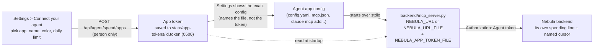

# Nebula Nodes MCP setup

To connect a Krea account for Nebula's agents and Canvas/Create generation,
use **Settings → Connections → Krea**. [Krea MCP setup](KREA-MCP.md) explains
sign-in, saved connection choices and workspace billing.

Nebula includes a local stdio MCP server that lets an agent work on the
person's open canvas: read it, build on it, run nodes and look at what they
made. It suits clients without a shell (Claude Desktop, Cursor) as well as
coding agents. The normal FastAPI backend must already be running because the
MCP process reads the same authoritative graph state as the canvas and CLI.

Configure an MCP host to launch:

```text
<repo>/backend/.venv/bin/python <repo>/backend/mcp_server.py --url http://127.0.0.1:8000
```

[Connect your agent](#connect-your-agent) does this for you: Settings (or
`nebula mcp connect <app>`) gives the agent its own token, cursor name and
color, and daily limit, and shows the exact config for Hermes, OpenClaw,
Claude Desktop, Claude Code, Cursor or Codex.

An agent's first call is `start_here` (the server's instructions say so).
One answer gives what a first turn needs, each part with its own budget so
the whole stays under about 7,000 tokens (28,000 characters), below Claude
Code's 10,000-token warning and its 50,000-character file cut:

| Part | What's in it | Past its budget |
|---|---|---|
| `canvas` | The open project, `view.stale`, the selection, other agents' cursors, and each node's id, name, `definitionId`, state, `onScreen`, `inputsFrom` and up to 8 params (each cut to 60 characters, redacted as `look_at_canvas` redacts them) | The first nodes in full (selected, then on screen), the rest as `others: {id: name}`, `truncated: true`, and "look_at_canvas gives every node" |
| `pins` | Open pins: id, text, anchor | The 10 newest, and `openCount` |
| `proposals` | Open proposals, briefly | 5, and `count` |
| `boards` | Every moodboard: id, name, `where` (`current`, `global` or the project's name), image count, analyzed or not, Direction cut to 80 characters. Boards in Recently deleted, or in a project there, are left out. `read` is how to read one (`moodboard_get(board="<id or exact name>")`; over the CLI `nebula moodboard show <id>`). `use` is how to put one on the canvas: the exact `edit_canvas` call for a Moodboard node (`nebula-moodboard`, the board in its `moodboard` param, sending from its `moodboard` port) wired to a Preview's `input` (or, over the CLI, the `nebula apply` flags) | 30 rows (this project, then Global, then the rest by last edit), `count`, and, when rows were cut, `more`: `moodboard_list(project_id=...)` lists a project's boards and Global's |
| `nodes` | The node types that run here, by category: `{id: price}` (`"free"`, `[low, high]` USD or `null`), `runsWith` for those that don't run on a key, and notes on modes, providers and Krea | Categories in a fixed order, cut at the budget, `rest: {category: count}`, and "find_nodes(category=…) gives the rest" |
| `spend` | The per-run limit, the budget kind, its limit and what is used, Krea plan runs. Outside agents share one 24-hour budget, so `usedUsd` is what all of them used; an app with a token also gets its own line (`limitUsd`, `usedUsd`) beside the shared one (`sharedLimitUsd`, `sharedUsedUsd`) | |
| `next` | `events.cursor` and the journal id for `wait_for_canvas_change`, then one line each: `describe`, `build`, `propose`, `point` and `pins`. Each is the exact call, its arguments named as the tool takes them (`describe_node(definition_id=...)`, `point_at(node_id=..., say=...)`); `build` is a whole `edit_canvas` plan (nodes `{ref, definitionId, params}`, edges `{source, sourceHandle, target, targetHandle}`, `arrange`), and `propose` says `propose_change` takes the same nodes and edges plus `params` and `run`. Over the CLI they are `nebula` commands with their real flags, so a first build needs neither `nebula apply --help` nor `nebula info nebula-moodboard` | |

No private note, image note, board note or pin reply history goes in. The
route is `GET /api/agent/start` (`?via=cli` words the hints for the CLI);
`nebula context` prints the same, and `nebula context --json` prints it as
it comes. Later turns use `look_at_canvas`, which stays the full snapshot.

A call with wrong arguments is refused before it runs, in one line naming
the tool's real ones, for every tool: `moodboard_get(id=...)` gets
"moodboard_get takes board (required), not id. Call
moodboard_get(board=...).", a name it doesn't take is refused even beside
the right ones ("run_nodes takes node_id, wait_seconds, ..., not node_ids
(did you mean node_id?)."), and a wrong type names the type ("point_at: x
must be a number, not "left". It takes ..."). Before, FastMCP sent
pydantic's report and ignored names a tool doesn't take. A node or wire in
another shape gets the same kind of line from `edit_canvas`,
`propose_change` and `nebula apply`/`propose --file`: a node with `type`
(or `kind`, `definition`, ...) is told the type goes in `definitionId`, and
a wire with `from`/`to` (or `sourcePort`/`targetPort`) is told it is
`{source, sourceHandle, target, targetHandle}`, with its own ends rewritten
when they read as node and port (`"+mb.moodboard"`). A wire with no port
(`{source, target}`, or `--wire +mb +pv:input`) is told the ports that end
has ("edges[0].sourceHandle must be a port id. Valid outputPorts on +mb
(nebula-moodboard): ['moodboard', ...]"), as a wrong port name is. These
lines copy back at most a few short params of the agent's node, never a
whole data URL. `point_at` with only `x` or only `y` is refused ("point_at
needs node_id, or x and y (both): you gave only x"). A node field `edit_canvas` and `propose_change` don't take is refused too, in one line: `x`/`y` are
told the place goes in `position` (or is left to Nebula), `name`/`label`/
`title` that a new node is named with `rename`, and anything else gets
the node shape `{ref, definitionId, params, position}`. Before, they
were dropped without a word.

The server's instructions stay under 3,000 characters, inside the 4,096
Claude Code shows, with the commons guide's two safety lines first in its
part. How to use moodboards, projects and Recently deleted is in those
tools' own descriptions.

The server exposes these tools for building and running (see
[Building and running over MCP](#building-and-running-over-mcp)):

- `start_here`: the first-turn answer above.
- `find_nodes`: node types to build with, best matches first, each with
  `runsWith` (key, free, krea, nous) and a list `price` at default settings.
  `ready_only=false` also lists nodes that can't run here, with what's
  `missing`. "free" is at the node's defaults: a row with `needsKeyFor` (the
  Video QC nodes) calls a provider in another mode.
- `describe_node`: one node type's ports, params (options, defaults, ranges)
  and list prices by the params that set them. `definition_id` is the id, or
  the node type's exact display name (any case, outer spaces ignored) when
  one node type has it: `describe_node(definition_id="Moodboard")` answers
  for `nebula-moodboard`, starting with `lookup` ("Moodboard is the Moodboard
  node: nebula-moodboard"). An id always wins; a name two node types share
  is refused with both ids; anything else gets "No node type '...'" with
  close matches, exact-name matches first. `nebula info` (and `nebula
  describe`) does the same, printing the `lookup` line first. Writes stay
  strict: `edit_canvas`, `propose_change`, `nebula apply`/`propose`/
  `create`/`quick` and a Style's `model_id` (`style_create`/`style_update`,
  `nebula style new/set --model`) take ids only, because they store and bill by id and a
  display name can be renamed or come to be shared; given a name they refuse
  with "unknown node definition 'moodboard': did you mean nebula-moodboard
  (Moodboard)?". (Before, `nebula create` stored a node of any type it was
  given and `nebula quick` tried to run it.) A local node that still calls
  a provider also has `runsWithOptions`: readiness per value of the param that
  picks the provider (Cinema Scene's `scene.base.model`, a QC node's `mode`),
  and a note when another value would run with the keys set here. A QC
  node's `pricedWhen` lists the price rows of its paid modes (Jev). A
  multi-provider node (FLUX.2, FLUX 3, Krea 3) has `providerChoice` and
  `routes`: per provider, its `params` exactly as the card shows them there
  (values cut, ranges narrowed, `onlyWhen`; a setting the provider doesn't
  offer is absent and named in `hides`), `price`, `priceUnconfirmed`, `note`
  and `block`. A saved value of a setting the route doesn't offer stops the
  run when another route would use it. The fix comes as `fixes` (plain param
  edits) on a `propose_change` cost entry; a run error or the estimate gives
  it as a sentence in its message. `_provider` changes go through
  `propose_change`. See
  [Provider routes](PROVIDER-ROUTES.md#hidden-settings-paramvisiblewhen).
  A node with a Moodboard input has `moodboardAdapter`: what a wired Nebula
  moodboard does there, from the adapter table (contract 07 section 1.16) at
  the node's defaults on the route a run takes here (`route`, when it has
  more than one). `line` is the card's Moodboard line ("Board images: on ·
  up to 10 to Image Style Refs"). The rest are the entry's own fields as
  section 1.16 defines them, without its sources: `channel`, `default`,
  `handler`, `slots` (port, `label`, `max`, `sharesLimitWith`),
  `needsWired`, `never`, `textSlot`, `text`, `negativeField`, `weight`
  (without its `schema`), `order`, `syntax`, `syntaxReason`, `costPerRef`,
  `reason` and `unconfirmed`, among others. A node with a Moodboard port and
  no entry gets `channel: null` and a `note`. `variants`
  lists the param values (`byModel`) or routes (`byRoute`) that change them,
  with the fields they change (and `route`, when the value moves the run to
  another route). `nebula info` prints the same as a `MOODBOARD:` line and
  one line of detail.
- `edit_canvas`: adds nodes, wires, param changes, renames, moves, removals
  (`remove`) and unwires (`unwire`) in one call, all or nothing: everything
  `nebula apply` does, with no limit on how much one call adds. `arrange:
  true` has the canvas lay out the new nodes by their real size. `steps`
  sends a list of such plans one after another, with the checks and
  stop-and-report of `nebula apply`'s steps. Its result has `undo`, the token
  that takes the edit back (see
  [Undoing your own edit](#undoing-your-own-edit)). A proposal
  (`propose_change`) takes the same nodes, wires and params, but not moves,
  removals, unwires, `arrange`, `steps` or renames of nodes already on the
  canvas; it can name its own new nodes (`rename`).
- `remove_from_canvas`: deletes nodes or single wires, all or nothing. Its
  result has `undo` too, which puts the nodes back with their params,
  outputs, names and wires.
- `undo_canvas_edit`: takes one of your own edits back with its `undo.token`
  (or a steps plan's `undo.tokens`, newest first). A part someone changed
  since stays as it is and is listed in `skipped`; so does a node someone
  else ran since (reason `ran since`). Your own runs don't count.
- `run_nodes`: runs a node and what feeds it (or the whole canvas) under the
  person's spending limits. Returns outputs with small inline previews, or
  `running` and a run id. A run in which any node failed comes back
  `failed`, with each node's message in `errors` and what did finish in
  `results`; see [Building and running over MCP](#building-and-running-over-mcp).
- `get_run` / `cancel_run`: collect or stop a run that is still going.
  `cancel_run` stops only runs an agent started (its own, another agent's,
  or an unnamed script's); a run the person started is theirs, and the
  refusal tells the agent to ask them to press Stop. See
  [Who may stop a run](#who-may-stop-a-run).
- `model_catalog` / `model_schema`: the models the universal nodes run.
  `model_catalog(provider, query, limit)` lists OpenRouter's, Nous Portal's
  or Quiver's models (`/api/openrouter/models`, `/api/nous/models`,
  `/api/quiver/models`, the routes the Inspector's pickers read), filtered by
  every word of `query`, and names the node and the param (`model`) the id
  goes in; OpenRouter and Nous rows carry `ports` ({inputs, outputs}, port
  ids). `model_schema(provider, model_id)` reads one model: its `ports`
  ({inputs, outputs}, each {id, label, dataType, required, multiple?}), the
  ports the node gets with that model, and the catalog row (`model`), or for
  Replicate (`/api/replicate/schema/{owner}/{name}`) the latest
  `versionId`, `params` (the other inputs, set as params of the same name)
  and the raw input and output schemas. They use the person's key and cost
  nothing; without the key the refusal names it. See
  [Universal nodes over MCP](#universal-nodes-over-mcp).
- `krea_discovery_tools` / `krea_discover`: the read-only Krea discovery
  calls (`list_models`, `get_model_schema`, `get_prompting_guide`,
  `list_styles`, `list_moodboards`, `get_node_apps`, `get_node_app_versions`,
  `list_node_types`) on the Krea account connected in Nebula, through
  `GET /api/krea/tools` and `POST /api/krea/tools/call`. They are the calls
  in-app turns also get from the `nebula_krea` server, with the same
  allow-list (`KREA_READONLY_TOOLS`), so an outside agent, which gets only
  this server, has them too. None generates, uploads or spends; anything
  else is refused before Krea is called.
- `view_output`: a node's output as an image (videos as three frames, image
  lists as tiles), or as text. For a node whose last run failed it returns
  the error instead of "no output yet"; if an older output is still on the
  card it returns that with a note that the last run failed.
- `get_spend_limits`: the limits and what this session has used.
- `list_projects` / `open_project` / `new_project`: list the person's saved
  projects, switch the canvas to one, or start a new, empty one. The project
  that was open is saved as it is. The person's canvas follows (from the
  Projects screen too, which opens the canvas), shows a note naming the
  agent, and offers a button back to the project they had open. The Projects
  screen also lists again whenever anyone makes, renames, deletes or restores
  a project (the `projectsChanged` socket event).
  Start new work in a new project rather than emptying the canvas: it keeps
  the person's work. Clearing a project that has nodes needs an explicit
  force from anyone (`nebula clear --force`, or `DELETE /api/graph?force=true`);
  on an open canvas the person can undo it.
- `list_project_covers` / `set_project_cover`: the images a project's card
  can show (`images`, `pinned`, `pinnedBy`, `cover`) and setting its cover to
  one of them (or `""` for the automatic one). An agent sets it while the
  person hasn't pinned one; a cover the person pinned changes only through
  `propose_asset_change`. A pin whose image is gone (its node deleted) no
  longer counts (`pinned` and `pinnedBy` null, `lostPin` names it). See
  [Proposals outside the canvas](#proposals-outside-the-canvas).
- `moodboard_list`, `moodboard_get`, `moodboard_create`, `moodboard_add`,
  `moodboard_update`, `moodboard_edit`, `moodboard_analyze`, `moodboard_move`, `moodboard_delete`: the boards in
  Moodboard Studio, with their brief (Direction, Avoid, pinned colours, a
  hand-written brief, and the brief generators get). `moodboard_edit` moves,
  resizes and groups a board's cards (the Studio's Board view) in one checked
  edit, and its `undo` takes it back. `moodboard_analyze`
  with `dry_run` previews an analysis, optionally with other colour
  thresholds, and saves nothing; with `read_with="gemini-4-argon"` and
  `dry_run` it reads the references with that vision model (paid, moves
  nothing; `estimate_only` prices it first). `moodboard_move` and `character_move`
  move a board or a Character to Global or a canvas project (`to`:
  "global", "current", or a project's id or exact name). See
  [Moodboards from the CLI and MCP](#moodboards-from-the-cli-and-mcp).
- `list_trash` / `restore_from_trash`: what's in Recently deleted (moodboards,
  characters, Styles, projects), and bring one back with the same id. See
  [Recently deleted](#recently-deleted).
- The Commons (the smart moodboard's analyzed references; only with
  `NEBULA_COMMONS_ENABLED=1`), all in the agent's brand scope (pass
  `brand`): `commons_search` and `commons_get` read references;
  `commons_add` adds one to a collection's inbox; `commons_comment` comments
  (`membership_id` picks the collection's thread); `commons_borrow` records
  an attribute taken from one. Since 2026-10-20 (Justin's Q63 b):
  `commons_collections` lists the collections (`{"collections": [...]}`;
  `commons_add` takes one's id), `commons_status` the analysis queue,
  worker and meters, `commons_borrowings` the recorded borrowings
  (`{"borrowings": [...]}`; `asset` narrows it),
  `commons_concentration` each reference's share of them, and
  `commons_fidelity` checks a borrowing against the output it was used in
  and saves the result. Curating (corrections, regions, a reference's role,
  why or inbox place) is the person's: agents propose it, see
  [Commons curation](#commons-curation). Each has a `nebula commons` twin.
- `style_list`, `style_get`, `style_create`, `style_update`, `style_delete`:
  the Styles in Create and the Assets panel (a prompt fragment, optionally a
  model and its settings). `style_update` returns `previous`, which undoes it
  as one checked write; `style_delete` moves one to Recently deleted. See
  [Styles from the CLI and MCP](#styles-from-the-cli-and-mcp).

And these canvas tools:

- `get_selected_nodes`: selected node IDs, display names, bounded/redacted
  parameters, output-port availability, and connections touching the
  selection.
- `look_at_canvas`: the canvas as data, so an agent doesn't need a
  screenshot. It returns the browser's viewport and visible area, every node
  with its run state, position, size and whether it is on screen, redacted
  parameters, output availability, wires, the selection, and agent cursors.
  A node whose last run failed has `state: "error"` with the message in
  `error` (and the plain-language `errorHint`, when there is one).
  `view.stale` is true when no browser has reported for 30 seconds.
- `point_at`: moves the agent's cursor on the canvas to a node, a port or a
  flow-space point, with an optional short line beside it (`say`, the
  agent's own action only) and an optional drag gesture
  (`from_node_id`/`from_port`). With only `say`, the line shows where the
  cursor already is and it doesn't move; an agent with no cursor yet gets
  one at the middle of the person's view, or at (0, 0) when no canvas has
  reported a view (the result's `placed` is `cursor`, `view` or `origin`;
  `nebula point --say "..."` does the same). The cursor is named after
  `$NEBULA_AGENT_NAME`, or the MCP client's own name. What the agent
  noticed goes in `post_note` instead (see [Updates](#updates)).
- `post_note` / `list_notes`: post what the agent noticed, a report or a
  suggestion, and read the list back. The person reads them under
  **Updates** in the top right of the canvas, saved with the project (or
  with a board, with `board`). See [Updates](#updates).
- `wait_for_canvas_change`: blocks until the person (or another agent)
  changes the canvas, then returns what changed and who did it. It skips
  your own edits. When the person undoes your edit with Cmd+Z, the events
  say so: each has `edit.undoes` (your `undo.editId`) and `edit.of` (you),
  and an `edit.undone` event follows. If you also use the `nebula` CLI, set `NEBULA_AGENT_NAME`
  so both share one name; otherwise your CLI edits arrive as `anonymous`
  (the result then carries a `note`). Pass the returned `cursor` back as `since`; see
  [Watching for changes](#watching-for-changes). The wait holds only its own
  call: other calls on the same server, such as the main agent's while a
  Claude Code subagent waits (subagents share the parent's connection) or
  parallel tool calls, answer meanwhile. Every tool runs off the server's
  event loop; up to 32 long calls (waits, runs, link downloads) run at once,
  and the short calls have 16 threads of their own. A wait the client
  cancels stops at its next poll (within 25 s).
- `resolve_pin`: answers one of the person's pinned notes (from
  `look_at_canvas` `pins`) with a one-line reply, which marks it resolved and
  moves the agent's cursor to it. See [Pins](#pins).
- `propose_change`: proposes new nodes, wires, param changes and runs as
  ghosts on the canvas. Nothing changes until the person clicks Accept. Use
  it before paid runs or reworking their graph. When a node the run needs
  can't run here (no key, no Krea sign-in, a route that can't take it), the
  reply has a `warning` naming each one, so the agent can say so or propose
  another model. See [Proposals](#proposals).
- `get_proposal`: reads one of your proposals; `wait_seconds` (up to 300)
  waits for the person's decision. On accept it returns `idMap` (your refs to
  real node ids) and `runNodeIds` (what the canvas will run; don't run them
  yourself).
- `withdraw_proposal`: takes back one of your open proposals.
- `propose_asset_change`: proposes a change outside the canvas that is the
  person's call: a project cover they pinned, a board's Send notes to
  generators, or curating a Commons reference. They decide on the Projects
  screen, in Moodboard Studio or in the Commons; `get_proposal` and
  `withdraw_proposal` take its id. See
  [Proposals outside the canvas](#proposals-outside-the-canvas).

There is no accept tool. Only the person accepts, in Nebula.

Selection is ephemeral. It is not written into `.nebula` graph files or
`~/.nebula/state.json`. Unknown or deleted node IDs are reported only as stale
IDs and are never presented as live handles.

The same context is available without MCP through:

```bash
nebula selection
```

## Agent cursors, `nebula look` and `nebula watch`

Agents that change the canvas over HTTP get a live cursor in the browser, so
the person can watch where they work. The backend names the cursor from the
request:

| Request carries | Cursor name | Notes |
|---|---|---|
| `Authorization: Agent <token>` (in-app chats, from their Nebula MCP server or CLI) | Claude, Codex | Verified by the token registry |
| `X-Nebula-Agent: <name>` | that name | Self-reported; set `NEBULA_AGENT_NAME` for the CLI |
| none of these (the browser itself) | no cursor | Your own clicks never spawn one |

Creating, wiring, setting, running, removing and unwiring nodes move the
cursor automatically (a wire shows as a drag from port to port). To point
explicitly, with a short line about your own action:

```bash
NEBULA_AGENT_NAME="Claude Code" nebula point n2 --say "Checking this prompt"
nebula point n2.prompt --from n1.text --say "Wiring the prompt in"
nebula look          # the canvas as text; --json for the full snapshot
```

Every one of these actions is also listed in the canvas's **Agent log**
(bottom right, shown by default with or without the chat; hide it from its
own eye-off button or Settings > Preferences > "Agent log"): the agent's
name in its cursor colour, the cursor's words ("Added Moodboard", "Running
Krea 2", "Accepted"), and the time. Moodboard writes are listed there too
(your edit batch's `say`, else the journal's words: "Set aside #1 on board
Dusk"; "Analyzed board Dusk"), and so is a run of the
whole canvas ("Running 4 nodes"); neither has one place on the canvas, so
they move no cursor. The log is in the browser's memory only: the last 50
entries, gone on reload.

The REST surface is `POST /api/canvas/cursor` (a `target`, or only `say` to
narrate where the cursor is; it answers with `placed`), `GET /api/canvas/snapshot`, and
`POST /api/canvas/view` (the browser's own report of viewport, node bounds and
run states; never persisted), plus `GET /api/canvas/events` (the change
journal, below), `/api/canvas/pins` (the person's notes, below) and
`/api/canvas/proposals` (agents' proposals, below). Cursors, view reports,
the change journal and proposals live in memory only and are lost on
restart; cursors expire two minutes after their last event. Pins are the
person's content and persist with the project.

### Watching for changes

`nebula watch` tells an agent when the person changes something, instead of
the agent re-running `nebula look` in a loop. Each line names who did it:
an agent's name, `Person` (the browser), or `Unnamed client` (a CLI or
script that didn't set `NEBULA_AGENT_NAME`).

```bash
nebula watch                      # stream changes until Ctrl-C (skips your own)
nebula watch --once               # wait for the next batch, print it, exit
nebula watch --once --since 42    # resume after cursor 42 (printed at the end, and by `nebula look`)
nebula watch --kinds node,pin --json --timeout 120
```

`--once` waits up to 600 seconds by default and exits 2 when nothing
changed (`No canvas changes in 600s.`), 0 when it printed events, and 130 on
Ctrl-C. Agents whose shell tool has a time limit (Claude Code's Bash tool
stops commands after 120 s by default) should pass a shorter `--timeout`,
such as 100, and run the command again on exit 2; the in-app agents are told
to do this. A typical loop is `nebula look`, then `nebula watch --once --since
<cursor>` with the cursor from the line before. `--include-self` also shows
your own edits; `--as NAME` sets your name for that filtering.

| Kind | When | Data |
|---|---|---|
| `node.added` / `node.removed` | create, cluster, connect-and-create / delete | definition, name |
| `node.params` | a param changed (only keys whose value changed) | `keys`, redacted `values` |
| `node.moved` | a drag ended, auto-layout or paste moved nodes 8 px or more | `nodeIds`, `count` |
| `node.renamed` | a node got a new name on the canvas (or went back to its model name) | `from`, `to` |
| `edge.added` / `edge.removed` | wired / unwired | source, target and handles |
| `selection.changed` | the selected set changed | `nodeIds`, `count` |
| `run.started` / `run.finished` / `run.failed` | per node, attributed to whoever started the run | `runId`, `error` |
| `run.cancelled` | a run stopped, attributed to whoever pressed Stop or called `cancel_run` (the starter when another backend took the Stop) | `runId`, `startedBy` (`kind`, `name`) |
| `run.skipped` | a gate upstream (Jev Decide's On Pass / On Fail) withheld the node's input, so it never ran | `runId`, `reason`, `gateNodeId` |
| `canvas.replaced` | import, project opened or created; node ids restart | `reason` |
| `canvas.cleared` | Clear canvas | |
| `project.cover` | a project's cover was pinned, changed or set back to automatic, by the person, an agent, or an accepted proposal (its summary ends "(accepted from <agent>)") | `projectId`, `projectName`, `cover` (the url, or null for automatic) |
| `commons.corrected` / `commons.region` / `commons.membership` | the person curated a Commons reference: a correction, a region drawn or changed, a membership's role, why or inbox place; or accepted an agent's [Commons proposal](#commons-curation) (the summary ends "(accepted from <agent>)") | `assetId`; `fieldPath`, `op` for a correction; `regionId`, `change` (`["added"]` or the fields changed) for a region; `membershipId`, `collectionId`, `change` (`["accepted"]` or the fields) for a membership. Never Commons text (no values, labels or whys) |
| `pin.added` / `pin.removed` | the person left or deleted a note | `pinId`, `text`, `anchor` |
| `pin.resolved` | an agent answered a note | `pinId`, `text`, `reply` |
| `pin.detached` | a pinned node was deleted, or an import/clear removed it | `pinId`, `anchor` (where the node was) |
| `proposal.created` | an agent proposed a change | `proposalId`, `note`, `adds`, `wires`, `sets`, `runs`, `paidRuns`; for a [proposal outside the canvas](#proposals-outside-the-canvas) `kind`, `targetId`, `targetName`, `change` instead of the graph counts (the decisions after it carry `kind` and `targetId` too) |
| `proposal.accepted` | the person accepted; the added nodes and wires follow as `node.added` / `edge.added` by the person (for a project cover, `project.cover` by the person) | `proposalId`, `idMap`, `runNodeIds`; outside the canvas `kind`, `targetId`, `targetName`, `applied` (what was set) |
| `proposal.rejected` | the person rejected | `proposalId`, `reason` |
| `proposal.withdrawn` / `proposal.expired` / `proposal.invalidated` | the agent took it back, 15 minutes passed, or the canvas changed under it | `proposalId`, `reason` |
| `board.added` / `board.removed` / `board.frame` / `board.grouped` / `board.setAside` / `board.resized` / `board.noted` / `board.moved` / `board.cover` | a moodboard edit or save changed the board's images, cards or frames: one event per write, its kind the first of these that applies (`noted` an image's notes, `grouped` is a card into or out of a frame, `moved` 8 px or more, `cover` the image the board opens on) | `kinds` (every kind in the write), `refs` (`{number, id}` per image), `boardId`, `boardName`, `scope`; never any note text ("private note changed") |
| `board.fields` | a moodboard edit, save or undo changed the board's own fields, by the person (Moodboard Studio, an accepted proposal) or an agent (`moodboard_update`, `moodboard_edit`'s `restore`, `nebula moodboard set`, `--restore`): one event per write, after the `board.*` event above when the same write changed images too; a write that changes no field writes none | `fields` (the names that changed, in this order: `name`, `notes`, `mode`, `strength`, `direction`, `avoid`, `pinnedColors`, `clashMode`, `colorChoices`, `sendNotes`, `briefOverride`), `boardId`, `boardName`, `scope`; never a value: no Direction, Avoid, notes or brief text, no colour, no strength, not which way Send notes went. The cover is `board.cover` |
| `edit.undone` / `edit.redone` | a whole edit was undone (an agent's `undo_canvas_edit`, or the person's Cmd+Z of a step the canvas knew the edit of) or redone; after the node and wire events it made | `editId` (the edit reverted), `of` (whose), `editKind`, `events` (that edit's event cursors), `undid` (for an undo of an undo), `counts`, `skipped` |
| `note.posted` | an agent posted an update to the person (Updates, `post_note`) | `surface` (canvas or board), `noteId`, `about`, `refs` (up to 12), `text`; `boardId`, `boardName` on a board |
| `style.created` / `style.updated` / `style.deleted` / `style.restored` / `style.purged` | a Style was saved, changed, moved to Recently deleted, restored from it, or deleted for good, by the person (Create, the Assets panel) or an agent (`style_*`, `nebula style`) | `styleId`, `styleName`, `scope` (`global` or the project id); `fields` (what an update changed: `name`, `category`, `prompt`, `params`, `modelId`, `refImages`, `thumbnail`); never a prompt or a setting's value |

Events of a canvas edit carry `edit`: an agent's `edit_canvas`,
`remove_from_canvas` or `nebula apply` gives each of its events `edit: {id}`
(the reply's `undo.editId`). An undo's events carry `edit: {id, undoes, of}`:
the edit id it reverted and whose edit that was (`redoes` for a redo). The
person's Cmd+Z is linked only when the canvas's step came from that edit's
graphSync (its `edit.id`); a step without one (the person's own edits, an
older edit) is journaled as before, with "(undo)" and no `edit`.

Expiry is attributed to "Nebula" (a `system` actor), not to anyone.

`GET /api/canvas/events` is a long-poll. Query: `after` (an event cursor;
default "from now"), `journal` (the id from a previous response), `wait`
(seconds, capped at 25), `limit` (1–100), `kinds` (groups like `node` or
exact kinds like `node.params`) and `self=1` to include your own events. It
answers at once when newer events exist, otherwise waits. Resume with
`after=<cursor>`: the cursor also moves past events filtered out for you, so
your own edits never wake you. `gap: true` means the 500-event buffer
overwrote events you hadn't read, and `reset: true` means the backend
restarted; run `nebula look` in both cases. Every event carries the project
id it happened in. Param values go through the same redaction as the
snapshot, and outputs never appear.

### Who counts as the person

Some actions are the person's alone. The backend knows the person by one
secret per launch, the **person token** (`backend/services/person_session.py`,
checked in `backend/services/person_gate.py`):

- Browser dev: `backend/devserver.py` makes it and prints (or, with
  `--open`, opens) `http://localhost:5173/#nebula-person=<token>&backend=<origin>`.
  The canvas moves it into that tab's sessionStorage, strips it from the
  address bar, and from then on talks only to that backend (no port
  discovery). It never goes into an environment variable, argv or a file.
- Packaged app: Electron main makes it, writes it to the sidecar's stdin, and
  hands it over IPC only to the app's own main frame. With
  `NEBULA_DESKTOP_DEBUG_PORT` set there is no token at all, so person-only
  actions stay locked and the window says why.

  Checked in the packaged app (2026-10-13; Electron 44, validation bundle,
  isolated profile; `desktop/README.md` and `implementation-notes.md` have
  the method):
  - The renderer's page origin is `file://`. Its HTTP requests carry **no**
    `Origin` header and send no CORS preflight, and it reads responses
    without `Access-Control-Allow-Origin`, so CORS plays no part; the token is
    the only gate. Its `/ws` handshake sends `Origin: file://`, which
    `services/local_guard.py` allows.
  - With the token: `PUT /api/settings` 200 (403 without), `GET
    /api/agent/spend` answers `limited: false` (`limited: true` without), the
    `/ws` hello gets `proposalSync` (a wrong token gets `personRequired`), and
    the Krea connection status reads `disconnected` while check and disconnect
    answer 200 (403 `person_required` without). The smoke run
    (`npm run test:smoke`, isolated profiles) repeats all of these.
  - While the app runs, no process has `nebula-connector-session` in its argv,
    and neither the person token nor any provider key or the Krea vault key is
    in any of its processes' argv or environment (`ps -E`). Keys and the vault
    key go over the sidecar's stdin after the token
    (`services/launch_secrets.py`); before this check they were in its
    environment. Provider keys and `NEBULA_APP_TOKEN`/`NEBULA_AGENT_TOKEN`
    inherited from a launching terminal are dropped from it as well
    (`sidecar.mjs` `INHERITED_CREDENTIAL_ENV_KEYS`).

The canvas sends it as `X-Nebula-Person` on every write and on
`GET /api/agent/spend`, in a `{type: "hello"}` frame on `/ws`, and as
`personToken` on every `/ws/chat` send. A request is the person's only when it
carries no agent marker (`Authorization: Agent`,
`X-Nebula-Agent`, `X-Nebula-Client`) and does carry a valid token. `Origin`
proves nothing: any local program can write `Origin: http://localhost:5173`.
(The Host/Origin guard in `services/local_guard.py` still keeps websites out.)

Person-only, refused with 403 `person_required` otherwise:

- creating and deleting pins; accepting and rejecting proposals (plus the
  per-proposal accept key, sent only to a `/ws` that said hello as the person);
- `PUT /api/settings` (every field), `DELETE /api/settings/api-keys/{provider}`,
  `POST /api/credentials/update`, and `POST /api/agents/codex/login/chatgpt`
  (it runs `codex logout` first, clearing the person's Codex sign-in);
- starting or releasing a run approved on Accept (`approvalId` on
  `/api/execute` and `/api/execute-node`, `DELETE /api/canvas/approvals/{id}`;
  see Proposals below);
- Krea connect, check, disconnect and trial (`/api/krea/connection/connect`,
  `/api/krea/connection/check`, `DELETE /api/krea/connection`,
  `/api/krea/trial`). `GET /api/krea/connection`, `/api/krea/tools` and
  `/api/krea/tools/call` stay open;
- making, limiting, coloring and revoking connected-agent tokens
  (`/api/agent/spend/apps`; see Connect your agent below);
- starting any `/ws/chat` turn (Claude, Codex), so no chat
  workspace or agent token is minted without the person;
- deleting for good from Recently deleted (`DELETE /api/trash/{kind}/{id}`,
  `POST /api/trash/empty`, `DELETE /api/projects/trash/{id}`,
  `POST /api/projects/trash/empty`). It can't be undone. The refusal tells an
  agent it can restore instead (see Recently deleted below);
- `POST /api/enhance-prompt`, the Create button's rewrite. The gate comes
  first; then prompts over 4,000 characters get a 413 that says so, and more
  than 20 calls a minute get a 429. Each call logs provider, length and outcome
  (never the prompt) to `nebula.enhance_prompt`. An agent that wants a prompt
  rewritten writes it itself, or adds a text node (`claude-chat`,
  `gpt-4o-chat`, `gemini-chat`), whose run is held to the spending limits.

Everything else, including running nodes, is open to agents and held to the
spending limits. The person isn't limited.

#### Who may stop a run

Agents stop only runs an agent started (Justin, 2026-10-20). The backend
records who started each run as it registers it (`ExecutionRunRecord.started_by`
in `services/execution_runs.py`: the person, a named agent, or anonymous), and
`DELETE /api/executions/{runId}` (the canvas's Stop, `cancel_run`, `nebula
cancel`) checks it before it records anything:

| Started by | The person stops it | A named agent stops it | Anonymous stops it |
|---|---|---|---|
| the person | yes | 403 `agent_refused` | 403 `person_required` |
| a named agent | yes | yes (any agent) | yes |
| anonymous | yes | yes | yes |

Anonymous is a caller with no agent marker and no person token: the `nebula`
CLI without `NEBULA_AGENT_NAME`, curl, a tab not connected as the person.
Its runs count as an agent's, since nothing proves the person started them;
its Stop is not the person's. So from the CLI by hand, `nebula cancel` still
stops what the CLI (or any agent) started, and a run started from the canvas
answers "ask them to press Stop in Nebula". A refused Stop leaves no durable
Stop intent, so no other backend stops the run either. A run ID that no run
here has used still takes the pre-admission Stop intent from anyone, as
before; one whose `/api/execute` is still being admitted is judged by the
journal's note of its starter. A run that already ended answers its status
to anyone, since nothing is left to stop.

Every process the backend starts (agents, the Commons reader, ffmpeg, the
Remotion renderer, git, `open`, `ps`, `sips`, `brctl`) gets the backend's
environment minus `NEBULA_PERSON_TOKEN`, `NEBULA_CONNECTOR_ENCRYPTION_KEY`,
`NEBULA_INJECTED_KEYS`, `NEBULA_CONNECTOR_SESSION`, `NEBULA_APP_TOKEN` and
`NEBULA_APP_TOKEN_FILE` (`services/child_env.py`). The desktop app no longer sets
the vault key or the injected keys in the backend's environment at all; the
scrub catches a hand-started backend that does.

Remaining risk, plainly: a program running as you with its own unsandboxed
shell can still read the token (the backend's memory, Chrome's on-disk Session
Storage and History). The token binds the in-app agents (Claude; Codex, whose
shell has no network; see "In-app agents use this server") and any client that reaches Nebula only through its MCP server,
CLI or API. It does not bind an outside agent with its own shell and network.
It is not a sandbox against hostile local code.

### Numbers in request bodies

Every JSON request body (`application/json`, `application/*+json`, any
other type that starts with `application/json` such as
`application/json-seq`, which some routes accept, or no content type) is
checked once before any route reads it
(`backend/services/json_number_guard.py`, added inside the Host/Origin guard
and inside CORS). `NaN`, `Infinity`, `-Infinity`, and numbers too big for a
float (`1e400`, an integer like `10**400`, or one over 4,300 digits) get a
422 with one line, for example `{"detail": "JSON number out of range: 1e400.
Send a finite number between about -1.8e308 and 1.8e308."}`. Only number
tokens count: a string holding "NaN" or 400 digits is fine, and a body that
isn't JSON at all gets the route's own error. A body whose first character
rules out a JSON number (a zip sent with no content type) streams through
unread. Places that parse client JSON
themselves follow the same rule through `loads_checked`: the `/ws` and
`/ws/chat` frames (the chat socket answers an `error` event), proposal
accept and reject bodies, and `graph.json` in a restore bundle (400 "Invalid
graph.json: ...").

### Pins

The person can pin a short note to a node or to a spot on the canvas for
agents ("warmer", "redo this one"): right-click a node and choose **Leave a
note for agents…**, right-click empty canvas for **Leave a note for agents
here…**, or use **Note** in the selection toolbar with one node selected.
Pins show as small badges on the node; hover or click one to read it, see
an agent's reply, or delete it.

Agents read open pins first in `nebula look` (a `PINS` section before
`NODES`), in the snapshot JSON (`pins`, open ones plus answers from the last
ten minutes), and as `pin.*` watch events. Treat an open pin as the person's
request: act on it, then answer in one line:

```bash
nebula pins                                            # list the notes
nebula pin resolve pin_8c41d2aa --say "Warmed the grade on n7"
```

The reply shows on the pin, and the agent's cursor moves there. Over MCP use
`resolve_pin(pin_id, reply)`. Resolving again replaces the reply. The reply
is about your own answer; anything else you noticed goes in an update
(below).

Rules:

- Only the person creates and deletes pins; agents only answer them.
  `POST /api/canvas/pins` and `DELETE /api/canvas/pins/{id}` refuse any
  request that carries an agent marker (`Authorization: Agent`,
  `X-Nebula-Agent`, `X-Nebula-Client`), even an invalid
  one, and require the person token (see "Who counts as the person"). The
  CLI and MCP server never have it.
- `POST /api/canvas/pins/{id}/resolve` needs a named agent
  (`NEBULA_AGENT_NAME`, `--as`, or an in-app agent token).
- Text is plain text: whitespace collapsed, control characters dropped, 1–280
  characters for notes and replies. At most 100 open notes per project and
  200 in total (the oldest answered ones are dropped first).
- Pins persist with the project (on the project record, beside the canvas
  snapshot, so autosave never touches them) and switch with it. Deleting a
  pinned node leaves its pins where the node stood, marked detached; so does
  an import or Clear canvas that removes the node.

### Updates

`say` is for your own action. What you noticed, a report or a suggestion
goes in an **update**: the person reads it in the Updates corner in the top
right of the canvas, not at your cursor. A card drops from the "Updates"
chip for about four seconds and outlines the nodes it names in your colour;
the chip counts the updates the person hasn't opened; the list keeps every
one, newest first, with your name, the time and a "Show on canvas" button
that frames what it names. Updates are saved with the project (beside the
canvas snapshot, like pins, so autosave never touches them) and switch with
it; a moodboard's are saved beside the board (`<moodboards>/.notes/<id>.json`,
never in the board file).

```bash
nebula note "The two portrait branches use different seeds; I'll match them" --node n4 --node n7
nebula note "#12 reads painterly and dither" --board Dusk --ref 12
nebula note "You moved the lake into Painterly" --board Dusk --since-last-turn
nebula notes --unread                                   # the list, newest first
```

Over MCP: `post_note(text, board?, refs?, about?)` and
`list_notes(board?, unread?)`. The words "note" stay in the tool names; on
screen they are Updates. A proposal outside the canvas (`propose_asset_change`)
posts its own Update with **Review**, and marks it with how it ended; see
[Proposals outside the canvas](#proposals-outside-the-canvas).

Rules:

- Text is one plain line, 1–240 characters. `refs` (at most 12) are node ids
  on the canvas, or image ids or numbers on a board; unknown ones are left
  out and listed in `dropped`, never outlined from a guess. On a board, `#12`
  in the text is saved as that image, so it always shows its current number
  ("(removed)" once it's gone); a `#n` not on the board refuses the update
  ("#45 isn't on this board").
- `about`: `sinceLastTurn` (what the person changed since your last turn; a
  newer one replaces your unread one) or `other` (the default). Other values
  are Nebula's own.
- No buttons: an agent's update carries no actions. Do the change, or propose
  it. Nebula's own updates (the board reader's results, from later versions)
  carry them.
- An update that quotes a private note (the person's own label on a board
  image) is refused (`note_quotes_private_note`): a whole note of 12 or more
  characters, or any 32-character run of a longer one, compared without case,
  punctuation or extra spaces. On the canvas every board the project can see
  is checked (its own and the Global ones).
- At most 6 a minute per agent per canvas or board (429
  `notes_rate_limited`); 200 kept per project and 100 per board, the oldest
  read ones dropped first.
- Agents post and list. Only the person marks updates read (opening the list
  marks them all; `{upTo}` reads that one and everything older, `{ids}` just
  those) or dismisses one: `POST .../agent-notes/read` and
  `.../{id}/dismiss` require the person token. A dismissed update stays in
  the list, greyed.
- Each update is one `note.posted` event in the change journal
  (`nebula watch --kinds note`); reading and dismissing aren't.
- REST: `GET`/`POST /api/canvas/agent-notes` and
  `/api/moodboards/{id}/agent-notes` (`?unread=1`), body `{text, refs?,
  about?}`, answer `{note, dropped, removed, unread}` (`removed`: updates
  that left the list to make room, such as your replaced "since its last
  turn" one). The `agentNotes` socket message (`op`: `sync`, `added`, `read`,
  `dismissed`, `acted`) keeps every tab's chip in step.
  A board `PUT` that sends `agentNotes` is refused (422).

### Proposals

An agent can propose a change instead of making it: new nodes, wires, param
changes on existing nodes, and which nodes to run. The person sees ghost
nodes and dashed wires in the agent's colour and a bar at the bottom of the
canvas with **Show**, **Reject** and **Accept** (or **Accept & run (N
paid)**). They can drag ghosts before accepting; the nodes land where they
dropped them. Accept adds everything in one step (one undo) and starts the
runs from the canvas, as if the person had clicked Run. Use proposals before
anything that costs money or reworks the person's graph.

```bash
nebula propose --note "Widen the take and upscale it" \
  --add +up=topaz-image-upscale --param +up.upscale_factor=2 \
  --wire n4:image +up:image --set n4.aspect_ratio=16:9 \
  --run +up --wait --timeout 100
nebula proposal p_9a1c3e02 --wait     # check one later, or wait for the decision
nebula proposal withdraw p_9a1c3e02   # take it back
nebula proposals                      # what's waiting for the person
```

New nodes use refs (`+up`, letters, digits, `_` and `-`, up to 24); existing
nodes use their ids (`n4`). `--at +up=820,140` places a node; otherwise
Nebula puts new nodes to the right of the nodes they connect to, or in the
middle of the person's view, clear of existing nodes. `--rename
+up="Wide, upscaled"` names a new node: the ghost shows the name with the
model beside its ref ("+up · Topaz Image Upscale · proposed by Codex"), and
Accept applies it. A proposal can't rename a node already on the canvas
(422, "Rename existing nodes with edit_canvas (or `nebula rename`)"), and
`nebula propose` doesn't take `apply`'s `--move`, `--remove`, `--unwire` or
`--arrange` (each gets an error naming it). `--file plan.json` takes the
same thing as JSON, which is also the `POST /api/canvas/proposals` body and
the `propose_change` arguments:

```json
{
  "note": "Widen the take and upscale it",
  "nodes": [{"ref": "+up", "definitionId": "topaz-image-upscale", "params": {"upscale_factor": 2}}],
  "edges": [{"source": "n4", "sourceHandle": "image", "target": "+up", "targetHandle": "image"}],
  "params": [{"nodeId": "n4", "params": {"aspect_ratio": "16:9"}}],
  "rename": {"+up": "Wide, upscaled"},
  "run": ["+up"]
}
```

A named node's entry in the proposal has `name` (the given name) and
`model` (the model's own name); an unnamed one has only `name`, the model's.

`--wait` exits 0 when accepted (printing the new ids and what the canvas will
run), 3 when rejected (with the person's reason, if any), 4 when withdrawn,
expired or invalidated, and 2 on timeout (600 s default, still open).

**Cost wording.** Proposals say how many paid model runs and free nodes
would run, and from which providers. Upstream nodes that have no outputs yet
are counted too, and then the count reads "up to", because the run cache may
skip some of them. `cost.estimate` adds up list prices in USD from
`backend/data/model_pricing.json`, where every price cites the vendor page it
came from: `{currency, low, high, open, unpriced, plan, plus}`. `low` and
`high` differ when a setting such as `auto` quality only resolves at run time
or a batch repeats a node. `open` is true when some paid node has no list
price (`unpriced`) or has a cost the vendor doesn't price up front (`plus`,
e.g. input images), so the real total can be higher. Krea runs billed to a
Krea account's plan are listed in `plan`. `estimate` is `null` when no node
in the run has a list price. Each entry in `cost.nodes` carries its own
`price` ({low, high} or null). These are list prices, not a quote.

**Nodes that can't run here.** `cost.notReady` lists every node the run
reads, upstream nodes with outputs included, that can't run here as set up,
as `[{ref, nodeId, name, missing}]`. `missing` is in the words `find_nodes`
and `describe_node` use (`node_readiness.instance_missing`, read at the
values Accept would write: "needs OPENAI_API_KEY in Settings > Providers",
a Krea sign-in, or why the chosen route can't take it), and the cost entry
of such a node has the same `missing`. `propose_change` and `nebula propose`
turn the list into a `warning` (`canvas_proposals.readiness_warning`), each
pointing at its own way to find a node that runs here: `find_nodes` for MCP,
`nebula context` for the CLI, and `GET /api/agent/nodes` in the HTTP reply. On
the canvas the ghost shows the ⚠ a real node shows, with the same title, and
the bar lists the nodes under its summary (three, then the rest in its
details). Both re-check keys as the person adds them, so a line goes away
once its key is set. Accept stays enabled, as the canvas's Run button does
for a node without its key: the run is refused at that node before any
provider is called, and the node shows why.

Rules:

- Proposals are checked like direct edits: unknown node types, ports, params
  or wires, cycles and missing node ids are refused when proposed (400 or
  422), so the person never sees
  something that can't be added. Cinema scene params and World Labs
  durable-recovery nodes can't be proposed.
- Limits: 12 new nodes, 24 wires, 12 param changes and 6 run targets per
  proposal (the person reviews each item; direct edits have no such limit);
  3 open per agent and 12 in total (429 beyond); a 160-character
  note. Proposals expire after 15 minutes.
- Deleting a node a proposal refers to invalidates it; so do import, opening
  another project and Clear canvas. If the canvas changed so that a
  proposal no longer fits, Accept fails with 409 and the proposal closes as
  invalidated.
- Proposals live in memory only and are lost on restart.
- Accepting never executes anything on the backend. The canvas starts the
  runs through the same path as its own Run button.
- Accept approves values, not just node ids (`backend/services/run_approvals.py`).
  Accept refuses (409, invalidated) if anything the listed runs would start
  changed since the proposal was made: a node's settings, its wires in, or a
  node gone. After Accept, every node those runs can start is locked against
  edits by anyone but the person until the canvas starts the run: set params,
  `apply`, wire, unwire and delete on them return 409 ("in a run the person
  approved ... hasn't started yet"). The canvas sends the approval id from the
  accept response with its run (also when the run waits for another to
  finish), and the backend starts it only if the live graph and the request
  still match what was accepted ("changed since you accepted" otherwise; the
  person can then run it by hand). An approval is used up by that run, and
  also ends when the person dismisses the waiting run, on import, project
  switch or Clear canvas, and after 30 minutes.

Who can accept: only the person, enforced in three layers.

1. `POST /api/canvas/proposals/{id}/accept` and `/reject` apply the same
   person gate as pins (no agent marker, and the person token).
2. They also need the proposal's accept key in `X-Nebula-Proposal-Key`. The
   key is random per proposal, sent only over `/ws` sockets that said hello
   with the person token (`proposalOpened` / `proposalSync`), and never appears in the REST views,
   the snapshot, the journal or MCP results.
3. There is no accept command in the CLI or MCP server.

In-app agents (Claude, Codex) are never handed the person token: it
is in no environment, argv or file the backend gives them. Codex can read the
browser's storage on disk but its shell has no network to use it with (see
"In-app agents use this server").

Before the click, the bar's "See what Accept writes" list shows every value
Accept will write: new nodes' params and `from → to` for changed params, in
full (up to 4,000 characters per value, with a marker beyond that). These
values reach only the browser (`personValues` in `proposalOpened` /
`proposalSync`); agents see the shortened, redacted view. If a param the
proposal changes was edited after the proposal was made, Accept fails with
409 and the proposal closes as invalidated, so it never overwrites a newer
edit. A proposal arriving while the person reads another never replaces the
one on screen.

Remaining risk: a program running as the same user with its own unsandboxed
shell can read the person token (see "Who counts as the person"), say hello
on `/ws`, receive the keys and accept. These layers stop an agent from
approving its own proposal through Nebula's tools and API; they are not a
sandbox against hostile local code.

### Proposals outside the canvas

Some of the person's calls live on a project or a board, not on the graph
(audit U16; Justin's Q60 a, 2026-10-20). An agent proposes those with
`propose_asset_change(kind, id, change, note)` (`POST /api/asset-proposals`
with the same four fields), and the person decides where they work on that
thing:

| `kind` | `change` | Decided | Applied through |
|---|---|---|---|
| `project` (a project id) | `{"cover": url}` (one of `list_project_covers`' images) or `{"cover": ""}` (automatic) | on the project's card on the Projects screen: the cover now and the one proposed, side by side, with **Keep mine** and **Use this cover** | `PUT /api/projects/{id}/cover`, as the person |
| `moodboard` (a board's id or name) | `{"sendNotes": true}` | in Moodboard Studio, under the board's Send notes switch, with **Keep them here** and **Send them** | `PUT /api/moodboards/{id}`, as the person |
| `commons` (a reference's id; the body may add `brand`) | one edit, or `{"edits": [...]}` (up to 8): see [Commons curation](#commons-curation) | in the Commons, on the reference's detail (each edit as it is now and as proposed; a line above the grid names the references waiting, and their tiles say "proposal"), with **Don't** and **Apply** (**Apply all** for several edits) | each edit's Commons route (`POST .../corrections`, `POST .../regions`, `PATCH /api/commons/regions/{id}`, `PATCH /api/commons/memberships/{id}`, `POST .../accept`), as the person |

Characters and Styles have nothing only the person may change yet, so their
kinds are refused by name (422).

**Project covers.** The person may pin a project's cover, or reset it to the
automatic one (its newest image), at any time. Anyone else (an agent, a
script) may too while the person hasn't pinned one: `set_project_cover`
(`PUT /api/projects/{id}/cover`) saves who set it as `coverBy` (`{kind,
name}`, on the card and as `pinnedBy` in the covers listing; a pin saved
before 2026-10-20 has none and is the person's) and returns `previous`
(`{"cover": url or null}`), which put back through the same call undoes it.
A cover the person pinned is refused for anyone else (403, `agent_refused`
or `person_required`) with a sentence naming `propose_asset_change`. An
accepted proposal pins the cover as the person's, so the next agent change
asks again. The Projects screen shows "Cover: set by <agent> (agent)" on a
cover an agent set.

A pin whose image is no longer in the project (its node deleted, or its
output gone from the project's snapshot; the same test as the cover
picker's list) no longer counts (Justin's Q90 a, 2026-10-21): the card shows
the automatic cover, the covers listing has `pinned: null`, `pinnedBy: null`
and `lostPin: {url, by}`, the card has `coverLostPin` and no `coverBy`, and
anyone may set the cover (`previous` is then `{"cover": null}`, what the card
showed). The stored pin isn't deleted: if the image comes back (Cmd+Z on the
canvas, saved by autosave) the pin counts again. An agent's reset to
automatic leaves a lost pin as it is (the cover is automatic already); the
person's reset drops it. The person's next pin counts as before. A proposal
made against a pin that has since lost its image stays open: its
`change.cover` reads `from: null`, `fromBy: null` and `lostPin`, so the strip
shows it against the automatic cover (never "You pinned" over a missing
image), and Accept applies it as before. The exception is a proposal back to
automatic (`{"cover": ""}`): once the pin's image is gone it would change
nothing, so it closes as `invalidated` ("No longer fits"), the same way a new
one is refused with 409, and the stored pin stays for an undo. The open
project's cover proposals follow its live canvas: a node deleted, undone or
removed by an agent re-checks them at once, so the person's screen updates
(or the proposal closes) without waiting for the autosave.

A board's own cover, the image a board opens on, is the board's setting
rather than a pin of the person's, so it has no proposal: agents set it with
the board's other fields. Taking that image off the board clears the cover
(the board opens on #1), so a board cover never outlives its image.

**Life cycle.** The same as canvas proposals: `open`, then `accepted`,
`rejected` (with the person's reason), `withdrawn`, `expired` (15 minutes)
or `invalidated`. Ids start with `pa_`; `GET /api/canvas/proposals/{id}`
(with `?wait=`) and `DELETE /api/canvas/proposals/{id}` answer for them, so
`get_proposal`, `withdraw_proposal` and `nebula proposal` work unchanged, and
the journal uses the same `proposal.*` kinds with `kind` and `targetId` in
`data`. `GET /api/asset-proposals?kind=&id=` lists the open ones. The view
is `{id, status, agent, note, kind, target: {kind, id, name}, change:
{<key>: {from, to}}, summary, decideIn, createdAt, expiresAt, reason,
applied, update}` (`change.cover` also has `fromBy`, `auto` (the image the
automatic cover shows now, the newest one, or null when the project has no
image; the strip shows it on the automatic side), and `lostPin` while the
pin it was proposed against has lost its image; `applied` is what Accept set;
a commons proposal's `change` is `{"edits": [...]}`, the agent's own edits;
`update` is `{id, projectId}` of its Update, below, or null). `start_here`'s
`proposals` part lists open asset proposals too, with `kind`, `targetId` and
`update` (the Update's id).
Caps: 3 open per agent and 12 in all (429 beyond), counted apart from canvas
proposals; a 160-character note.

**Checks.** A proposal is refused when its target is missing (404), the
image isn't one of the project's (400, the open project read from the live
canvas), or the change is already so (409: that cover, or notes already
sent). `{"sendNotes": false}` needs no proposal (422: set it directly).
Each proposal records its target as proposed (the pin and who set it,
notes off). If that no longer holds before the person decides (they pinned
another cover, an agent changed it, the image or the project or the board
is gone, notes were turned on), it closes as `invalidated` with the reason:
on any read or decision, after every cover change, and when the screen that
shows it hears its project or board changed. Accept checks once more and
answers 409 then.

**Who decides.** Only the person, through the canvas proposals' two layers:
`POST /api/asset-proposals/{id}/accept` and `/reject` need the person token
and no agent marker, and the proposal's key in `X-Nebula-Proposal-Key`. The
key goes only to `/ws` sockets that said hello with the person token
(`assetProposalOpened` on creation, `assetProposalSync` after hello, on any
screen), never to REST, the journal or MCP results. `assetProposalClosed`
`{proposalId, status, reason, kind, targetId}` goes to every socket. The
Agent log names the proposal ("Asks to make another image the cover of
project "Dusk" (decide on the Projects screen)"), since no cursor can go
there. Memory only: lost on restart.

**The Update.** Each asset proposal also posts an Update in the Updates
corner (Justin's Q92 a, 2026-10-21), on the open project's list, written by
Nebula in the strip's words and attributed to the agent (`author` is the
agent, `source: "nebula"`, `about: "proposal"`): "Claude Code asks to change
the cover of Dusk", "Claude Code asks to send Dusk board's notes to
generators", "Claude Code asks to change a reference in the Commons" (or
"asks to make 3 changes to a reference in the Commons", "asks to take a
reference out of the inbox"). Names only: never the agent's note, a board's
notes, a private note or Commons text. It carries `proposal: {id, kind,
targetId}` and one **Review** action (`proposal.review`), which takes the
person to the Projects screen with that card's strip in view, to Moodboard
Studio on that board, or to the Commons on that reference. One per agent and
target: a new proposal on the same target replaces the agent's earlier
Update (the socket's `removed`), and while the agent still has another
proposal open there, closing one leaves the Update asking about the other.
When the last one closes the Update gets `resolvedAt`, `resolvedBy` (`person`,
the agent, or `system`), `readAt` and a short `outcome` ("Accepted: the cover
changed", "You kept your cover", "You kept the notes here", "Applied",
"Withdrawn by Claude Code", "Expired", "No longer fits"), and shows that in
place of Review. Expiry lands on time, even when nobody reads proposals:
Nebula checks each proposal when it is due, and `list_notes` never lists an
expired one as waiting. After a restart (proposals are memory only) an
Update whose proposal is gone resolves as "Expired". The socket sends `agentNotes` op `resolved` (op `changed`
when it moved to the other proposal) for the open project. With no project
open there is no Update (`update: null`); the Agent log line still is.
Agents read it with `list_notes` / `nebula notes` and through the view's
`update`.

### Commons curation

Curating the Commons is the person's (Justin's Q63 b, 2026-10-20; audit U13):
correcting a reference's reading, drawing, renaming, confirming or deleting a
region, and a reference's role, why or inbox place in a collection. Those
routes stay person-only (403 for agents). An agent asks with
`propose_asset_change(kind="commons", id=<reference>, change, note, brand)`
(`POST /api/asset-proposals`, or `nebula commons propose <id> --edit <json>
--note <why>`), a [proposal outside the canvas](#proposals-outside-the-canvas)
like a cover's. `change` is one edit or `{"edits": [...]}`, up to 8, all on
that reference, accepted or rejected together:

| Edit | Takes | Applied through |
|---|---|---|
| `{"correction": {...}}` | `field_path` (`summary`, `subject`, `composition_notes`, `type_style`, `spacing_density`, `layout`, `medium`, `axes.<quiet_loud, warm_cold, geometric_humanist, dense_airy or polished_raw>`, with or without `.value`) and `value` (text up to 2,000 characters, one of the enum's values, a number from -1 to 1), op `set`; or `keywords` with op `add` or `remove` and one keyword; `reason` optional (300 characters) | `POST /api/commons/assets/{id}/corrections` |
| `{"region": {"box": [x, y, w, h], "label": ...}}` | a new region, the box in fractions of the image | `POST /api/commons/assets/{id}/regions` |
| `{"region": {"id": ..., ...}}` | one of the reference's regions: `label`, `note`, `status` (`confirmed`, or `deleted`, which the person can undo), `box` | `PATCH /api/commons/regions/{id}` |
| `{"membership": {"id": ..., ...}}` | one of the reference's memberships in the agent's scope: `role` (`attract`, `avoid`, `evidence`, `neutral`), `why`, `accept: true` (out of the inbox, which queues it for analysis) | `PATCH /api/commons/memberships/{id}`, `POST .../accept` |

**Checks.** The agent must see the reference in its brand scope, as
`commons_get` does (404 otherwise, and for a region or membership that isn't
the reference's or out of scope, or a region the person deleted). One edit
per field, keyword, region or membership (422 for two). Parts of an edit
that are already so are dropped from it; an edit with nothing left is
refused (409). Each edit
records its target as it was: the field's value or whether the keyword is
there, the region, the membership. That is Commons text, so it goes only to
the person's screen (`before` in `assetProposalOpened` / `assetProposalSync`);
the view agents read holds only their own edits. Reading a commons proposal
(`GET /api/canvas/proposals/{id}`, `GET /api/asset-proposals`) and
withdrawing it are for the person, the session that proposed it, and
callers who see the reference in the brand it was proposed for: a
brand-bound agent session gets 404 for another brand's, as `commons_get`
answers. Its `proposal.*` journal events and `assetProposalClosed` carry
ids, not its note or the person's reason (`reason` is null there), since
every agent on the canvas reads them. If it changes before the
person decides (they corrected that field, the region or membership changed
or went, the reference was deleted, the Commons was turned off), the
proposal closes as `invalidated`; the person's own edits check the
proposals on that reference at once.

**Accept** makes each edit in order through its Commons route, as the person,
so a correction is the person's and outranks the model's reading. The
journal gets one `commons.*` event per edit by the person, ending "(accepted
from <agent>)", then `proposal.accepted` with `applied: {"edits":
[{"correction": <id>}, {"region": <id>}, {"membership": <id>}]}`. Should an
edit fail midway (its target went in the instant between the check and the
write), the ones before it stay made and the proposal closes as invalidated
with the reason.

Blind labeling (`/api/commons/evaluation...`) and the agent review
(`/api/commons/review...`) stay the person's alone, with no proposal and no
tool, exactly as before; Justin's answer changed only when agents get the
Commons, not who decides. The GM Commons trial is on hold: nothing here calls
a hosted Commons service.

### Spending limits

The person decides what agents may spend, in **Settings > Preferences**:

- **Ask before costly runs** (default $1): the canvas asks the person before
  a run that could cost this much, and an agent run at or over it is refused.
  Off means no per-run limit.
- **Per chat session**: the most one agent chat may run in total.
- **Agents outside Nebula chats**: what every agent without a Nebula chat
  (Claude Desktop, terminal tools, scripts) may run together over the last 24
  hours. Unset, it is the per-session amount. Restarting Nebula doesn't reset it.
- **Krea plan runs**: how many runs one chat, or the outside agents over 24
  hours, may bill to the signed-in Krea plan. Default 10 until you pick a
  number; "Ask every time" (0) makes every plan run a proposal, and only "No
  limit" lifts it.
- **Limit a model**: a per-run limit that replaces the general one for that
  model, a session budget for it (for outside agents, over 24 hours), or both.
- **Connect your agent**: a token per outside agent app, with its own optional
  daily limit (see "Connect your agent" below).

Any limit also makes an agent ask before running a node with no list price,
since Nebula can't check it. That includes a Video QC node in vision-llm mode (it calls a vision model,
which has no list price; Jev mode is priced per request) and a node whose priced setting arrives by wire (Krea Kling 3.0's
`multi_prompt` port), or is set to something the price list doesn't cover
(multi-shot Kling). Free nodes always pass. The person's own runs from the
canvas are never limited.

How it works (`backend/services/agent_spend.py`):

- Every run route checks it (`/api/execute`, `/api/execute-node`,
  `/api/graph/run`, `/api/quick`, `/api/cinema/generate-shot`), after the
  graph is validated, for any caller that isn't the person's canvas (the same
  person gate as pins and proposals).
- The cost is the upper estimate at list prices over every node the run
  includes, batches counted. Nebula can't know in advance what the cache will
  skip, so the estimate never undercounts.
- A cinema scene counts as its base image model (`scene.base.model`, default
  `seedream-4-5`), once per shot, and falls under that model's own limits. A
  base without a list price means the run must be proposed. A shot request
  with `variations` counts once per variation, because each one runs again
  with the cache off.
- A run counts against the session when it starts, at that estimate. Nodes
  that made no provider request get their share back, because they can't
  have cost anything:
  - a node that stops at its own key check before any provider request (its
    handler raises `MissingCredentialError`);
  - a node that never reached its handler: answered from the cache, held
    back by an upstream failure, or the run stopped first. This is settled
    when the run ends (`execution/provider_calls.py`);
  - every node of a request refused after the check but before the run
    started.

  A node whose handler was called stays counted, even if it failed. The
  limit is still checked on the whole estimate first, since what the cache
  skips is only known by running. The keys are not: each run route reads
  settings once and hands the same snapshot to the check and to the run, so
  the route priced (a dual-route node, which vision model QC calls) is the
  route billed.
- Whose total a run counts against:
  - `chat:<session>`: the in-app Claude and Codex chats each get
    their own session budget, from the agent token Nebula mints for each chat.
  - `outside:shared`: everything else (outside agents, scripts). A name or
    header is the caller's to set, so renaming can't buy a fresh budget, and
    the key is the same every launch, so restarting the backend can't either.
    It counts events from the last 24 hours: a refund lands at the time of
    the run it refunds, never in a later window, and older events are dropped
    when the file is saved. Budgets from before this change
    (`unverified:<launch>`) were folded in once, counted at their last update.
  - `outside:app:<id>`: an app the person gave a token (below). Its own daily
    limit applies, and its runs also count in `outside:shared`; both are
    checked and the stricter wins, so a token never adds headroom.

  Totals are kept in `~/.nebula/agent-spend.json`.
- Krea plan runs: a node billed to the signed-in Krea plan has no per-call
  price (Krea charges compute units it doesn't publish per model), so it is
  counted as runs: batch runs times a cinema scene's shots times variations.
  A run that would go over "Krea plan runs" needs a proposal. Left unset, the
  limit is 10; a saved value Nebula can't read counts as 0 (every plan run
  asks), and only the person's "No limit" (`null`) lifts it. The runs are
  always counted and shown, and the same give-back rules apply. An agent
  can't move a node onto the plan itself; anything that isn't the person
  gets a 403 pointing at `propose_change` when it would change `_kreaAuth`,
  or bring in a node that offers both modes already set to `mcp`:
  - edits: `edit_canvas` (`/api/graph/apply`), `nebula set`/`create`
    (`/api/graph/node`), `/api/graph/node-and-connect`, `/api/graph/cluster`
    and `/api/graph/import`;
  - project snapshots: `PUT /api/projects/{id}` and `/api/projects/recover`
    (opening a project loads its snapshot onto the canvas), compared with the
    live canvas and the project as saved;
  - runs that take nodes in the request: `/api/execute`, `/api/execute-node`,
    `/api/cinema/generate-shot` and `/api/quick`. A node there may bill only
    the way the canvas node with its id and definition does (`_kreaAuth`, and
    a multi-provider node's `_provider` too; a Moodboard node can't open
    `send_notes` further), judged on its params after retired ones are
    renamed; any other node starts on Auto and the API token. A
    run's params are written back to the canvas only onto a node of the same
    definition, and for a run that isn't the person's only what the run
    itself changed, never `_kreaAuth`.

  Proposals carry `_kreaAuth`, and the person's Accept applies it. Nodes that
  offer only the plan (Krea Files, Moodboards) have nothing to switch.
- A refusal is a 403 whose message names the cost, the limit and the exact
  `nebula propose ... --run <node>` to send instead. Accepting a proposal is
  the person's approval, so the canvas runs it without checking a limit.
- Only the person can change the limits: `PUT /api/settings` refuses every
  change from anyone without the person token.

`nebula spend` (or `GET /api/agent/spend`) shows an agent its limits and what
its session has used. `budget` is `chat`, `shared` or `app`; outside callers
also get `outsideSpent`, the shared 24-hour total.

### Personal agents' session tokens

A personal agent (your own Claude Code, Codex, Gemini CLI, Antigravity or custom ACP agent in the
chat panel, [PERSONAL-AGENTS.md](PERSONAL-AGENTS.md)) gets a session token
that Nebula writes to a 0600 file (`<state dir>/agent-tokens/<pid>/<session>.token`).
The `env` of this MCP server's entry in ACP `session/new` carries only the
file's path, as `NEBULA_AGENT_TOKEN_FILE`, with `NEBULA_AGENT_NAME` set to the
agent's name, because adapters may put that environment on a command line
(the Claude adapter's `claude --mcp-config <json>`). At startup this server
reads the file into its own `NEBULA_AGENT_TOKEN` and exits if the file is
missing, unreadable, open to other users or malformed. The token's record names its budget outright: `outside:personal:<agentId>`, inside
the shared outside budget, with its own line in Settings once it has spent in
the last 24 hours (`GET /api/agent/spend/apps` returns every one under
`personal`). `/api/agent/spend`
reports `budget: "shared"` for it. The token is revoked, and its file deleted,
when the chat session ends. `agent_spend.PERSONAL_AGENT_BUDGET = "chat"` would give each personal
chat its own session budget instead.

### Connect your agent

Bring an agent you already use (Hermes, OpenClaw, Claude Desktop, Claude Code,
Cursor, Codex or any other MCP client) onto the canvas. It stays in its own
app with its own memory, skills and tools, and calls Nebula's MCP server. On
the canvas it is a cursor with the name and color you gave it.



**In Settings.** Settings > Preferences > Agent spending > **Connect your
agent**: pick the app, name the agent, pick a cursor color (or keep the
automatic one) and a daily limit, then Connect. Nebula makes a token, writes
it to `<state dir>/app-tokens/<app id>.token` (`~/.nebula` for a dev backend;
the folder 0700, the file 0600, created without following symlinks and never
over an existing file; `services/app_token_file.py`), and shows the exact
config for that app. The config names the token file. It never holds the
token, so the token isn't in the app's config file, on a command line, in your
shell history or on the Settings screen. The store, `app-tokens.json` (mode
600), keeps only the token's SHA-256. Revoking the app deletes its token file;
at startup the backend also deletes any file whose app is no longer active
(revoked while the delete failed, say). If it can't read `app-tokens.json` at
startup, it deletes nothing. The `app-tokens` folder is protected like the
Commons store: graph and media paths and in-app agents can't read it.

To change a connected agent's cursor color later, click the color dot beside
its name in the list and pick another (or the automatic one).

Settings also shows the same setup as one `nebula mcp connect <app>
--token-file <file>` command for the apps the CLI can set up (Claude Code,
Codex, Claude Desktop, Cursor). See "From the terminal" below.

The `POST` response still carries the raw `token` field, for scripts that
call the route. Settings doesn't display it. For a plain token (no app picked,
or a packaged app) it shows the file's path and offers a "Show the token"
button for an app that can't read a file.

Each config starts this checkout's server the same way:

- command: `<repo>/backend/.venv/bin/python` (the venv's own path, not the
  interpreter it links to);
- args: `<repo>/backend/mcp_server.py`;
- env: `NEBULA_APP_TOKEN_FILE` (the token file's absolute path), and where to
  find Nebula:
  - a dev backend (`backend/devserver.py`, uvicorn) has a port you chose, so
    the config has `NEBULA_URL`, the address the request arrived on;
  - the desktop app's sidecar gets a new port every launch, so the config has
    `NEBULA_URL_FILE` instead: `<state dir>/backend-url`, which the backend
    rewrites (mode 600) each time it starts and removes when it quits. The MCP
    server reads it on every call, so a client that started before you
    reopened Nebula still finds it, and says "Nebula isn't running" while the
    app is closed. It only accepts an `http` address on 127.0.0.1, localhost
    or ::1 (services/backend_address.py).

    The file also holds a secret made fresh each launch. Before the MCP
    server or the CLI sends the token, it checks the address: it sends a
    random challenge to `GET /api/agent/address-proof`, and only the backend
    that wrote the file can answer it (an HMAC keyed by that secret). So if
    Nebula crashed and left the file behind, and another program now holds
    that port, the program gets a challenge and never the token.

Requests from the MCP server and the CLI ignore `HTTP_PROXY` and similar
variables. Nebula is always on this machine, and httpx would otherwise send
even a 127.0.0.1 request, token and all, through a configured proxy.

A packaged app with a bundled Python has no checkout to point at yet; Settings
says so and offers a plain token. That waits for the desktop pass. The desktop
app running from this checkout is fine: its configs use `NEBULA_URL_FILE`.

**Before you paste it.** Settings and the CLI say both of these for every app:

- The agent's own scheduled jobs, cron tasks and automations can run Nebula
  nodes with this token while you aren't watching, up to its daily limit and
  the shared outside budget.
- The token is in its token file, which only your macOS user can read, and the
  config holds just the path. Any program running as you can still read the
  file and spend as the agent until you revoke the token. Revoking deletes the
  file.

**Connected before token files?** An app connected before this change has the
token itself in its config (`NEBULA_APP_TOKEN`), and it keeps working. Nebula
has only that token's hash, so it can't make a file for it. To move the app to
a token file, revoke it in Settings and connect it again.

#### Per app

Formats checked against each app's docs on 2026-10-13 (Antigravity CLI on
2026-10-20).

- **Hermes** ([MCP config reference](https://github.com/NousResearch/hermes-agent/blob/main/website/docs/reference/mcp-config-reference.md)).
  Add the entry under `mcp_servers` in `~/.hermes/config.yaml`, then run
  `/reload-mcp`. Nebula sets `trust: untrusted`, so Hermes asks you before any
  Nebula tool without `readOnlyHint` (everything that edits, runs or
  proposes). `hermes mcp add` has no env flag, so it can't carry the token
  file's path.

  ```yaml
  mcp_servers:
    nebula:
      command: "<repo>/backend/.venv/bin/python"
      args: ["<repo>/backend/mcp_server.py"]
      env:
        NEBULA_URL: "http://127.0.0.1:8000"
        NEBULA_APP_TOKEN_FILE: "/Users/you/.nebula/app-tokens/<app id>.token"
      trust: untrusted
  ```

- **OpenClaw** ([MCP](https://github.com/openclaw/openclaw/blob/main/docs/tools/mcp.md),
  [saved servers](https://github.com/openclaw/openclaw/blob/main/docs/cli/mcp/registry.md)).
  `openclaw mcp set nebula '<json>'` saves it under `mcp.servers`, but it
  refuses while the local Gateway runs: stop the Gateway, run it, start it
  again. With the Gateway running, use Control UI > Settings > MCP > Add
  server > Stdio instead and enter the command line; add the two environment
  variables if the form offers them. `openclaw mcp doctor` doesn't flag
  `NEBULA_APP_TOKEN_FILE`: it warns only about env keys ending in token,
  secret, password, api key and the like (it would flag an older config's
  `NEBULA_APP_TOKEN`). A remote Gateway would need an HTTP
  transport, which Nebula's MCP server doesn't have yet.
- **Claude Desktop** ([connect local servers](https://modelcontextprotocol.io/docs/develop/connect-local-servers)).
  Claude menu > Settings > Developer > Edit Config opens
  `~/Library/Application Support/Claude/claude_desktop_config.json`. Add the
  `nebula` entry inside `mcpServers`, then quit and reopen Claude Desktop.
- **Claude Code** ([MCP](https://code.claude.com/docs/en/mcp)).
  `claude mcp add --scope user --env NEBULA_URL=... --env
  NEBULA_APP_TOKEN_FILE=... --transport stdio nebula -- <python>
  <mcp_server.py>`. An option has to sit
  between `--env` and the name, or Claude Code reads the name as another
  `KEY=value`. User scope is stored in `~/.claude.json`.
- **Cursor** ([MCP](https://cursor.com/docs/context/mcp)). The `nebula` entry
  inside `mcpServers` in `~/.cursor/mcp.json`, with `"type": "stdio"`.
- **Codex** ([MCP](https://learn.chatgpt.com/docs/extend/mcp?surface=cli)).
  `codex mcp add nebula --env NEBULA_URL=... --env NEBULA_APP_TOKEN_FILE=... --
  <python> <mcp_server.py>`, or the `[mcp_servers.nebula]` table in
  `~/.codex/config.toml`. Add `tool_timeout_sec = 150` there: a run can take
  longer than Codex's 60-second default (`nebula mcp connect codex` sets it
  for you).
- **Antigravity CLI (`agy`)** (`agy mcp add --help` in agy 1.4.3, checked
  2026-10-20). In Settings > Connect your agent pick **Other MCP client**,
  then run:

  ```bash
  agy mcp add --env NEBULA_URL=http://127.0.0.1:8000 \
    --env NEBULA_APP_TOKEN_FILE=/Users/you/.nebula/app-tokens/<app id>.token \
    nebula -- <repo>/backend/.venv/bin/python <repo>/backend/mcp_server.py
  ```

  Every flag goes before the name (agy rejects one after it), and `--` keeps
  agy from reading the command's arguments as its own. It writes your
  user-level `~/.gemini/config/mcp_config.json`. For one project only, put the
  Other MCP client snippet, unchanged, in `<project>/.agents/mcp_config.json`
  instead: agy loads `.agents/` from the folder it runs in, once you've trusted
  that folder. `agy mcp list` shows only the user-level servers.

  agy asks before each Nebula tool call. A headless run (`agy -p`) can't ask,
  so it denies the call and prints the rule it needs. To allow them, add
  `"mcp(nebula/*)"` to `permissions.allow` in
  `~/.gemini/antigravity-cli/settings.json`; that allows every Nebula tool,
  including the ones that run nodes, which still spend only inside the app's
  daily limit.

  To read a board, ask in plain words: "Use the nebula tools: call
  look_at_canvas, then view_output on the image node, and tell me what it
  shows", or for a moodboard, "call moodboard_list, then moodboard_get on my
  board 'Autumn campaign' and summarise its brief". agy passes the images
  `view_output` returns to its model: on 2026-10-20 agy 1.4.3 with
  `gemini-3.8-flash-low`, set up from a project's `.agents/mcp_config.json`,
  read three random capital letters from an image node that way (the
  per-client image check the moodboard plan's PR10c asks for).
- **Other MCP clients**: the usual `{"mcpServers": {"nebula": {command, args,
  env}}}` block.

The printed commands (Claude Code, Codex, OpenClaw) carry only the file's
path, so running one leaves no token in your shell history or the process
list.

#### From the terminal: `nebula mcp connect`

```bash
nebula mcp connect <hermes|openclaw|claude-desktop|claude-code|cursor|codex|other> --token-file <file> [--print] [--yes]
nebula mcp connect <client> --paste-token [--name N] [--daily-usd N] [--print] [--yes]
nebula mcp disconnect <client> [--yes]
```

The CLI can't make tokens. Making one is the person's alone, and only the
canvas opened from the launch link holds the person token; the CLI is also
what agents run. So make the token in Settings and run the command it shows:
`--token-file` with the file Nebula saved the token to (or set
`$NEBULA_APP_TOKEN_FILE`). The CLI reads the file with the MCP server's own
strict reader (a regular file, not a symlink, owned by you, mode 600 or
tighter, holding one app token) and writes a config that names the file.

A token from before token files has no file. Give it in `$NEBULA_APP_TOKEN` or
pass `--paste-token` for a hidden prompt. That still works, but the config
then holds the token itself and the CLI says so. Without a token file, a
token or `--paste-token`, connect stops and says where to get one.

The CLI checks the token with Nebula and refuses a revoked token, one that isn't an app token, or an address
where something other than Nebula answers. If nothing answers, it writes
nothing (`--print` still prints). It finds Nebula at `--url`, else
`$NEBULA_URL`, else the address in `$NEBULA_URL_FILE` (for the desktop app, the
`backend-url` path its Settings config shows), else `http://localhost:8000`.
The config it writes uses the address Nebula reports for itself, so a desktop
config gets `NEBULA_URL_FILE` even if you passed this launch's `--url`. Then:

- **Claude Code, Codex**: runs the app's own `mcp add`. If the app already has
  a server named `nebula` (checked with `mcp get`, which looks in every
  scope), it stops and asks you to disconnect first, since `codex mcp add`
  would silently replace it.
  - With a token file only its path is on the command line. Codex: the CLI then
    adds `tool_timeout_sec = 150` to `config.toml` (keeping its mode) and checks
    the file parses back. If it doesn't, it removes the half-made entry.
  - With a pasted token: Codex gets a one-off placeholder on its command line,
    which the CLI swaps for the token in `config.toml`. `claude mcp add` can
    only take the token on its command line, so it is visible in the process
    list for the second the command runs; the CLI says so first.
- **Claude Desktop, Cursor**: shows the change as a diff (token masked), asks,
  copies the old file to `<file>.nebula-backup-<timestamp>` (mode 600) and
  writes the merged file with mode 600. Only `mcpServers.nebula` changes; a
  file that isn't valid JSON is never touched. When the old file had a nebula
  entry (a disconnect, or a connect that replaces one), its token is blanked
  out in the backup, so a revoked app leaves no working token behind.
- **Hermes, OpenClaw, other**: prints the config and where it goes. Nebula
  doesn't rewrite Hermes's YAML (it would lose your comments), and
  OpenClaw's own command needs its Gateway stopped.

`--print` only prints (with a placeholder path if there's no token file).
`--name` and `--daily-usd` fill in the Settings steps when you don't have a
token yet.
`disconnect` removes the entry the same way (Claude Code: `claude mcp remove
nebula` with no `--scope`, so an older local-scope entry goes too; or it prints
the app's remove command) and reminds you to revoke the token in Settings. Both refuse to run
inside an in-app agent (`NEBULA_AGENT_TOKEN` set). Run from a packaged app
(bundled Python), they say it isn't supported yet; the desktop app running
from this checkout is supported, through `NEBULA_URL_FILE`.

#### Under the hood

The MCP server and the `nebula` CLI send the token as `Authorization: Agent
<token>`. The MCP server reads its token files at startup (`backend/mcp_server.py`
`load_agent_token_file`, `load_app_token_file`). The first of these that is set
wins:

1. `NEBULA_AGENT_TOKEN`: an in-app chat's turn token.
2. `NEBULA_AGENT_TOKEN_FILE`: a personal agent's session token file.
3. `NEBULA_APP_TOKEN_FILE`: a connected app's token file. It replaces a
   `NEBULA_APP_TOKEN` set beside it. If it is set, it must be good: missing,
   unreadable, a symlink, open to other users or malformed, and the server
   prints why and exits instead of falling back to the raw token or to no
   token. That is what happens after a revoke.
4. `NEBULA_APP_TOKEN`: the token itself, from a config made before token files.

With 1 or 2 set, the app file isn't read. The backend scrubs
`NEBULA_APP_TOKEN` and `NEBULA_APP_TOKEN_FILE` from every process it starts,
so an in-app chat never spends as an app. The `nebula` CLI reads only
`NEBULA_AGENT_TOKEN` and `NEBULA_APP_TOKEN`, as before.

The agent shows by its name and color on the
canvas, and `get_spend_limits` reports `budget: "app"` with its
`appDailyUsd`. Settings lists what it spent in the last 24 hours. Revoking the
token makes its requests fail with 401; what it spent stays in the outside
total.

Routes, all person-only: `GET /api/agent/spend/apps` (the outside total, each
app, and `connect`: the clients on offer and whether this backend can point
them at a checkout), `POST /api/agent/spend/apps` `{name, dailyUsd, client?,
color?}` (returns the token, `tokenFile`, and `setup` when `client` is given),
`PUT
/api/agent/spend/apps/{id}` `{dailyUsd?, color?}`, `DELETE
/api/agent/spend/apps/{id}`. The config text comes from
`backend/services/agent_connect.py`, shared by Settings and the CLI.

Remaining risk: the token is still a bearer secret, now in one file in
Nebula's state dir instead of in each app's config. Mode 600 keeps other
macOS accounts out, not your own programs: an agent with its own shell can
read the file, or its MCP child's environment once the server has loaded it.
Anything that can read it can spend as the app, inside the app's limit and
the shared outside budget, until the person revokes it, which deletes the
file. Apps connected before token files keep the token in their config until
they are revoked and connected again.

### Recently deleted

Deleting a moodboard, a character, a Style or a project doesn't remove it. It
moves to Recently deleted with who deleted it (you, an agent by name, or an
unnamed client) and when. Agents may delete boards, characters and Styles
(`DELETE /api/moodboards/{id}`, `DELETE /api/characters/{id}`,
`DELETE /api/presets/{id}`), because anyone can undo it:

- `GET /api/trash` lists it, newest first. `kind` (`moodboard`, `character`,
  `style`, `project`) narrows it; `scope` (`global`, or `project` with
  `projectId`) narrows boards, characters and Styles the way their lists do.
- `POST /api/trash/{kind}/{id}/restore` brings one back with the same id and
  contents, so a Moodboard or Character node that points at it runs again. A
  project comes back closed. Agents may restore. Restoring one that is already
  back is a no-op (200, `alreadyRestored: true`). MCP: `list_trash`,
  `restore_from_trash`. CLI: `nebula trash list`, `nebula trash restore [kind] <id>`.
- Deleting for good is person-only (see the list above). The person does it
  from Moodboard Studio, Character Studio, the Assets panel's Styles tab or
  Projects. Emptying sends what the
  person's list showed (`{"items": [{kind, id}]}` to `/api/trash/empty`,
  `{"ids": [...]}` to `/api/projects/trash/empty`) and only those go, so an
  agent's delete that lands after the list loaded stays restorable.
- "Deleted by" is attribution, never permission. `deletedBy.kind` says who:
  `person`, `agent`, `system` or `anonymous`. An agent names itself, so its
  `name` proves nothing; the canvas and CLI label every agent from `kind`
  ("Claude (agent)") and only `kind: "person"` reads as "you". Names are
  stored NFKC-normalized, without control, format (zero-width, bidi),
  private-use or surrogate characters.

A board, character or Style in Recently deleted answers `GET` and `PUT` with
404 and `code: "in_trash"` plus its trash record. Its node card and the Inspector say
it's in Recently deleted and offer Restore. Running the node fails with a
message that says how to restore it, and `edit_canvas` refuses to point a node
at it.

No saved graph points at a Style (applying one copies its prompt and settings
into Create), so deleting one breaks nothing: it only leaves the Styles lists.

Boards, characters and Styles stay until the person deletes them for good:
there is no timer. Projects keep their 30-day expiry. Files live in
`<store>/.trash/<id>.json` with a `<id>.trash.json` record beside them
(`backend/services/asset_trash.py`).

### Building and running over MCP

`edit_canvas` (without `steps`) and `remove_from_canvas` send one body to `POST /api/graph/apply`
(`backend/main.py`, parsed by `services/canvas_edits.py`). It takes the
proposal shape (`nodes` with `+refs`, `edges`, `params`) plus `rename`,
`move`, `remove` and `unwire`, stages all of it on a copy of the graph in that
order (unwire, remove, add and change, rename, move) with the validators the
single-edit routes use, and commits it at once. A bad wire or a missing node
leaves the canvas exactly as it was. There is no limit on how much one edit
does: the only bound is the most a project can save
(10,000 nodes and 50,000 wires, the same limits as import). An edit that
would pass them is refused with 413 and changes nothing. Proposals keep their
limits because the person reviews them item by item. Nodes with unresolved World Labs paid
state can't be removed. Krea nodes may name `_kreaAuth` only to keep the mode
they have: a change is refused with 403 and must be proposed (see Spending
limits). Other `_` params are refused. The route never runs anything and
is for agents only (the canvas edits through its own routes). `nebula apply`
is the CLI twin (see below). `edit_canvas(steps=[...])` sends a plan of steps
one step at a time, exactly as `nebula apply` does (both use
`backend/apply_steps.py`): it returns `{status: "applied", steps, idMap,
undo}`, or `{status: "stopped", failedStep, steps, error, applied, idMap,
undo}` when a step is refused, and refuses a plan whose refs don't add up
before anything is sent.

#### Universal nodes: ports from the model

The OpenRouter, Nous Portal and Replicate nodes have no fixed ports: a
vision model takes `images`, an image model outputs `image`, a Replicate
model's file inputs are its ports. One backend module has the rules
(`services/universal_ports.py`), and every path uses it:

- An edit (`edit_canvas`, `nebula apply`, a proposal when the person
  accepts it, and `nebula create` / `set` with an agent name) that creates
  one of these nodes with a model, or sets its `model` (`model_id` on
  Replicate), configures it as the canvas's model picker does. Nebula reads
  the model's catalog row or schema through `/api/openrouter/models`,
  `/api/nous/models` or `/api/replicate/schema/{owner}/{name}` (cached 5
  minutes, a Replicate schema an hour; reading costs nothing) and writes the
  node's canvas-owned params: `_output_image`, or `_version_id`,
  `_schema_fetched` and the schema's defaults, plus `_model_ports` (the ports,
  stamped with the model). The agent's own values in the same edit win over
  the schema's defaults; setting the model a node already has keeps its
  current values. Agents still can't send `_` params themselves.
- The reply has `modelPorts` ({node id: {model, inputs, outputs}}) for each
  node it configured. When the model's data can't be read (the key isn't
  set, the model doesn't exist, the provider is down) the node keeps its
  definition's ports (OpenRouter: `messages` in, `text` out; Nous Portal adds
  `images`; Replicate none), the reply says why in `modelPortNotes`, and a
  wire to any other port of it is refused with that reason, for example
  "Nebula can't read OpenRouter's model list because OPENROUTER_API_KEY isn't
  set, and only the person can add it (Settings in Nebula)".
- A model change that leaves wires on ports the node no longer has is
  refused and names them; `unwire` them in the same edit. That covers a new
  model without those ports, and clearing the model or naming one Nebula
  can't read, which leaves the definition's ports. (The person's picker drops
  them instead, as it always did.)
- Replicate: a port per file input (`x-uploadable`, or a `uri` string),
  named as the schema names it, and one output. A file output's schema is a
  plain `uri` string whatever the file is, so its type comes from the
  model's own data: a content hint in the output schema (`contentMediaType`,
  an `x-` MIME hint, a MIME type or extension in its description), else the
  file its `default_example` run returned (the schema route keeps it as
  `default_example_output` from the model read it already makes; no extra
  call). That gives `video` (Video), `audio` (Audio), `image` (Image), `svg`
  or `mesh`; when nothing says, `image` with `typeUnconfirmed: true`, and
  the reply's `modelPortNotes` (and `model_schema`'s `note`, `look_at_canvas`'s
  `ports.unconfirmed` and `ports.note`) say so. Any other output is `text`
  (`typeUnconfirmed` too when the model has no output schema and no example
  file). A run fills that declared port; a returned file whose type
  contradicts a confirmed port fails the run naming both. On an unconfirmed
  port the file's own type wins: it goes out under `video`/`audio`/...,
  shown and saved, but a wire on the guessed port gets nothing. A node
  configured on 2026-10-20 (no `rev` in its `_model_ports`) shows its file
  output as unconfirmed with a note: set its `model_id` again to re-read. Other inputs are params of the same name; a wire to one is
  refused ("... are params of the same name: set them with params instead
  of a wire").
- `describe_node` on these nodes has `modelPorts`, a sentence with the rules;
  `look_at_canvas` lists a configured node's `ports` ({inputs, outputs}).
  Before an edit, `model_schema` (and `model_catalog`'s rows, as ids) give a
  model's ports from the same function.
- `POST /api/universal/ports {definitionId, model, params?}` returns a
  model's ports without a node (and, for Replicate, its params and version).
- The canvas export, the wire checks (`port_contracts.node_ports`) and the
  run check read `_model_ports`, so the canvas draws the ports and wires an
  agent made without a reload. A node saved before 2026-10-20 has no
  `_model_ports` and keeps exactly the ports it had (its definition's) until
  its model is set again. A Replicate node configured on 2026-10-20, before
  file outputs were typed (its stamp has no `rev`, every file output
  `image`), keeps that port and runs as it did; sending its `model_id` again
  (an edit or `PUT /api/graph/node/{id}`) reads the model again and types it.

The canvas's pickers call `POST /api/graph/node/{id}/model {model}`, which
configures the node with the same function, drops wires the model has no
port for, and returns the params, ports, Inspector controls
(`dynamicParams`, Replicate) and `providerMeta`. It is the canvas's (403 for
an agent).

#### Undoing your own edit

Every apply that changes something replies with `undo: {token, editId,
expiresInSeconds, summary}`. `undo_canvas_edit(token)` (`nebula undo
TOKEN`, `POST /api/graph/apply/undo {token}`) takes the edit back:

- A node it added is removed with its wires, unless it changed since (its
  params or name), or the person wired it to something else since.
- A param, name or position it changed goes back to the earlier value,
  each param on its own: if the person changed the prompt since, the prompt
  stays and the seed the agent changed goes back.
- A node it removed comes back under its own id with its params (an
  uploaded image's preview, a painted mask and a Paper source included),
  outputs, name, position and wires. A wire whose other end is gone, or
  whose input has taken another wire since, stays out.
- A wire it added is unwired; one it took away is wired back.

A run counts as a change. A node the edit touched that someone ran after
the edit (the person, another agent, or a client that didn't name itself)
stays whole: it isn't removed, its params, name and position aren't put
back, and no wire into it is taken away or put back, because those inputs
made its result. It is one `skipped` item with reason `ran since`,
`ranBy` (`[{kind, name}]`), `left` (the parts it kept: `node`, `params`,
`name`, `position`, `wires in`) and a message such as "n3 ran since (run
by the person), so it stays". Wires out of it follow the rules above. Only
runs the undoing agent started itself don't count, so an agent can still
undo its own experiments. A run counts if it was asked for after the edit
landed, including one still going when the undo comes (all the nodes it
set out to run count); a run asked for before the edit doesn't, even if it
reached the node after. The person's own Cmd+Z is unchanged.

Each part someone changed since is left as it is and listed in `skipped`
(`{nodeId, part, keys?, wire?, reason, message}`, plus `ranBy` and `left`
for `ran since`), as a moodboard restore does. A param only the person may change back (opening a Moodboard node's
"send notes" again) is skipped too. The rest is one restore through the
same staging as the canvas's Cmd+Z, so it lands whole or not at all, and
the person can undo the undo. `status` is `undone`; `skipped` when nothing
could go back (the token keeps working, for when the person puts a changed
part back; a node someone ran since stays for good, since a run can't be
taken back, and the message says so); or `already-undone`, with `undoneBy` (you, or the person with Cmd+Z,
which the backend learns from the canvas's restore). `message` says what
went back and each part left, and why. Calling it twice changes nothing
the second time.

The backend keeps each inverse in memory (`services/canvas_undo.py`): for
60 minutes, the last 100 edits, at most 16 MB each and 64 MB in all. A
token works only for the agent that made the edit (403 otherwise), only
while the project it was made in is open (409), and not after it expired,
was pushed out, or the canvas was cleared or a graph loaded into the
project (410: their node ids start again). A restart forgets them (404).
Because the server wrote the inverse, the undo may put back `_` params and
the person's billing choice on a node it brings back; agents still can't
send `_` params themselves, through `restore` or anywhere else.

#### Arrange: let the canvas lay out new nodes

An agent can't know how tall a node will be on screen (an image card sizes
to its image), so an edit can leave the layout to the canvas. Add `arrange`
to the edit:

- `"arrange": true` lays the new nodes out left to right, following their
  wires: each step of the wiring is a column, 120 px apart, and nodes in the
  same column stack 40 px apart.
- `"arrange": {"direction": "down", "gap": 80}` flows top to bottom instead:
  each step is a row, and nodes in the same row sit side by side.
  `direction` is `right` (default) or `down`; `gap` is 0 to 2000 px.

Only that edit's new nodes move. The block starts at the top-left of where
they were placed, and shifts right or down only if it would cover another
node. The person's nodes never move. An edit with `arrange` must add nodes.
When the block fits in what the person can see (clear of the top bar, the
rail, the chat panel, the bottom toolbar and an open proposal bar:
`computeCanvasFitPadding`), it
lands inside that area, moved in from where it was placed and clear of other
nodes when there is room. When it can't (too big at this zoom, or no free
room), the canvas pans, or zooms out just enough, on the agent cursor's
spring to show it whole, unless the person is dragging. Fit view (Shift+1,
the toolbar button, the command palette) frames open proposals' ghosts along
with the nodes, above the proposal bar.

How it works (`services/canvas_arrange.py`, `components/canvas/ArrangeController.tsx`):
the backend keeps the request and sends open requests with every graphSync
(`arrange: [{id, nodeIds, direction, gap}]`), and in `GET /api/graph/export`
for a tab that loads a project. An open canvas waits until those nodes have
their real size (it draws every node meanwhile, even off screen, and loads
their images), lays them out with the
same size-aware layout as Auto-layout, and saves the positions with
`PUT /api/graph/layout` and `arrangeId`. The first write for an id wins; a
second open tab gets `already-arranged` and changes nothing, and every tab
takes the winning positions from the next graphSync. The arrange is part of
the agent's edit, not an edit of its own: that graphSync carries `arranged:
{id, nodeIds}` and no `edit`, and each canvas puts the positions into the
undo step that added those nodes. So Undo removes the nodes, and Redo puts
them back arranged. The activity log credits the agent. Only the person's
canvas finishes an arrange this way; a write with an `arrangeId` from
anyone else (an agent or script can read it off a graphSync) is a normal
move, its own undo step, credited to whoever wrote it.

The edit's reply has `arrange: {id, nodeIds, direction, gap, status,
message}`. `status` is `waiting` when a canvas is open, or
`waiting-for-canvas` when none is: the nodes stay where they were placed and
the first canvas that opens lays them out. If someone moves one of the nodes
first (a drag, or an agent's `move`), that position wins and the arrange
leaves it alone. Opening another project, Clear canvas or a backend restart
drops open requests; the nodes keep the positions they were placed at.
#### The person can undo any agent edit

Every graph edit an agent makes (`edit_canvas`, `remove_from_canvas`,
`nebula apply`, `set`, `create`, `delete`, `wire`, `move`, `nebula graph
load`, the layout route) is one undo step on each open canvas (a canvas
finishing an agent's `arrange` joins that agent's step instead; see above). The canvas shows "Claude changed the
canvas" with an Undo button, and Cmd-Z works too. Undo puts back exactly
what that edit changed: deleted nodes come back with their params, outputs,
name and wires, and new nodes go away with their wires. Redo (Cmd-Shift-Z)
applies the edit again. A run's results are never undo steps, so undoing a
param change keeps the outputs a run made since.

How it works: a graphSync caused by an edit request carries `edit` =
`{actor, tab?, id?, undoes?}`. `id` names an agent's apply or undo (its
`undo.editId`), and `undoes` says the sync is an agent undoing that edit
(the notice then reads "Claude undid its edit"). `actor` is the request's journal actor (a named agent, the
person, or anonymous). `tab` is the canvas tab that sent it (`X-Nebula-Tab`,
set by the canvas on every write), so that tab skips the echo of its own
edit. Only the person's canvas (this launch's person token) gets a `tab`:
an agent, or a script without the token, never does, even if it sends the
header. Run
results and status syncs carry no `edit`, and opening, creating or switching
a project is never an undo step. Loading a graph into the open project
(`nebula graph load`) is: undo puts the whole canvas back, and since a load
hands out ids from n1 again, the restore swaps any id that now holds a
different model. Undo and redo then send what
changed to `POST /api/graph/restore`, so the backend graph, the saved
project and every other canvas match. A step that came with an `id` sends
it as `edit`, and the person's restore is then linked to that edit (see the
journal above): the agent's `wait_for_canvas_change` learns its edit was
undone, and its undo token answers `already-undone` until the person redoes
it. The restore is journaled as whoever
the canvas is (`Person` when the tab is connected as you), with "(undo)" or
"(redo)" on each line. Agents never need to call it; they undo their own
edits with `undo_canvas_edit`.

A run from `run_nodes` is a CLI run (`POST /api/graph/run` with `wait`), so
it gets the same spending check and the same long-run handling. It also gets
the canvas Run button's pre-call check (`validate_graph`: missing keys,
unwired required inputs, a cycle), before the spending check. A node that
fails it refuses the whole run: nothing is called or spent, the reply is
`{status: "failed", error: "Nothing ran, so nothing was spent. …", errors:
{nodeId: message}, results: {}}`, and the canvas marks the node exactly as a
refused click on Run does. Every node's state from an agent's run reaches
open canvases as it happens (queued, executing, done, failed), the same
events a canvas run sends, so a failure shows on the card with its message.
A run in which any node failed reports `status: "failed"` with `error`
naming the node, `errors` with each message and `results` with what
finished; `get_run` and `nebula result` say the same. The backend keeps each
node's last error (`services/node_errors.py`) for `look_at_canvas`,
`view_output`, `nebula look` and `nebula path` until the node runs again,
whoever ran it (the canvas Run button too). It is kept per project, in
`node-errors.json` in the state dir, so it survives a page reload, a switch to
another project and back, and a backend restart; every graph the canvas loads
(graphSync, `GET /api/projects/{id}`) gives such a node `state: "error"` with
the card's `error`, `errorFriendly` and `errorCategory`. Loading a graph over
the project or clearing it forgets its errors, as does deleting the project
for good. Deleting a node keeps its error, so undoing the delete
(`POST /api/graph/restore`) puts the node back failed, as the canvas's undo
shows it; an undo that swaps another node in under the id forgets it. It waits 45
seconds by default because Codex gives each tool call 60 seconds unless
configured otherwise (in-app Codex gets 150); `get_run` waits again (up to 300). Finished image and
video outputs come back as small previews from
`GET /api/graph/node/{id}/preview`, which reads only files in Nebula's output
folder (external URLs are never fetched), downscales images to 512, 1024 or
1568 px and keeps each preview under 350 KB, since Claude Code caps a tool
result at 25,000 tokens.

`GET /api/agent/nodes` and `GET /api/agent/nodes/{id}` back `find_nodes` and
`describe_node`. Both use `services/node_readiness.py`, the same rule
`nebula context` uses, so the CLI and the MCP server agree on what can run.
`apiProvider: utility` only means "no top-level key". A local node that still
calls a provider says how in its definition's `providerVia` (`kind: model`
for Cinema Scene's base model, `kind: param` for the QC nodes' mode, with
`byValue` for a mode that needs its own key, like QC `jev` and
`TYPESAFE_API_KEY`), and readiness, the canvas badge, the run estimate and proposals all read it.
`backend/tests/test_node_readiness.py` fails when a utility handler that can
reach the network isn't declared, and pins `providerVia` to the handler
constants it describes. Its import walk fails closed: relative imports are
resolved, and dynamic imports or spawned processes count as network unless the
module is listed with a reason. `frontend/tests/lib/nodeKeys.test.ts` keeps the
canvas's TS copy of `providerVia` equal to the JSON one.

### Universal nodes over MCP

`model_catalog` and `model_schema` (above) say which models the OpenRouter,
Nous Portal, Quiver and Replicate nodes can run, and for the three universal
nodes which ports each model gives the node. Those ports come from
`services/universal_ports.py`, the same function `edit_canvas` configures a
node with, the canvas draws from and `look_at_canvas` reads (see
[Universal nodes: ports from the model](#universal-nodes-ports-from-the-model)),
so the three always agree:

1. `model_schema("openrouter", "google/gemini-3-pro-image")` returns
   `ports: {inputs: [messages, images], outputs: [text, image]}` (each port
   with its `dataType`).
2. One `edit_canvas` call creates the node with `params: {model: ...}` (or
   `model_id` on Replicate) and wires those ports: `images` in, `image` out,
   or a Replicate model's file inputs by name. The reply's `modelPorts` lists
   the same ids, `look_at_canvas` shows them as the node's `ports`, and the
   canvas draws them without a reload.

- **OpenRouter / Nous Portal:** `messages` always; `images` (Image, several
  wires) for a model that takes images; `text` and/or `image` out for what
  it makes, as the model list says.
- **Replicate:** a port per file input (`x-uploadable`, or a `uri` string),
  named as the schema names it; one output, for a file URL or a list of them
  typed from the model's data (schema content hint, else its
  `default_example` run's file) as `video`, `audio`, `image`, `svg` or
  `mesh`, else `text`. With nothing to tell, it is `image` with
  `typeUnconfirmed: true` and a `note`. The run fills that port, so
  `model_schema("replicate", "<a video model>")` gives `outputs: [video]`
  and one `edit_canvas` can set the model and wire `video` into a Video
  input. `model_schema`'s `params` are the other inputs: set them as params
  of the same name; a wire to one is refused.
- **Quiver** nodes have fixed ports (`describe_node`); their catalog rows
  carry no `ports`.

### In-app agents use this server

The chat panel's agents reach Nebula through this same MCP server, started by
their own CLI for each turn (`services/agent_profiles.py`,
`services/krea_agent_mcp.py`). Each turn has a token Nebula minted for that
chat (`Authorization: Agent`), which names the chat's own spending budget and
its private workspace. The token reaches the server by environment variable
name only, never in argv or a file:

| Agent | How the server is registered | Other Nebula access |
|---|---|---|
| Claude | `--mcp-config` with `env: {"NEBULA_AGENT_TOKEN": "${NEBULA_AGENT_TOKEN}"}`, which Claude Code expands from its own environment. Every tool is allowed by exact name (`mcp__nebula__look_at_canvas`, ...); a test compares the list with the server's registered tools. | The `nebula` CLI through Bash, for projects, save/load, keys and `commons fetch`. `ps` is denied. |
| Codex | `-c mcp_servers.nebula.*` with `env_vars = ["NEBULA_AGENT_TOKEN", "NEBULA_URL"]` (Codex gives stdio servers a filtered environment), `tool_timeout_sec = 150`, and the same exact tool list as `enabled_tools`, each with `approval_mode = "approve"` (with `approval_policy = "never"`, Codex otherwise refuses tools marked open-world, such as `run_nodes`). | None. Its shell has no network (`permissions.nebula-agent.network.enabled=false`), so `nebula`, curl and pip can't reach anything; MCP servers run outside that sandbox. |

- With a token, the server asks `GET /api/agent/context` for the turn's
  workspace once at start and confines local paths to it (as the CLI does);
  if that fails it exits, and the agent has no Nebula tools.
- Codex also runs with only reviewed features. `CODEX_DISABLED_FEATURES`
  turns off hooks, plugins, apps, skill MCP installs, browser and computer use,
  the in-app features, the daemon and the like. It also turns off
  `image_generation`, Codex's own image tool on the ChatGPT plan: images made
  that way skip the canvas, the spending limits and proposals, so Codex
  generates through Nebula nodes like the other agents. `code_mode_host` stays on:
  newer models (gpt-6.1-sol) call every tool through it. Checked live, its
  JavaScript has no `fetch`, `require` or `Deno`, and nothing from it reached
  the backend. Before every turn
  `codex features list` runs with the turn's exact `-c`/`--disable` flags (and
  an empty `CODEX_HOME`, standing in for `--ignore-user-config`, which that
  command doesn't take); any feature that is on and not in
  `CODEX_ALLOWED_FEATURES`, a turned-off name Codex no longer lists, or a
  failed check refuses the turn. A Codex update can therefore stop in-app
  Codex until the lists are reviewed; the error says which features.
- Codex's workspace keeps `.codex` and `.agents` unwritable, so a turn can't
  leave project config, hooks or skills for its next turn. Checked live with
  codex-cli 0.160.0: a planted `.codex/config.toml` MCP server and hooks file
  never start under `--ignore-user-config`.
- The Commons skill text the MCP server and in-app Codex get names only the
  `commons_*` tools. In-app Claude, whose shell reaches Nebula, also gets the
  `nebula commons` CLI twins (`backend/commons/skill_cli.md`). No primer sent
  to Codex names a `nebula` command.

### Long runs and graph edits from the CLI

`nebula run <node>` and `nebula run-all` wait up to 100 seconds (`--wait`),
which fits inside most agents' shell-tool limits. A run that takes longer,
like most video, keeps going on the backend; the command prints its run id
and exits 2:

```bash
nebula run n5                       # exit 2: "Still running after 100s (run 3f…)"
nebula result 3f… --wait 100        # 0 finished, 2 still running, 3 stopped
nebula cancel 3f…                   # stop it; outputs that finished stay
```

Finished outputs land on the canvas as each node completes, so a stopped
run keeps what it made. The backend remembers the last 50 finished CLI runs
until it restarts.

To build or change several things at once, `nebula apply` sends one plan to
`POST /api/graph/apply` (the route `edit_canvas` uses), and the backend
applies all of it or none of it:

```bash
nebula apply --note "Two takes" \
  --add +p=text-input --param +p.value="a lighthouse at dusk" \
  --add +wide=nano-banana --add +tight=nano-banana \
  --wire +p:text +wide:prompt --wire +p:text +tight:prompt \
  --rename +wide=Wide --move n3=400,120 --remove n7 --unwire n1:text n2:prompt
# Applied: added 3, wired 2, renamed 1, moved 1, removed 1, unwired 1.
#   +p → n8  Text Input
#   +wide → n9  Wide
#   +tight → n10  Nano Banana
#   Undo: nebula undo 3f9c…  (for 60 minutes; parts changed or run since stay)
nebula undo 3f9c…                   # take it back (see Undoing your own edit)
nebula apply --file plan.json       # or --file - to read standard input
nebula apply --file plan.json --arrange        # or --arrange down
```

The plan is the one `nebula propose` takes (`nodes` with `+refs`, `edges`,
`params`) plus `rename`, `move`, `remove` and `unwire`, so a file of nodes,
edges and params can be proposed or applied as it is. `nebula apply` never
runs anything: a plan with `run` is refused before it's sent (propose it, or
apply it and then `nebula run`). Like proposals, it needs your agent name
(`$NEBULA_AGENT_NAME` or `--as`). `--json` prints the backend's result,
including `idMap`. There's no limit on how much one plan adds. `--arrange`
(or `"arrange"` in the file) has the canvas lay out the new nodes by their
real size; see Arrange above.

A plan file can also hold steps, for a build where later parts wire into
nodes earlier parts made:

```json
{"note": "Moodboard, then takes",
 "steps": [
   {"nodes": [{"ref": "+mood", "definitionId": "image-input"}]},
   {"nodes": [{"ref": "+p", "definitionId": "text-input"},
              {"ref": "+img", "definitionId": "nano-banana"}],
    "edges": [{"source": "+p", "sourceHandle": "text", "target": "+img", "targetHandle": "prompt"},
              {"source": "+mood", "sourceHandle": "image", "target": "+img", "targetHandle": "images"}],
    "arrange": true}
 ]}
```

`nebula apply` sends the steps in order. Each is its own edit that lands
whole or not at all. A step can use the `+refs` earlier steps made: the CLI
swaps in the node ids each step's reply gave in `idMap`, so the backend
keeps no plan state. A ref names one node across all steps, and the CLI
checks every step's refs before it sends step 1. If a step is refused, the
command stops there (exit 1), names the step and the reason, and lists what
the earlier steps applied, with the ids their `+refs` became. Those steps
stay on the canvas: fix the refused step and apply it and the rest on their
own, using those ids in place of the refs. `--json` prints `{status, steps, idMap, undo}`, or `{status: "stopped",
failedStep, error, applied, idMap, undo}`; `undo.tokens` are the applied
steps' undo tokens, newest first, and a plan that landed ends with the line
`Undo these N steps: nebula undo <newest> … <oldest>`. `nebula undo` takes
them in that order and stops at the first one refused. `nebula propose`
doesn't take steps. The checks and the stop-and-report rule are
`backend/apply_steps.py`, which MCP's `edit_canvas(steps=...)` uses too.

Other graph commands:

```bash
nebula delete n3 n4                 # nodes and their wires
nebula disconnect n1:text n2:prompt
nebula rename n2 "Hero shot"        # an empty name restores the model's
nebula move n2=400,120 n3=400,320   # canvas coordinates
nebula projects                     # saved projects; * is open
nebula project open <id>            # switch the canvas (not while a run is going)
nebula project new "Logo ideas"     # start a new, empty project and open it
nebula clear                        # refused when the canvas has nodes
nebula clear --force                # clears it anyway; the person can undo it
nebula trash list                   # Recently deleted boards, characters, projects
nebula trash restore [kind] <id>    # bring one back with the same id
```

Opening or starting a project keeps the one that was open as it is. When an
agent (or any script that isn't the person's own canvas) does it, the
person's canvas follows, says who switched it, and offers a button back.
The project's history names the agent.

`nebula clear` refuses when the open project has nodes and points to
`nebula project new` instead, which keeps this project's work. `--force`
clears anyway, for agents and the person alike. The backend enforces this
for every caller: `DELETE /api/graph` on a project with nodes returns 409
unless it has `?force=true` (the canvas's Clear button and chat `/clear`
send it after the person confirms). It's a check of intent, not of who is
asking. With the canvas open, a clear is one undo step: Undo (or Cmd-Z)
brings back every node, wire, name and output. With no canvas open there is
nothing to undo it from, so prefer `nebula project new`.

### Styles from the CLI and MCP

A Style (a preset; `/api/presets`, `backend/services/preset_store.py`) is what
the person saves from Create with "Save current" and finds again in Create's
Styles and the Assets panel's Styles tab: a `prompt` fragment Create adds to
the prompt, and optionally a `modelId` with that model's `params`. Applying it
copies those into Create; no saved graph points at one.

- **CLI:** `nebula style list [--project ID|current] [--global] [--json]`,
  `show <style>`, `new <name> [--prompt] [--category] [--model NODE]
  [--params JSON] [--ref URL] [--project ID|current]`, `set <style> [--name]
  [--prompt] [--category] [--model NODE|""] [--params JSON] [--ref URL]
  [--base-version N] [--restore FILE]`, `delete <style>`. A Style is named by
  id or exact name (any case).
- **MCP:** `style_list(project_id)`, `style_get(style)`,
  `style_create(name, prompt, category, params, model_id, ref_images,
  project_id, thumbnail)`, `style_update(style, ..., base_version)`,
  `style_delete(style)`. They share `backend/style_client.py` with the CLI and
  go through the routes the app uses.
- **New Styles** are Global unless a project is given; `current` is the
  project open on the canvas. `nebula style new` and `style_create` send
  `paramsVersion` (the version of the code they run), so their params are
  never read as older ones. A `POST /api/presets` without it is still read as
  a pre-marker bundle's, version 0.
- **Updates are checked writes.** `PUT /api/presets/{id}` takes `baseVersion`
  (the `version` read) and answers 409 `code: "version_conflict"` with the
  Style as it is now when someone saved it since. `style_update` and
  `nebula style set` always send it. `params` replaces the settings whole;
  `modelId: ""` makes a Style style-only. They return `previous` (the fields
  the call changed, as they were, with `base_version` the version it made):
  `style_update(style, **previous)` or `nebula style set <style> --restore
  <file>` undoes exactly that change, and is refused if someone changed the
  Style again since.
- **Who bills is the person's call.** Applying a Style puts its settings on
  Create's draft, billing included, so Style writes follow the node routes'
  rules: nobody but the person may save a Style whose `_provider` or
  `_kreaAuth` differs from the model's default (or, for an update, from what
  the Style had), 403 with a node edit's sentence, except that a Style
  change can't be proposed, so it says to leave the key out or ask the person
  to pick it in Create; an agent may not write an internal (`_`) param it
  didn't read back unchanged (422), and leaving one out of `params` keeps
  the Style's own, so `previous` still undoes the change; an agent's
  `modelId` must be a node in the catalog (400).
- **Delete** moves a Style to Recently deleted (kind `style`, with
  `deletedBy`); `restore_from_trash(kind="style", id)` or
  `nebula trash restore style <id>` brings it back with the same id. On a
  Nebula without Recently deleted for Styles both refuse rather than delete
  for good.
- **Everyone sees it.** Every write journals one `style.*` event with its
  actor (see [Watching for changes](#watching-for-changes)), broadcasts
  `storedAssetChanged` with `kind: "style"` (the Assets panel and Create's
  Styles list again), and an agent's write is a line in the Agent log
  ("Changed the prompt of Style Dusk"). Starter Styles are seeded once
  (`<preset root>/.seeded` marks it), so starters the person deleted, even
  for good, don't come back on the next start.

### Moodboards from the CLI and MCP

`nebula moodboard` and the `moodboard_*` MCP tools edit the boards Moodboard
Studio shows. Both use `backend/moodboard_client.py`.

```bash
nebula moodboard new "Nature + tech" ./refs https://example.com/ref.jpg --project current
nebula moodboard show "Nature + tech"      # settings, the brief generators get, images, analysis
nebula moodboard add <board> more.png
nebula moodboard set <board> --weight 2=0.5 --image-note 3="the orange accent" --set-aside 5 --strength 0.6
nebula moodboard set <board> --private-note 2="PAINTERLY (liked)"   # a label, never sent anywhere
nebula moodboard set <board> --direction "quiet coastal mornings" --avoid "neon signage" --pin-color "#E8593C"
nebula moodboard set <board> --unavoid "neon signage" --keep-out-color "#0000FF" --unpin-color "#E8593C"
nebula moodboard set <board> --brief "My own brief..."   # or --clear-brief, --keep-brief
nebula moodboard set <board> --keep-anyway "#a6392d"     # or --leave-out, --leave-out-flagged, --reset-color
nebula moodboard set <board> --clash-mode flag           # leave-out (default), flag, no-measured, keep-all
nebula moodboard set <board> --restore set-output.json  # undo: the `set --json` output
nebula moodboard edit <board> --place 12=200,40 --resize 3=0.6 --in 5=Dither --link 5=Glass
nebula moodboard edit <board> --ops ops.json --say "Moved the warm ones together"
nebula moodboard edit <board> --undo edit-output.json   # undo: the `edit --json` output
nebula moodboard analyze <board>
nebula moodboard analyze <board> --dry-run --merge-delta-e 8   # preview; saves nothing
nebula moodboard analyze <board> --read-with gemini-4-argon --estimate           # the price; reads nothing
nebula moodboard analyze <board> --read-with gemini-4-argon --dry-run --only 3,5   # paid read; moves nothing
nebula moodboard list                      # boards for every project, plus the open project's
nebula moodboard move <board> --to global  # or current, or a project's id or exact name
nebula character move <character> --to "Shoot B"
nebula moodboard delete <board>
```

- "Project" is a canvas project, the same one the app's Project tabs show:
  `--project current` (`project_id="current"`) is the one open on the canvas,
  otherwise an id from `nebula projects` / `list_projects`. An id that isn't a
  canvas project, or one in Recently deleted, is refused (422). Without it a
  board is Global, for every project. A node that names a board from another
  project still shows, runs and opens it there; the board stays in its own
  project. Boards filed under an old-style id (the backend's folder name, from
  older builds) are moved at startup (contract 07, section 1.9).
- Moving: `nebula moodboard move <board> --to ...` / `moodboard_move(board,
  to)`, and `nebula character move` / `character_move` for a Character,
  file it under Global or another canvas project (contract 07, section
  1.10). `to` is `global`, `current` (refused with no project open), a
  project's id, or its exact name (refused when two projects share it, or
  it's in Recently deleted). Only its listing changes: id, contents,
  `version` and `updatedAt` stay, and nodes in every project keep using it.
  Anyone may move, agents included; the result's `from` says where to move
  it back, and `movedBy` who moved it. Already there is a no-op
  (`status: "unchanged"`); one in Recently deleted is refused until it's
  restored. A Studio draft kept for it follows the move, also one made while
  the tab's socket was closed (contract 07, section 1.12).
- Editing a Character: `PUT /api/characters/{id}` with only the fields you
  change and `baseVersion` (the `version` you read); a 409
  `version_conflict` carries the Character as it is now. An open Character
  Studio shows the change live, keeps the person's unsaved edits, and names
  you when you both changed one field (contract 07, section 2.1). No MCP
  tool edits a Character's fields.
- Images on a Character (`referenceViews`) or a Style (`refImages`,
  `thumbnail`; `POST`/`PUT /api/presets`) must be Nebula's own files: an
  output or an upload as `/api/outputs/<path>` (upload a file with
  `POST /api/uploads` and use the `url` it returns; the file's path inside
  the output folder works too) or a shipped Style thumbnail
  `/api/presets/thumbnails/<name>`. An `http(s)` link to another site, a
  `data:` URI or a file outside the output folder is refused with a 422 that
  names the field, and nothing is saved: the app would otherwise fetch that
  site whenever it shows the image. To use an image from the web, download it
  and upload it first (moodboard_create and moodboard_add do that for a
  board). Links a Character or Style already holds are kept, but the app
  shows a placeholder for them, and a run of a Character node leaves such a
  view out and says so in the run's notes (it stops when every view is one)
  (contract 07, section 2.2).
- A board is named by its id or exact name; an image by its number or id
  from `show`. `--json` prints the board as JSON (the MCP tools return the
  same shape).
- `show --json` and `moodboard_get` add the board's layout: each image's
  `placements` (its cards: `x`, `y`, `w`, `h` in board pixels, `weight`,
  `frameId` for the frame it is in or null, `placedBy`, `placedAt`) and the
  board's `frames` (contract 07, section 1.1). Lists and the results of
  edits leave it out. A card's area is its weight (full weight is a 480x270
  card). The layout never steers, so it isn't in the analysis, the brief or
  the node's outputs. Images you add land after the last card, in its row
  if there is room, else in a new row; a weight you set resizes the
  image's cards. The layout view also has the board's `version`, its write
  counter.
- Moving cards: `nebula moodboard edit <board>` and `moodboard_edit(board,
  ops, base_version?, say?)` send checked edits through
  `POST /api/moodboards/{id}/edits`, the route Moodboard Studio's Board view
  uses when the person drags a card (`place`, `resize`, `link`, `unlink`,
  `setAside`, `weight`, `note`, `add`, `remove`, `frame.create`,
  `frame.update`, `frame.delete`, `frame.merge`; contract 07 section 1.12).
  The CLI's flags are those ops: `--place CARD=X,Y` (the card's top-left in
  board pixels), `--resize CARD=WEIGHT` or `CARD=WxH` (it keeps its aspect),
  `--in CARD=LOOK` (a loose card joins the look; a card in another look
  moves there), `--link IMAGE=LOOK` (a copy in another look),
  `--set-aside`, `--use`, `--note`, `--private-note`, and `--ops FILE` (or
  `-`) for any other ops as JSON. A CARD is an image's number or id when it
  has one card, a card id from `placements`, or `12@Dither`. The ops land
  together or not at all, an open Studio shows them at once and keeps what
  the person was doing, and the edit is journaled under your name with your
  `say` (`--say`, up to 140 characters) in the Agent log. A `base_version`
  (`--base-version`) that is no longer the board's changes nothing and says
  the board's version: read it again. Each edit answers with `undo`
  (`edit --json` prints it, the plain output prints the command): sent back
  (`moodboard_edit(board, undo["ops"])`, `edit --undo FILE` or `-`), it
  puts back only what is still as the edit left it and names the rest ("#12
  changed since, left as is"). A `PUT` keeps what it leaves out (images
  merge by id), keeps the saved cards of images already on the board, and
  takes `baseVersion` too.
- Two writers never overwrite each other: an add from the CLI or MCP is one
  `add` op, applied to the board as it is saved, and an open Moodboard
  Studio shows it without a reload and keeps its own unsaved edits (it
  sends image changes as ops and only the board fields it changed). Each
  write is journaled as a `board.*` event in the writer's name, and a change
  to the board's own fields as `board.fields` (the field names, never their
  values), so `wait_for_canvas_change(kinds=["board"])` returns on the
  person's Direction edit at once.
- `moodboard_add` (and `add --json`) returns `addedIds` and `undo` (the
  batch that takes them off again); the CLI prints the `nebula moodboard
  set <id> --remove ...` line that does it. A URL already on the board is
  skipped and counted in `duplicatesSkipped`.
- Set aside (contract 07, sections 1.1 and 1.3a): `--set-aside N` /
  `--use N` (old names `--exclude` / `--include`), or `{"image": 5,
  "excluded": true}` in `moodboard_update` (`setAside` is the same key). A
  set-aside image stays on the board with its weight and cards and is still
  read for its colours: the analysis lists it with `setAside: true`. It never
  steers: it isn't in the palette, accents, colour sources, cues, summary,
  brief or representative images, and the Moodboard node's outputs (and so
  Krea 2's style references) leave it out. Weight 0 shows as set aside too;
  each image in `show --json` and `moodboard_get` has `setAside` (`excluded`
  or weight 0), while the analysis marks only switched images with
  `setAside` (a weight-0 image keeps its ordinary entry, measured and in no
  colour's sources). Using a weight-0 image again sets the weight its card shows,
  unless the same change gives a weight. Set-aside images still count in a
  board's image count, named beside it: `nebula moodboard list` reads
  "(5 images, 1 set aside, look, ...)", and the Moodboard node card, the
  Studio's board list and the Assets panel read "5 images · 1 set aside · look"
  (the card on one line, the whole of it on hover). An open Studio, the card and the
  lists also catch up on a change made while their tab's socket was closed
  (a backend restart), once it opens again. A Preview of the run
  counts only the images that steer ("4 images"), weight 0 left out like
  the switch, and so does the analysis's summary ("4 reference image(s)
  analyzed"). The Moodboard node's bundle leaves weight-0 images out of
  `images`, `analysis.images` and `representativeImages` as it does switched ones. When nothing
  steers, the analysis warns "Every reference is set aside, so none of them
  shapes the board." and its summary says "No reference image steers this
  board: every one is set aside."
- Each image has `notes`, which steer (the analysis reads them), and
  `privateNote`, the person's own label (`--private-note`, or
  `{"image": 2, "privateNote": "..."}` in `moodboard_update`). The private
  note is shown to whoever inspects the board (`show`, `moodboard_get`,
  Moodboard Studio) and nowhere else: not the analysis or its source hash,
  not `brief`, not the negative prompt, not the Moodboard node's outputs.
  Changing it keeps the analysis, and `previous` puts it back like any other
  image setting.
- `cover` in `moodboard_update` (a number, `#n` or an id; `""` for none)
  picks the image the board opens on: its canvas card, its thumbnail in the
  lists and Studio, `cover` ({number, id}) in `moodboard_get` and
  `moodboard_list` when one is chosen (`nebula moodboard set --cover` /
  `--clear-cover`). Without one it is #1. It moves no image, so #n stays the
  same image, and generators get exactly what they got before: same images,
  weights, brief and analysis. A set-aside image can be the cover; taking
  the cover image off the board opens it on #1 again, and `previous` puts
  the cover back like any other change.
- Images can be files, folders (the images directly inside, in name order,
  so `2.png` comes before `10.png`), http(s) links or Nebula outputs
  (`/api/outputs/...`, used as they are).
- Links are downloaded by the CLI or the MCP server process, never by the
  backend, with the guarded fetcher Commons uses for links
  (`backend/commons/net.py`): public web addresses only, so never this
  computer, its local network or a cloud metadata address (checked on every
  redirect, 3 at most, and the connection goes to the address that was
  checked); ports 80 and 443; no user name or password in the link. Then a
  PNG, JPEG, GIF or WebP content type whose bytes match, 20 MB at most, 60
  seconds in all. For an image anywhere else, save it and add the file. The
  bytes go through `POST /api/uploads`, like Moodboard Studio's Add Images.
  Everything is read and downloaded before the first upload, so one bad
  source changes nothing.
- An in-app chat's turn reads local files only from its own workspace (as
  with Commons); a relative path means that workspace. Every image found in
  a folder is checked the same way, and the check runs again when the file
  is read (which follows no links), so a link can't lead outside it.
- Each board comes with its brief fields (`direction`, `avoid`,
  `pinnedColors`, `briefOverride` with `by` and `stale`) and `brief`, the
  backend's computed brief (`styleBrief` is what generators get,
  `negativePrompt` their negatives). On a Nebula too old to send `brief` it
  is `null`; the client never offers `analysis.styleBrief` in its place,
  since that leaves out Direction, pinned colours and a hand-written brief.
- `set` and `moodboard_update` change the brief fields: `--direction` /
  `direction` (`""` clears), `--avoid` / `--unavoid` / `--clear-avoid`
  (`avoid_add`, `avoid_remove`, `avoid` to replace), `--pin-color`,
  `--keep-out-color`, `--unpin-color` (`pin_colors`, `keep_out_colors`,
  `unpin_colors`, `pinned_colors` to replace), `--brief` / `--clear-brief`
  (`brief_override`, `""` for the generated brief) and `--keep-brief`
  (`keep_brief`). Values are checked against the backend's limits before
  anything is sent, and never cut short. Only the person may change or Keep
  the person's own hand-written brief; the refusal says so in a sentence,
  and nothing in that call is saved.
- Clashes (contract 07, section 1.11): Nebula checks the measured colours
  against the words in Direction and Avoid. `brief.leftOut` lists the
  colours generators don't get, each with `reason`, `reasons`, `level`
  (conflict or warning), `why` (check, choice or mode) and `foundBy` (the
  check that found it: `words` today; a check that looks at the images can
  add findings later). `brief.mayClash` still goes, `brief.kept` holds the
  person's Keep anyway, and `brief.pinnedClashes` lists pinned colours that
  clash (they always go). `show` prints each list with the command that
  changes it. `--keep-anyway` / `keep_anyway` puts a colour back without
  pinning it, `--leave-out` / `leave_out` takes one out,
  `--leave-out-flagged` / `leave_out_flagged` takes out every flagged one,
  `--reset-color` / `reset_colors` drops either choice, and `--clash-mode`
  / `clash_mode` picks `leave-out` (default), `flag`, `no-measured` or
  `keep-all`. `colorCheck` is the saved check and its findings.
- Notes: a board's notes and its images' notes are for the person, their
  team and agents. Generators get them only when the person turns on "Send
  these notes to generators" (`sendNotes`; `brief.notesSent` says whether
  they went), or a Moodboard node's `send_notes` is `yes`. `--no-send-notes`
  / `send_notes=False` turns it off; turning it on is the person's call, so
  an agent's `--send-notes` / `send_notes=True` is refused and nothing in
  that call is saved. `previous` has `clash_mode` and `color_choices`, and
  `send_notes` when the change touched it.
- Each colour in `analysis.colors` lists `sources`: the images it comes
  from, by `number` (as `show` numbers them, excluded images counted) and
  `id`, with `share` (the colour's share of that image) and `contribution`
  (its part of the board share), largest first. `show` prints them as
  `#4 0.35%, #5 0.26%`. An analysis from before sources existed has none;
  `analyze` again to see them.
- `analyze --dry-run` (`moodboard_analyze` with `dry_run`) calls
  `POST /api/moodboards/{id}/analyze/dry-run`: the analysis and the brief
  generators would get, plus `changes` against what's saved (palette and
  accents added, removed, nudged or reordered; the brief and negatives
  before and after). It saves nothing, so agents may run it without the
  person. `--accent-min-chroma` / `accent_min_chroma` (0-150, default 40),
  `--accent-separation` / `accent_separation` (0-100, default 10) and
  `--merge-delta-e` / `merge_delta_e` (0-50, default 5) try other colour
  thresholds for that run only; without the dry run they are refused.
  On a Nebula without the dry run it says so and analyzes nothing.
- `analyze --read-with gemini-4-argon --dry-run` (`moodboard_analyze` with
  `read_with` and `dry_run`) reads the references with a vision model
  (`POST /api/moodboards/{id}/read?dryRun=1`, contract 07, section 1.13):
  batches of 6, two at a time, each image sent as a 1024 px JPEG. It prints
  every line as it arrives, the readings first (`#21  clouds under a
  halftone screen → Dither (0.82)`), then how Analyze would sort them
  (`#6 Unsorted: no look fits (0.41)`, a suggestion such as "Make a
  Painterly × Dither look for #3, #9, #14?"), a done line ("Dry run: would
  sort 14 into 4 looks (1 new) · 2 Unsorted · nothing moved") and what it
  spent. It is paid, and only the dry run exists: it saves nothing and moves
  nothing, and the board's `version` stays. Without `--dry-run` it is
  refused.
  - `--estimate` / `estimate_only` (`POST .../read/estimate`) prices it and
    sends nothing: "$0.37 to $1.02" for 14 images at medium, from Google's
    list price on the day (Gemini 4 Argon is $2.00 input and $10.00 output
    per million tokens through 2026-11-30, then $4.00 and $20.00; thinking
    counts as output). The high end assumes one retry per batch.
  - The spent line is a minimum: a request that stopped without a token
    count (a 5xx, a time bound) isn't in it, and the CLI says how many
    there were (`spent.requestsWithoutUsage` in the MCP answer).
  - `--only 3,5` / `only=[3, 5]` reads some images (numbers or ids);
    `--thinking-level low|medium|high` / `thinking_level` (default medium);
    `--quiet` prints only the done and spent lines; `--json` prints each
    trace line and then the result as JSON lines. `include_thoughts` adds
    the reader's thought lines to the MCP answer (Argon's thought summaries
    are unconfirmed, so it asks for none yet).
  - Agents go through the spending limits: a read counts as one run of the
    Gemini chat node, priced at its high estimate, so one above the per-run
    limit (default $1) is refused with the price and how to ask. The person
    can raise Gemini chat's limit in Settings > Agent spending. A request
    that never started is given back. A read with no list price is refused
    under any dollar limit.
  - The reader sees the images as A to F, never board numbers; reasons that
    name another image are cleaned before they are shown. A new look's name
    must be 1 to 60 characters and at most 4 words, of letters, digits,
    spaces and `&-'`, with no `#n`, image label, link or `@`; when the
    reader names a look any other way, its images show as Unsorted ("its
    look's name was refused") instead. Each reading in `--json` carries
    `reader` and `readerName` ("Gemini 4 Argon"), and the answer's `reader`
    says who read (`source: "model"`). Board and image
    notes go only when the board's `sendNotes` is on; private notes never.
    A reference that isn't a file on this computer is skipped and listed.
  - It needs `GOOGLE_API_KEY` (400 without it, and nothing is charged).

- Strength 0 turns the board off for every node it's wired into: no brief,
  Avoid, negatives or images, and each such node's run notes "Board
  strength is 0: board not sent". Any other board wired into the same node
  still goes. The Moodboard node's own outputs (Brief, Negative, Palette,
  Images) are unchanged, since wiring one is the person's choice. `show`
  says the brief is not sent while strength is 0. Images off with text on
  is the node's "Send board images" switch, not strength 0; that switch
  isn't in this version yet, and until it is, GPT Image, Nano Banana, FLUX
  and the other content-slot nodes get the text only anyway.
- Like Moodboard Studio, changing images, notes, mode or strength clears the
  board's analysis, so run `analyze` again; a rename and the brief fields
  keep it. `--remove` takes an image off the board; its file stays, and the
  command prints the URL to add it back.
- `moodboard_update` (and `set --json`) returns `previous`: what the change
  changed, as it was before (only those settings and brief fields, and only
  the image settings it changed), so undoing it keeps what others changed
  since in anything else. Passing it back undoes it:
  to `moodboard_update` as they are (`undo` included), or `nebula moodboard
  set <board> --restore <file>` with the saved `set --json` output (or just
  `previous`). Its `undo` goes as one checked write: a setting someone
  changed again since is left as they set it, and the result's `skipped`
  says so ("Direction changed since, left as is", "#2's weight changed
  since, left as is"; the CLI prints each line). Images the change took off
  come back with it. Its board-field part is the `undo` the server's `PUT`
  answered with: a direct `PUT /api/moodboards/{id}` answers with the board
  plus `undo`, and sending its `ops` to `POST /api/moodboards/{id}/edits`
  is the same checked undo. The person's Cmd+Z in Moodboard Studio never
  takes back your edit, so take back your own this way. The other keys are what an older Nebula puts back
  instead; a `previous` without `undo` is put back as arguments, and the
  images it took off come back from `removed` (`moodboard_add` / `nebula
  moodboard add`).
  It has the hand-written brief only when the change touched it, so undoing
  anything else leaves a brief the person wrote since alone; if the person
  replaced your brief since, the undo leaves theirs and says so (a
  `previous` without `undo` is refused with nothing saved: send it again
  without `brief_override`). If Keep fails after the other changes were
  saved (the person wrote or removed the brief while the call ran), the error
  says so and carries the `previous` that puts them back (in the MCP error
  text; on stderr from the CLI).
- Deleting: where Nebula keeps deleted boards in Recently deleted, anyone
  may delete one, agents included, because it can be restored. Where a
  delete is for good (a Nebula without Recently deleted), `nebula moodboard
  delete` and `moodboard_delete` refuse for everyone; the person deletes the
  board in Moodboard Studio. The client never decides who is the person:
  that would be a check any client could skip.
- `moodboard_create` and `moodboard_add` are marked open-world because they
  fetch links; `moodboard_delete` is marked destructive.

### The nebula skill

`skills/nebula/SKILL.md` teaches Claude Code and Codex the `nebula` CLI. It
is for agents outside Nebula, so it lives apart from `.agents/skills/`, the
provider knowledge Nebula's own chats read (they get their own primers).
Install it once per machine:

```bash
backend/.venv/bin/python -m nebula skill install          # link it (git pull keeps it current)
backend/.venv/bin/python -m nebula skill install --copy   # or copy it
backend/.venv/bin/python -m nebula skill install --for codex
```

It goes to `~/.claude/skills/nebula` (Claude Code) and
`~/.agents/skills/nebula` (Codex's user skill folder), for each app set up on
the machine. Anything already there is moved, not deleted, to
`skill-backups/nebula.backup-YYYYMMDD-HHMMSS` next to the skills folder
(`~/.claude/skill-backups/`, `~/.agents/skill-backups/`). The backups sit
outside the skills folder so they don't load as a second `nebula` skill.
A copy records its checkout in `.installed-from`.

`nebula context` lists the definition ids that can run here: with your keys,
free, on the signed-in Krea account (marked `*`), or with a Nous sign-in.
