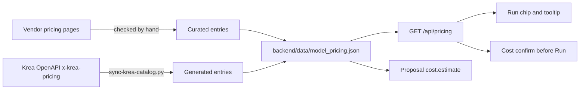

# Model pricing



Nebula shows what a run would cost at **list prices**, not a quote. Every price
in the table names the page it came from and the date it was checked. A node
without a sourced price is shown as unpriced, never guessed.

## Where it shows

- **Run chips** (bottom bar and selection bar):
  - "~$0.16" when the price is exact.
  - "$0.0047–0.43" when a setting such as `auto` quality only resolves at run time.
  - A trailing "+" when part of the run has no list price.
  - "N paid" when nothing in the run is priced.
  - "Priced when its input is known" in the tooltip for a node priced from its input file whose file doesn't exist yet.
  - "Nebula can't read the size of its input" in the tooltip when that file exists but Nebula can't measure it (a file on another host, never downloaded to price it, or one it can't read).
  - The tooltip lists each node.
- **Cost confirm:** before a run whose high estimate reaches the threshold in
  Settings › Preferences › *Ask before costly runs* (default $1, or Never).
- **Agent spending limits:** the same threshold, plus a per-session budget and
  per-model limits, decide when an agent must propose a run instead of
  starting it (see [MCP-SETUP](MCP-SETUP.md#spending-limits)).
- **Agent proposals:** `cost.estimate` and each node's `price` (see
  [MCP-SETUP](MCP-SETUP.md#proposals)).

## What counts

- **Batches multiply.** A node below a Batch runs once per item. Below an Iterator it runs up to the iterator's cap.
- **Dual-route nodes are priced on the route that bills.** For example, Veo 3.1 (`veo-3`) runs on Vertex AI when a Vertex service-account key is set, then on the Gemini API key, and on fal otherwise. Both Google routes use the same per-second rows (model × resolution, times the node's duration: 8 s at 720p by default). The fal route is unpriced.
- **Defaults come from the node definition.** The estimate reads each param's default from `params`, `sharedParams`, `directParams` and `falParams`. So an untouched Veo node is priced at 8 s, 720p.
- **Krea account runs** are their own class, "on Krea plan": the chips count them apart from paid ("2 paid · 1 on Krea plan"), each gets the line "“Krea 2” runs on your Krea plan.", and they add nothing to the dollar total. A node priced at a sourced $0 is free: never in "N paid" or the figure, and a run of only those reads "$0", "This costs nothing to run."
- **Costs the vendor doesn't fix up front** (`plus`) are named but not added. For example, OpenAI bills input images on edit nodes by size.
- **A multiplier that can't be read is unknown.** A count or duration the price multiplies by (`n`, `num_images`, `duration`) that is set but isn't a positive number leaves the node unpriced, rather than priced as one unit. Left unset with no default, it counts once.
- **Some prices are measured from the input file at run time.** An entry with `sizing` multiplies by quantities read from the file its input port gets: `(input megapixels)`, `(output megapixels)`, `(larger megapixels)`, `(source seconds)` and `(source frames)`. The output follows from the input and the params (`output: "upscale"`: factor mode is the input's sides times `upscale_factor`; in target mode the vendors don't say which side `target_resolution` sets, so both are computed and the larger counts). A megapixel is 1,000,000 px unless the vendor says otherwise (BFL: 1,048,576). Where the vendor is unclear, Nebula prices the side that costs more and rounds up what `roundUp` lists, and says so in the entry's notes. The file is measured when the run is checked (an agent's run, `nebula quick`, the canvas's cost confirm, a proposal's price; `services/input_sizes.py`): an Image Input or Video Input's file, `nebula quick`'s file, a Nebula output or upload, or (in a proposal) an upstream output that already exists. Only a file in Nebula's output folder (its path and resolved path both inside, no `..`, not one Nebula is still writing) or an inline image is measured, since a file anywhere else could change between the check and the run; an agent adds its own file first with `nebula upload` (MCP `upload_file`). An image is read from its header (Pillow; one with more than one frame or size isn't measured). A clip is measured as an upper bound of what a decoder gets: exactly one video stream that isn't cover art, frames and seconds from its demuxed packets as well as its header (ffprobe, nothing decoded), and none with a parameter change in its packets; a size change inside the coded bitstream is the known limit (MCP-SETUP "Spending limits"). A file on another host is never downloaded. When the input doesn't exist yet (the node that makes it hasn't run, or runs in the same request), the node is unpriced: the chip says "Priced when its input is known", and an agent's run is refused with what to do. When the input exists but can't be measured (a file on another host, or one Nebula can't read), the node is unpriced too, the chip says "Nebula can't read the size of its input", and the refusal names that cause instead (`input_sizes.run_input_sizes` `reasons`), so an agent isn't told to repeat the step that failed. SeedVR2 Upscale is $0.001 per megapixel of the larger of input and output, rounded up to a whole megapixel (unconfirmed: fal doesn't say which it counts or how it rounds). SeedVR2 Video Upscale is $0.001 per megapixel of output width × height × frames. FLUX Video Upscale on BFL and Replicate, and FLUX Video Edit [fast] on BFL and fal, are priced from the clip, with seconds rounded up; FLUX Video Upscale on fal stays unpriced, since fal doesn't say where its output tiers split. The provider switcher shows "by size" for such a route.
- **A priced setting that arrives by wire is unknown.** When an input port has the same id as a setting the price reads (Krea Kling 3.0's `multi_prompt`), the wired value replaces the param at run time, so that node is unpriced. The check covers every row, extra and multiplier the entry reads, not just the row that names it.
- **Krea 2 is priced by billing tier.** Krea bills each Krea 2 run as text to image, with style references, or with a moodboard (a moodboard with style references bills the moodboard price): Medium $0.03 / $0.035 / $0.04, Large $0.06 / $0.065 / $0.07, Turbo $0.015 / $0.0175 / $0.02. An input counts when its field is filled in or its port is wired: rows read `(wired PORT)`, a price variable that is `yes` with an edge into that port. Because every row that reads such a param also reads `(wired PORT)`, a wire into it is priced rather than unknown. On `krea-2-generate` a wired `moodboard` is a Nebula board (sent as style references) or a Krea moodboard id (billed as a moodboard), so it shows the range between the two. Krea doesn't say which tier LoRA styles or an image-to-image source bill, so such a run shows the range from the tier its references give up to the moodboard price, the highest tier Krea lists (a Medium LoRA run without references: $0.03-0.04). An agent's limit checks the top of a range, so it never counts less than the bill. A field that holds only whitespace counts as empty, because the handler strips it before sending (the entry's `whitespaceUnset`).
- **Multi-shot Kling is unpriced.** Kling V3 (fal) and Kling 3.0 (Krea) rows match only an empty `multi_prompt`. Kling's API reference says the shot durations must sum to the total, but neither fal nor Krea says whether a mismatched sum is rejected or billed by the shots. The Krea guard lives in `scripts/sync-krea-catalog.py` (`PRICE_GUARDS`), so a catalog refresh keeps it.
- **Audio on Krea's Wan 2.5/3.0, LTX 2.5 Fast/Pro and Vidu Q3 costs nothing extra.** Krea's price list for them keys on resolution and duration only, and their entries say so. Krea does put audio in the price where it charges for it (Veo 3, Kling 3.0).
- **Local nodes that call a provider.** Cinema Scene is priced as its base model, once per shot. A Video QC node in vision-llm mode calls a vision model (the first of `ANTHROPIC_API_KEY`, `OPENAI_API_KEY`, `GOOGLE_API_KEY` that is set) and has no list price, so it shows as unpriced and an agent has to propose it under any limit. In Jev mode it sends every check to TypeSafe in one request and is priced per request like the other Jev nodes (up to $0.0027). Heuristic and opencv runs are free. A local node's entry may only hold rows that match a mode that calls a provider, so its free modes stay free.

## The table

`backend/data/model_pricing.json`, keyed by node id. Its format and matching
rules are documented at the top of `backend/services/model_pricing.py`.
`frontend/src/lib/pricing.ts` implements the same estimate, and both run the
shared cases in `backend/tests/fixtures/pricing_cases.json`.

### Krea (generated)

```bash
python scripts/sync-krea-catalog.py --refresh
```

This rewrites only the entries marked `generatedBy`, from `x-krea-pricing` in
Krea's public OpenAPI spec. Models whose price depends on something a node
param doesn't capture stay unpriced, and the script prints why. Without
`--refresh` it regenerates from the pinned catalog, offline. `PRICE_GUARDS`
adds conditions Krea's price list leaves out (multi-shot Kling 3.0), and
`UNPRICED_FIELD_NOTES` says outright when a request field like
`generate_audio` doesn't change the price. `DERIVED_DIMENSIONS` are price
dimensions that aren't request fields but follow from them (Krea 2's
`k2BillingTier`, mapped by `K2_CATALOG_INPUTS` and `K2_NODE`, which also
prices the hand-written `krea-2-generate` from the same price points).
Every refresh also re-reads the Pricing section of Krea's Krea 2 guide
(https://www.krea.ai/docs/developers/krea-2/overview.md) and pins it in the
catalog as `krea2Guide`; `--refresh-guide` re-reads only that, and
`--guide <file>` reads a saved copy. The script stops if the guide's prices
differ from the OpenAPI's, or if that section has a line it doesn't parse (a
new note or column), so a change to the guide gets a human re-read.
`--openapi <file> --only <endpoint>` (repeatable) refreshes just those
entries. `--check` verifies the committed files offline.

### Everything else (curated)

To add or update a price:

1. Open the vendor's pricing page and find the line for this model and setting.
2. Add rows whose `match` keys are the node's own params and option values. Specific rows go before general ones.
3. Put the URL and the quoted price line in `sources`, and today's date in `checked`.
4. Run `backend/.venv/bin/python -m pytest backend/tests/test_model_pricing.py`. It fails on unknown params or option values, missing sources, and dual-route nodes that don't name a `provider`.

Never copy a price from a search snippet or an aggregator. If the vendor page
doesn't say, leave the node unpriced.
