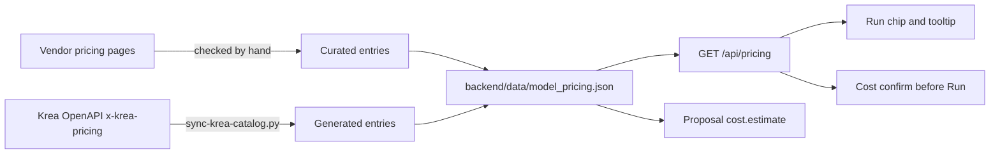

# Model pricing



Nebula shows what a run would cost at **list prices**, not a quote. Every price
in the table names the page it came from and the date it was checked. A node
without a sourced price is shown as unpriced, never guessed.

## Where it shows

- **Run chips** (bottom bar and selection bar):
  - "~$0.16" when the price is exact.
  - "$0.0047–0.43" when a setting such as `auto` quality only resolves at run time.
  - A trailing "+" when part of the run has no list price.
  - "N paid" when nothing in the run is priced.
  - The tooltip lists each node.
- **Cost confirm:** before a run whose high estimate reaches the threshold in
  Settings › Preferences › *Ask before costly runs* (default $1, or Never).
- **Agent spending limits:** the same threshold, plus a per-session budget and
  per-model limits, decide when an agent must propose a run instead of
  starting it (see [MCP-SETUP](MCP-SETUP.md#spending-limits)).
- **Agent proposals:** `cost.estimate` and each node's `price` (see
  [MCP-SETUP](MCP-SETUP.md#proposals)).

## What counts

- **Batches multiply.** A node below a Batch runs once per item. Below an Iterator it runs up to the iterator's cap.
- **Dual-route nodes are priced on the route that bills.** For example, Veo 3.1 (`veo-3`) runs on Vertex AI when a Vertex service-account key is set, then on the Gemini API key, and on fal otherwise. Both Google routes use the same per-second rows (model × resolution, times the node's duration: 8 s at 720p by default). The fal route is unpriced.
- **Defaults come from the node definition.** The estimate reads each param's default from `params`, `sharedParams`, `directParams` and `falParams`. So an untouched Veo node is priced at 8 s, 720p.
- **Krea account runs** are listed as billed to your Krea plan. They add nothing to the dollar total.
- **Costs the vendor doesn't fix up front** (`plus`) are named but not added. For example, OpenAI bills input images on edit nodes by size.
- **A multiplier that can't be read is unknown.** A count or duration the price multiplies by (`n`, `num_images`, `duration`) that is set but isn't a positive number leaves the node unpriced, rather than priced as one unit. Left unset with no default, it counts once.
- **A priced setting that arrives by wire is unknown.** When an input port has the same id as a setting the price reads (Krea Kling 3.0's `multi_prompt`), the wired value replaces the param at run time, so that node is unpriced. The check covers every row, extra and multiplier the entry reads, not just the row that names it.
- **Multi-shot Kling is unpriced.** Kling V3 (fal) and Kling 3.0 (Krea) rows match only an empty `multi_prompt`. Kling's API reference says the shot durations must sum to the total, but neither fal nor Krea says whether a mismatched sum is rejected or billed by the shots. The Krea guard lives in `scripts/sync-krea-catalog.py` (`PRICE_GUARDS`), so a catalog refresh keeps it.
- **Audio on Krea's Wan 2.5/3.0, LTX 2.5 Fast/Pro and Vidu Q3 costs nothing extra.** Krea's price list for them keys on resolution and duration only, and their entries say so. Krea does put audio in the price where it charges for it (Veo 3, Kling 3.0).
- **Local nodes that call a provider.** Cinema Scene is priced as its base model, once per shot. A Video QC node in vision-llm mode calls a vision model (the first of `ANTHROPIC_API_KEY`, `OPENAI_API_KEY`, `GOOGLE_API_KEY` that is set) and has no list price, so it shows as unpriced and an agent has to propose it under any limit. In Jev mode it sends every check to TypeSafe in one request and is priced per request like the other Jev nodes (up to $0.0027). Heuristic and opencv runs are free. A local node's entry may only hold rows that match a mode that calls a provider, so its free modes stay free.

## The table

`backend/data/model_pricing.json`, keyed by node id. Its format and matching
rules are documented at the top of `backend/services/model_pricing.py`.
`frontend/src/lib/pricing.ts` implements the same estimate, and both run the
shared cases in `backend/tests/fixtures/pricing_cases.json`.

### Krea (generated)

```bash
python scripts/sync-krea-catalog.py --refresh
```

This rewrites only the entries marked `generatedBy`, from `x-krea-pricing` in
Krea's public OpenAPI spec. Models whose price depends on something a node
param doesn't capture stay unpriced, and the script prints why. Without
`--refresh` it regenerates from the pinned catalog, offline. `PRICE_GUARDS`
adds conditions Krea's price list leaves out (multi-shot Kling 3.0), and
`UNPRICED_FIELD_NOTES` says outright when a request field like
`generate_audio` doesn't change the price. `--check` verifies the committed
files offline.

### Everything else (curated)

To add or update a price:

1. Open the vendor's pricing page and find the line for this model and setting.
2. Add rows whose `match` keys are the node's own params and option values. Specific rows go before general ones.
3. Put the URL and the quoted price line in `sources`, and today's date in `checked`.
4. Run `backend/.venv/bin/python -m pytest backend/tests/test_model_pricing.py`. It fails on unknown params or option values, missing sources, and dual-route nodes that don't name a `provider`.

Never copy a price from a search snippet or an aggregator. If the vendor page
doesn't say, leave the node unpriced.
