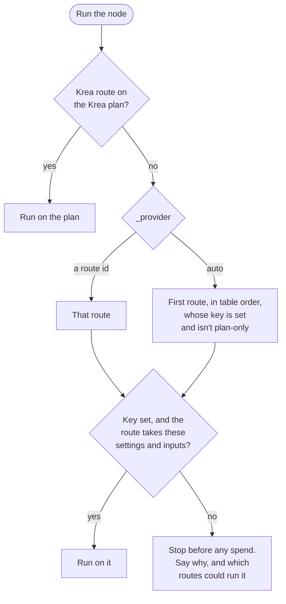
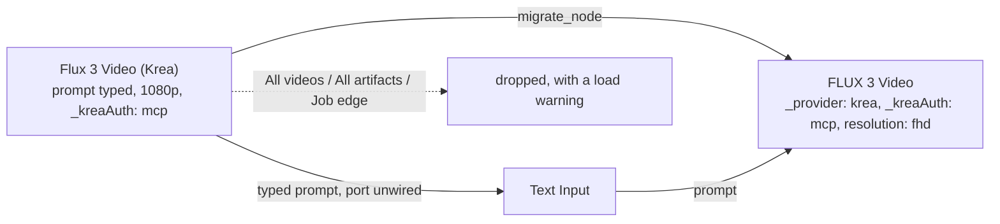
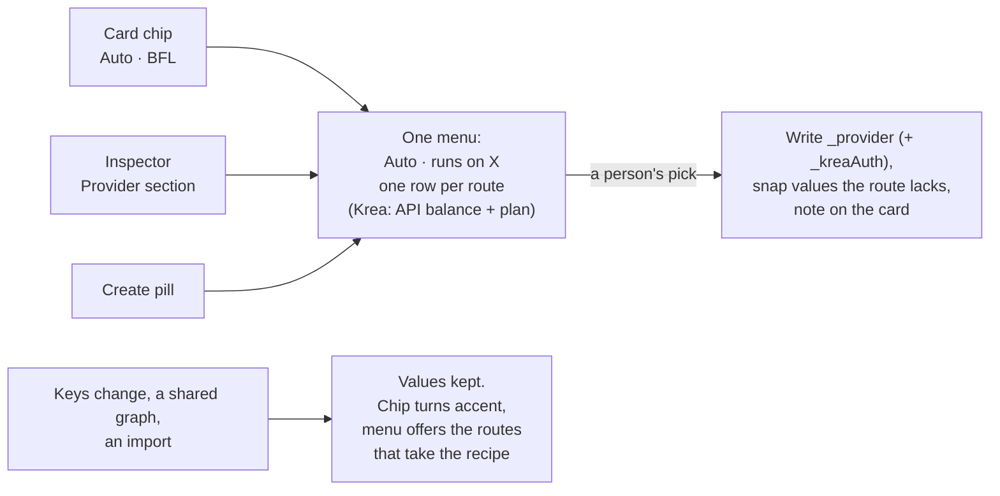

# Provider routes

One node per model. A model that more than one provider sells (FLUX 3 on BFL, fal, Replicate, OpenRouter and Krea) is **one node** with a `routes` table. The person picks the provider, or leaves it on Auto. Nothing else decides who bills.



- **Auto never moves.** If the route Auto lands on can't take a setting (a 4K resolution, a seventh reference image), the run stops and says which other routes could. It doesn't quietly try the next one. Who bills depends only on the choice and the keys.
- **Switching is the person's call.** An agent that wants another provider proposes it (`propose_change`). A direct edit of `_provider` is refused, the same as `_kreaAuth`.
- **Old nodes are untouched.** The ~72 dual-route nodes (a fal or Krea copy that also runs on the maker's API) keep their own `directRoute` rule, byte for byte. Only new nodes use `routes`.

## The nodes

Seven route-table nodes ship (PR 3, 2026-10-15). The node library's provider line names every route in Auto order (`modelDiscovery.ts` `libraryProviderLine`): "BFL · fal · Replicate · OpenRouter · Krea".

| Node | Routes, in Auto order | Notes |
|---|---|---|
| `flux-3-image` FLUX 3 Image | `bfl` (maker), `fal`, `replicate`, `openrouter` | Up to 10 reference images on every route. fal takes no 1.5k or 9:21 (its `valueMap`); `grounding` is BFL and Replicate only, `enable_prompt_expansion` fal only. fal's price is `unconfirmed`. |
| `flux-3-image-klein` FLUX 3 Image Klein | `bfl` (maker), `openrouter` | `steps` and `output_format` on BFL only; OpenRouter takes no seed. fal's Klein endpoints are left out. |
| `flux-3-image-klein-base` FLUX 3 Image Klein Base | `fal` | BFL's API doesn't serve Klein Base, so the node is fal-only (`apiProvider: fal`). Price `unconfirmed`. |
| `flux-3-video` FLUX 3 Video | `bfl` (maker), `fal`, `replicate`, `openrouter`, `krea` (API token or plan) | Text, start/end image, keyframes (up to 10 images in all with the start and end image, the cap BFL, fal and Replicate share), or a start video to continue. `draft` on BFL, fal (its `/draft` endpoints) and Replicate. A continuation runs 5-15 s on BFL. OpenRouter takes no keyframes, start video or draft, and frames only as public URLs; Krea takes hd and fhd, no keyframes or draft. Priced by `(mode)`. Replaces `krea-video-black-forest-labs-flux-3-video`. |
| `flux-video-edit` FLUX Video Edit [fast] | `bfl` (maker), `fal`, `krea` (API token or plan) | Prompt plus the clip to edit. Priced per second of the source clip, so unpriced until the run; Krea has no list price. Replaces `krea-video-black-forest-labs-flux-video-edit`. |
| `flux-video-upscale` FLUX Video Upscale | `bfl` (maker), `fal`, `replicate`, `krea` (API token or plan) | `creativity` (precise/creative) and `upscale_factor` 1.5-3; optional prompt. Priced by the output's megapixel-seconds or tier, so unpriced until the run. Replaces `krea-enhance-black-forest-labs-flux-video-upscale`. |
| `krea-3` Krea 3 | `krea` (maker, API token or plan; early access for beta workspaces), `fal` | Up to 8 reference images. Krea's options (`thinking_mode`, `resolution`, `aspect_ratio`, `regional_edit`) and fal's (`model`, `reasoning_level`, `image_size`, ...) are each route's own; only `seed` is shared. |

The three Krea FLUX nodes the catalog generated before are now the `krea` routes of these nodes: `scripts/sync-krea-catalog.py` `FOLDED` (see Adding a route-table node). Saved graphs that still name the old ids load as the new nodes (below).

### Saved graphs with the old Krea nodes

`services/retired_nodes.py` `MERGED` maps each old id to its new node, and every way a graph comes in (`/api/graph/import`, clusters, proposals, restore bundles, project snapshots, the boot state file) runs `migrate_graph` before staging:



- The node is set to the Krea route with its `_kreaAuth` kept, so the same account pays the same way. Values the new node spells differently are renamed (`720p`→`hd`, `1080p`→`fhd`, creativity `precise`/`creative`→`0`/`1`); anything else is kept, and the run stops before billing if Krea can't take it.
- Ports keep their ids except Upscale's `video_url`, now `video`.
- A prompt or media URL typed on the old node, with nothing wired to that port, moves to a Text, Image or Video Input node wired to it. The new nodes read these only from ports.
- A renamed node keeps its title. An agent may load one on the API token but not on the plan, the same rule as before.
- Create presets (styles) saved on an old node read as the new one (`services/preset_store.py` runs `migrate_node` on every read), so applying one switches Create to the new node on the Krea route with the saved `_kreaAuth`. Create never spreads a preset's params over a model the catalog doesn't have, and a style-only preset (no model) never changes `_provider` or `_kreaAuth` (`lib/applyPreset.ts`).
- Per-model agent spend limits under an old id apply to the new node; where both are set, the lower holds (`agent_spend._fold_models`).
- Tests: `test_retired_nodes.py` (the map, each node, `migrate_graph`, and `fixtures/krea_flux_folded.nebula` through import, project open, restore and the state file).

## The switcher



- **Where.** A route-table node (`routeSwitch`, lib/directRoute.ts) shows `components/nodes/ProviderSwitcher.tsx` three ways: the first section of the Inspector, a chip next to the id chip on the card (it replaces the missing-key badge, and turns accent with a warning glyph when the run can't start), and a pill in Create Studio. Older dual-route nodes never show it.
- **Rows.** `Auto · runs on Black Forest Labs`, or `Auto · can't run: 1.5k isn't on fal.ai` with one-click switches to the keyed routes that take the recipe. Then one row per route: provider, `Key set` or `Add key →` (opens Settings → Providers at that key), the price at the current settings (`*` when the route's price entry says `unconfirmed`, `-` when there's no list price, the route can't take the settings, or it bills the Krea plan) and a note when the route can't take them ("Doesn't take 1.5k"), or else the route's own `note` on its API row. A Krea route that can bill the plan shows two rows, `Krea · API balance` and `Krea · plan` (`Sign in` when signed out); each writes `_provider` and `_kreaAuth`.
- **Per-provider options.** The Inspector and the pills list only the shown route's options (`routeParamDefinitions` / `route_param_definitions`): an enum cut to the values the route takes (its `valueMap`, `accepts` and `rejects`), a number range narrowed to its `accepts`, and other routes' own params left out. Shown route: the chosen one; under Auto, the route Auto lands on with the current keys; with no key, the maker's (`shownRouteId` / `shown_route_id`). A saved value off the list stays and reads "(not on fal.ai)". `rejectsWhen` combinations stay a run-time block.
- **A click snaps, nothing else does.** Picking a provider moves each saved value the new route doesn't take to its closest one there (an enum's nearest option by list order, a tie going up: 1.5k → 2k; a number clamped into range; else the default), and the card shows one dismissible line ("1.5k isn't on fal.ai: set to 2k"). Another route's own setting that the new route refuses and has no control for goes back to its default ("Draft (fast preview) isn't on Krea: turned off"), so a click never lands on a stop the person can't fix there. A route change without a click (a key added or removed, a shared graph, an import) keeps every value; the run stops before billing and the switcher offers the routes that take it. The `.nebula` import summary names nodes set to a provider you have no key for.
- **Saving** accepts any route's params and values, since they stay flat in `node.params`; `route_block` decides at run time.
- **Agents and the CLI** see the same per-route lists: describe_node's route rows carry each route's params as it offers them (and `priceUnconfirmed`), and `nebula info` prints what each route takes that the PARAMS list doesn't say.

## Where it lives

| Piece | Backend | Frontend |
|---|---|---|
| The route table, Auto, blocks, messages | `backend/services/node_route.py` | `frontend/src/lib/directRoute.ts` |
| Running a route | `backend/execution/maker_routes.py` `multi_route`, clients in `backend/execution/route_clients.py` | |
| Preflight (fail before spend) | `backend/execution/engine.py` `validate_graph` | |
| Prices | `backend/services/model_pricing.py` `estimate_routes`, `route_price_key` | `frontend/src/lib/pricing.ts` `estimateRoutes`, `frontend/src/lib/runScope.ts` |
| Readiness | `backend/services/node_readiness.py` `instance_access`, `keys_needed` | `frontend/src/lib/kreaConnection.ts` `ownKeyStatus` |
| Who may change billing | `backend/main.py` `_billing_choice`, `_refuse_agent_billing_change`, `_check_provider` | `frontend/src/lib/billingParams.ts` |
| Agents and CLI | `describe_node` / `find_nodes` in `main.py`, `backend/cli/formatter.py` | |
| Per-route options | `node_route.route_param_definitions`, `shown_route_id` | `directRoute.ts` `routeParamDefinitions`, `shownRouteId` |
| The switcher | | `components/nodes/ProviderSwitcher.tsx`, `lib/providerSwitch.ts`, `store/providerNoteStore.ts`, `styles/provider-switcher.css` |

The Python and TypeScript twins behave the same. Shared fixtures keep them honest (see Tests).

## A route table

A route-table node keeps its usual fields (`apiProvider` is the maker, `envKeyName` is every route's keys in order) and adds:

- `params`: the hidden `_provider` choice (`auto` plus each route id), and `_kreaAuth` when a Krea route exists.
- `sharedParams`: the settings every route takes.
- `routes`: the table, in Auto order. Each route:

| Field | What it says |
|---|---|
| `id` | What `_provider` names. Usually the provider; two routes on one provider need different ids. |
| `provider` | Who bills: a `KEY_PROVIDERS` value (`bfl`, `fal`, `replicate`, `openrouter`, `krea`, ...). |
| `maker` | `true` on the model maker's own API. At most one. |
| `keys` | Any one of these keys runs it. |
| `plan` | Krea only: `optional` (API token or the Krea plan, by `_kreaAuth`) or `only` (plan only; Auto skips it). |
| `handler` | Which client runs it (`bfl`, `fal`, `replicate-model`, `openrouter-images`, `openrouter-videos`, `krea`). |
| `endpoint`, `endpointWhen` | The provider's model or path, and an override when settings match (`{"images": "(set)"}` for an edit endpoint once images are wired). |
| `params` | Settings only this route takes. |
| `rename`, `valueMap` | Our spelling to the provider's: a param name, or a value (`1k` to `1K`). A `valueMap` also says which values the route takes. |
| `rules` | `accepts`, `rejects`, `rejectsWhen`, `blockedBy`, `size` (the `directRoute` grammar), plus `ports: {"images": {"max": 4}}` for how many inputs a port may carry. An entry with `of` caps several ports together, its key naming the group and `label` how messages say it: FLUX 3 Video's `"frames": {"max": 10, "of": ["start_image", "keyframes", "end_image"]}` on BFL, fal and Replicate (`port_limit_count` / `portLimitCount`). |
| `pricing` | The key its price is under in `model_pricing.json` (default: its `id`). |
| `note` | One line for the person, shown under the route's API row in the switcher (Krea 3's "Early access"); a "Doesn't take ..." note replaces it. |

`node_route.routes_problems` and `scripts/check-node-contracts.mjs` both check this shape.

## What a run sees

- `select_route` returns a `Route`: `kind` (`plan`, `direct` for the maker, `fallback` for any other route, `unset` when it can't run), `provider`, `key`, plus `routeId`, `block` and `missing` on route-table nodes.
- `route_unavailable` explains an `unset` run: `{routeId, missing, block, alternatives, message}`. The same `message` shows on the node, in the run error, in the preflight and in the run estimate.
- Wired inputs count. A port rule reads how many inputs arrive, under the reserved `"(wired ports)"` key that `with_wired_blockers` adds. The router and the cache key count items (`filled_counts`: a list counts its length, which is what the provider gets). The preflight, the estimate and the switcher count edges, all that is known before upstream nodes run. So one edge bringing a list of six images to a route that takes four passes the preflight and stops in the router, before that provider is called.
- The Krea plan is decided from the same routed values (`with_wired_blockers`), so a wired input that blocks or unblocks the plan route changes the preflight's sign-in check, the estimate's plan runs and the spend gate the same way it changes the router.
- The cache key names the route that ran: `direct:bfl`, `fallback:replicate`, `plan:krea`, so a result from one provider never replays as another's.
- The handler gets only the route's own settings, renamed and value-mapped (`translate_params`). A Krea route also gets `_kreaAuth` for how this run bills.

## Route clients

`backend/execution/route_clients.py` `ROUTE_CLIENTS` has one client per `handler`. The router hands each one the route's own params, already renamed and value-mapped, the run's inputs and keys, the route spec, and the `endpoint` it picked from `endpointWhen`. It picks the endpoint from our names and the wired ports, before translation. The client does the structural part a table can't say:

| `handler` | Calls | Wired media | Notes |
|---|---|---|---|
| `bfl` | `handlers/bfl.py` `run_task` on the route's path (`/v1/flux-3-image` and so on) | `images` → `images`; a video's `start_image` + `keyframes` + `end_image` → `keyframes` (`mode: i2v`), `start_video` → `start_video` (`mode: v2v`), nothing → `mode: t2v`; video edit `video`, upscale `input_video` | URLs pass through, local outputs go as data URIs. No cancel (BFL has none). |
| `fal` | `handle_fal_universal` on the endpoint id | by the endpoint's last segment: `edit-image` `image_urls`, `image-to-video` `image_url`, `first-last-frame-to-video` `start_image_url`/`end_image_url`, `keyframes-to-video` `keyframes[{image_url, frame_index}]` (spread evenly over `duration` × 24 frames), `extend-video`/`edit-video` `video_url`; or by the whole id where a last segment is ambiguous: `blackforestlabs/flux-video-upscale` `video` → `video_url`, `krea/v3/edit` `images` → `image_urls` | fal forwards every param, so its copy holds only the route's params, the media fields and `endpoint_id`. `draft` only picks a `/draft` endpoint and is never sent (`FAL_ENDPOINT_SWITCHES`), and a `/draft` endpoint gets no `resolution` (`FAL_DRAFT_DROPS`; drafts are 720p). Polls up to 10 minutes, 30 for a video (`FAL_VIDEO_POLLS`). Cancel: fal's queue cancel, on a stop and when the polls run out. |
| `replicate-model` | `handlers/replicate_model.py` `run_model`: `POST /v1/models/{owner}/{name}/predictions` | `images` (and a video's frames, in order) → `images`, `start_video` → `start_video`; a model whose one input is a source video takes it under its own field (`REPLICATE_SOURCE_VIDEO`: `black-forest-labs/flux-video-upscale` `video` → `input_video`, prompt optional) | Local files go up through `POST /v1/files` first. The output is saved as the node's port type, fetched with the token only from `replicate.delivery`. Cancel: `POST /v1/predictions/{id}/cancel`. |
| `openrouter-images` | `handlers/openrouter_media.py`: `POST /api/v1/images` | `images` → `input_references` | Params outside the documented request fields go under `provider.options[<owner slug>]` (FLUX: `safety_tolerance`). Saves `data[0].b64_json`. |
| `openrouter-videos` | `POST /api/v1/videos`, poll `GET /api/v1/videos/{id}`, download `unsigned_urls[0]` | `start_image`/`end_image` → `frame_images` (`first_frame`/`last_frame`) | A source video isn't sent: its request shape isn't documented. Frames go only as public http(s) URLs: OpenRouter documents data URLs for `/images` references but not for `/videos` `frame_images`, so a local output wired to a frame stops before any request and points to another provider. No cancel (OpenRouter has none for video). |
| `krea` | `handlers/krea_gateway.py` `handle_krea_catalog`: the catalog model the `endpoint` names (a catalog key, or the `/generate/...` path one entry serves) | by name: Krea's request fields are its port ids, except where the catalog entry's `portFields` names another (`krea_inputs`: Krea 3 `images` → `image_urls`, FLUX Video Upscale `video` → `video_url`) | Bills by the `_kreaAuth` the router sets. The plan runs through the same account path as every Krea node. |

- **Nothing is dropped.** A wired input the chosen endpoint can't take stops the run before any request, and so does a recipe the provider can't express (a video and images together). An end image with no start image or keyframes before it stops on every video route (`route_clients.refuse_end_alone`), even where the provider's schema would take it alone, so no provider opens the clip on its closing frame. Each error says what to disconnect or that another provider would take it.
- **Output.** The result lands on the node's own output port, typed by that port.
- **Request shapes are pinned.** `backend/tests/fixtures/provider_schemas/` holds each provider's request schema, copied from its docs on 2026-10-15 (OpenRouter's is hand-written from its parameter tables; it publishes none). `tests/test_route_clients.py` checks every body against them with unknown fields refused. It also runs each client end to end through `multi_route` on the fixture nodes in `fixtures/route_client_definitions.json`.

### Adding a client, or a provider path

1. Read the provider's own schema or docs. Copy the request schema into `tests/fixtures/provider_schemas/` with its source URL and date.
2. A new path on an existing client (a BFL path, a fal endpoint segment) is a row in that client's table in `route_clients.py`. A client with no shape for a path refuses it, so this step can't be skipped by accident.
3. A new client is a `run(node, inputs, api_keys, *, route, emit, endpoint)` in `ROUTE_CLIENTS`, keyed by a name in `node_route.ROUTE_HANDLERS`, `check-node-contracts.mjs` `ROUTE_HANDLERS` and the TS `RouteHandler` type. Put the HTTP calls in a `handlers/` module and keep the structural step in `route_clients.py`.
4. Test it with `httpx.MockTransport`: the request against the schema, the output, errors, and cancel where the provider has one. Add a case to the end-to-end test.

## Prices

A route-table node's price entry keys each route by its `pricing` key (default its id):

```json
"flux-3": { "routes": {
  "bfl": { "currency": "usd", "per": "image", "rows": [...] },
  "fal": { "currency": "usd", "per": "image", "provider": "fal", "rows": [...] }
} }
```

- The run is priced on the route it takes. A run that can't start is `unavailable` with the reason, never priced at another route.
- `estimate_routes` gives every route's price at the current settings, for the provider switcher.
- A route entry with `"unconfirmed": true` is a price the provider's page doesn't state exactly; the switcher shows it with `*` (`route_price_unconfirmed` / `routePriceUnconfirmed`). Where two of a provider's own sources disagree (fal's model page and its pricing API), the higher is kept and marked.
- A row may match `(mode)`, a price variable read from the wired ports, not a saved param: `v2v` with `start_video` wired, `i2v` with `start_image`, `keyframes` or `end_image`, else `t2v` (`model_pricing.VIDEO_MODE` / `pricing.ts` `videoMode`). FLUX 3 Video prices by it.
- A row may also match `(references)`: `some` with an edge into `images`, else `none` (`model_pricing.REFERENCES` / `pricing.ts` `REFERENCES`). Krea 3 prices a run with no references at the exact base price, and a range up to the most references a route takes only once images are wired.
- A Krea route's rows don't match `_kreaAuth`. A plan run is sent to the plan before any row is read (`uses_krea_account`), so the rows are the API balance's price, which the switcher's `Krea · API balance` row shows whatever mode is saved.
- An entry that reads `(source seconds)`, `(output megapixels)` or `(output tier)` (`RUN_TIME_VARIABLES`) is priced by the source clip, which isn't known before the run, so it is unpriced until then. FLUX Video Edit [fast] and Upscale price this way; `per: "megapixel-second"` is BFL's and Replicate's upscale unit.
- A route with no entry (Krea's Video Edit and Upscale, which have no list price) shows `-`.

## Adding a route-table node

1. Write the node in `frontend/src/constants/nodeDefinitions.ts` (above the generated Krea block) and the same entry in `backend/data/node_definitions.json`. `scripts/export-node-defs.ts` writes the JSON from the TS, but the two already differ in a few labels, so check its diff before keeping it, or insert only the new entries. Give it no `docUrl`: the Krea sync treats `docs/model-providers/krea/krea-gateway.md` as its own and rewrites those nodes.
2. Each route's `handler` names a client in `route_clients.ROUTE_CLIENTS` (see Route clients). Its endpoint must be a path that client has a request shape for. If not, add the shape first.
3. Price it per route in `backend/data/model_pricing.json`, with sources (an `https` url and the quoted price line each).
4. A Krea route on a model the Krea catalog has: add its endpoint to `scripts/sync-krea-catalog.py` `FOLDED` (`endpoint: (node id, route id, {port: Krea field})`) and run the script. The catalog entry gets `foldedInto` (and `portFields`); no Krea node or Krea price is generated for it, and `--check` (`folded_problems`) fails when the node's Krea route sends a param, value or port the entry's request schema doesn't take. A model not in the pinned catalog yet comes in alone with `--openapi <spec> --only <endpoint>` (or `--refresh --only`), which stamps that entry with its own `fetchedAt` and `openapiSha256` and leaves every other entry as pinned.
5. Regenerate: `backend/.venv/bin/python scripts/generate-route-tables.py` and `node scripts/generate-model-reference.mjs`.
6. Run `node scripts/check-node-contracts.mjs`.

## Tests

- `backend/tests/fixtures/route_cases.json`: shared Python/TS cases. The first 147 are the legacy rule, unchanged; the `definitions` block holds three fixture route tables and the cases that run on them.
- `backend/tests/fixtures/route_tables.json`: every node's computed routes and param list, and each route-table route's offered params (`routeParams`), pinned (`scripts/generate-route-tables.py --check`). Route cases with `shownRoute` / `routeParams` pin the narrowing in both languages.
- `backend/tests/fixtures/pricing_cases.json`: the `table` node, a five-route fixture, with `runCases` and `routeEstimateCases`; `moded` and `tooled` for `(mode)` and run-time prices; `shippedRouteCases`, each real node's route prices on the shipped table, in both languages.
- `test_route_clients.py` with `fixtures/route_client_definitions.json` and `fixtures/provider_schemas/`: the six clients.
- `test_flux3_nodes.py`: the seven real nodes. Each route's cheapest run goes through the registry's `multi_route` handler and its one request is checked exactly and against the provider's schema (or the Krea catalog entry's), every route is priced or said to be unpriced, and the `unconfirmed` routes are listed. `route_cases.json` also has cases on the real nodes.
- `backend/tests/fixtures/switch_cases.json`: the switcher joined to the clients. Each case is a click in the Inspector's switcher on a `route_client_definitions.json` node or a real route-table node (`switchToClient.test.tsx` checks what it writes, the card note and what the switcher then shows) and the run of those saved values through `multi_route` (`test_route_clients.py` `test_switch_cases_*` checks the route picked and the one provider request, body checked against the provider's schema, or the stop before any request). Change a click's outcome in one language and this fixture fails there.
- `test_node_route.py`, `test_maker_routes.py`, `test_route_preflight.py`, `test_billing_choice.py`, `test_route_agent_surfaces.py`, `test_krea_catalog.py` (the `FOLDED` entries and `folded_problems`); `directRoute.test.ts`, `routeTables.test.ts`, `pricing.test.ts`, `runScope.test.ts`, `billingParams.test.ts`, `providerSwitch.test.ts`, `ProviderSwitcher.test.tsx`, `modelDiscovery.test.ts` (the library's provider line).
