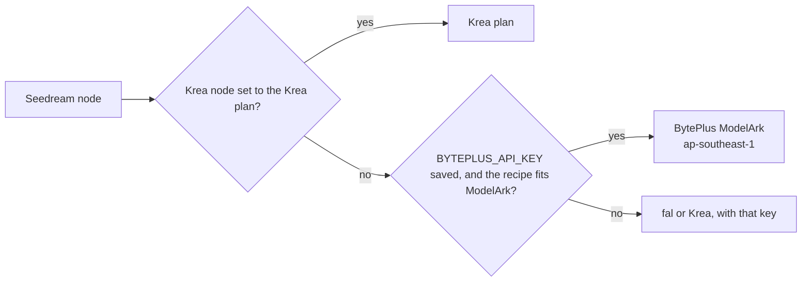

# BytePlus ModelArk in Nebula Nodes

> BytePlus ModelArk is ByteDance's own international API for its Seedream image models (and Seedance video, coming next). With a BytePlus key saved, Nebula's Seedream nodes run on ByteDance's API and ByteDance bills you, instead of going through fal or Krea.

## Before you start: where BytePlus works

- **Not in the United States.** BytePlus's Service Specific Terms, section "Model Services": "The BytePlus Model Services are not available in the United States." (docs.byteplus.com/en/docs/legal/docs-service-specific-terms, read 2026-10-14). If you're in the US, keep using the fal or Krea key for these nodes. Nebula's first-time setup for them points at the fal or Krea key, never at BytePlus.
- **Asia Pacific keys only.** Nebula calls `https://ark.ap-southeast.bytepluses.com/api/v3` ("Data plane API", base-url-and-authentication). BytePlus says "Platform-level resources, such as API keys and model activation status, are isolated by region", so a key from the EU (eu-west-1) console won't work. There's no region setting yet.
- **Activate each model first.** A new account has to switch on each model on the ModelArk console's Model activation page (https://ai.byteplus.com/ark/region:ap-southeast-1/openManagement). Until then BytePlus answers 404 `ModelNotOpen`: "Your account %s has not activated the model %s. Please activate the model service in the Ark Console." Seedance 2.x video also needs USD 30 of credits, a USD 30 AI Savings Plan or a USD 30 resource pack before it can be activated (seedance-model-activation-usage-and-refund).

## Nodes that can run on BytePlus (5)

| Node | Node ID | Copy | ModelArk model | Runs on BytePlus unless |
|---|---|---|---|---|
| Seedream 4.5 (model 4.5) | `seedream-4-5` | fal | `seedream-4-5-251128` | `seed` is set; size is `square` (512x512), `auto_3K`, or a custom size outside the limits |
| Seedream 4.5 (model 5.0 lite) | `seedream-4-5` | fal | `seedream-5-0-lite-260128` | `seed` is set; size is `square` or a custom size outside the limits |
| Cinema Scene (default base) | `cinema-scene` | fal, through `seedream-4-5` | as above | as above, for the scene's computed size |
| Krea Seedream 4 | `krea-image-bytedance-seedream-4` | Krea | `seedream-4-0-250828` | Krea plan; `style_images` set; width x height outside the limits |
| Krea Seedream 5 Lite | `krea-image-bytedance-seedream-5-lite` | Krea | `seedream-5-0-lite-260128` | Krea plan; `style_images` set; width x height outside the limits |
| Krea Seedream 5 Pro | `krea-image-bytedance-seedream-5-pro` | Krea | `dola-seedream-5-0-pro-260628` | Krea plan; `style_images` set; width x height outside the limits |

The readiness line under each node says which route a run takes and why. When a setting keeps the run on its copy, the line names the setting. A run never quietly changes a recipe to make it fit BytePlus.

## Setup

1. In the BytePlus console, switch to Asia Pacific (Johor, ap-southeast-1) and create a ModelArk API key (https://ai.byteplus.com/ark/region:ap-southeast-1/apiKey).
2. Activate the Seedream models you'll use on the Model activation page.
3. In Nebula, open **Settings → Providers**, find **BytePlus · ModelArk** (`BYTEPLUS_API_KEY`), choose **Add key**, paste it and save. Nebula doesn't test the key: BytePlus documents no free, read-only check, so the Settings row says "Saved" and node readiness says "Configured · not checked" until a real run.

## How each setting maps (image-generation-api, read 2026-10-14)

Request: `POST /images/generations` with `watermark: false` (BytePlus's default is `true`, an "AI-generated" mark; the fal and Krea copies send none) and `response_format: b64_json`, so images arrive inline rather than as 24-hour URLs.

| Nebula setting | ModelArk field | Notes |
|---|---|---|
| prompt | `prompt` | |
| `image_size` `auto_2K` / `auto_3K` / `auto_4K` (fal) | `size` `2K` / `3K` / `4K` | 3K is 5.0 lite only ("Optional values: 2K, 3K, 4K"; 4.5 is "2K, 4K") |
| `image_size` shaped presets (fal) | `size` `WxH` from ModelArk's 2K table | square_hd 2048x2048; portrait_4_3 1728x2304; landscape_4_3 2304x1728; portrait_16_9 1600x2848; landscape_16_9 2848x1600. fal doesn't publish its presets' pixel sizes, so the shape is exact and the pixel count is ModelArk's. |
| `image_size` `{width, height}` (fal), `width`/`height` (Krea) | `size` `WxH` | Must be whole numbers within the model's limits, below |
| reference images | `image` (URL or `data:image/<fmt>;base64,`) | Up to 10 (the node's port); ModelArk takes 14 on 4.0, 4.5 and 5.0 lite and 10 on 5.0 pro |
| `num_images` (fal) | separate requests | fal: "Number of separate model generations" |
| `max_images` > 1 (fal) | `sequential_image_generation: auto` + `max_images` | "The model determines whether to return multiple images and how many"; references + outputs ≤ 15 |
| `seed` (fal), `enable_safety_checker` (fal) | none | fal only. A set `seed` keeps the run on fal. |
| `seed` (Krea) | none | Krea fills a default (1337), so it can't decide the route; it's dropped on BytePlus |
| `style_images` (Krea) | none | Krea's per-image `strength` has no ModelArk field; set ones keep the run on Krea |

Size limits per model ("Total pixels range", "Aspect ratio range: [1/16, 16]"):

| Model | Tiers | WxH total pixels |
|---|---|---|
| Seedream 4.5, 5.0 lite | 2K, 4K (+3K on 5.0 lite) | 3,686,400 (2560x1440) to 16,777,216 (4096x4096) |
| Seedream 4.0 | 1K, 2K, 4K | 921,600 (1280x720) to 16,777,216 |
| Seedream 5.0 pro | 1K, 1.5K, 2K | 921,600 to 4,624,220 |

## Pricing (model-pricing, read 2026-10-14)

Per successfully generated image, in USD: Seedream 4.5 $0.04, 5.0 lite $0.035, 4.0 $0.03, 5.0 pro $0.045 at "≤ 2.61 million pixels (1.5K or lower)" and $0.09 above. Seedream 5.0 pro reference images: "First image: Free; From the 2nd image: 0.003". BytePlus: "For Seedream 5.0 lite, Seedream 4.5, and Seedream 4.0, sequential image generation is billed based on the actual number of generated images" and "Images that are not successfully output due to reasons such as content moderation are not billed."

Nebula's run estimate on the BytePlus route:

- `seedream-4-5`: price × `num_images`, as a range from 1 to `max_images` images when `max_images` > 1 (the model decides how many it returns).
- Krea Seedream 5 Pro: shown as $0.045–$0.09, since the price rows can't read width × height.
- Free-trial quota isn't modelled.

## Errors and what to do

| BytePlus answer | Meaning | Fix Nebula shows |
|---|---|---|
| 401 `AuthenticationError` | key rejected | Check `BYTEPLUS_API_KEY`; it must be an ap-southeast-1 ModelArk key |
| 404 `ModelNotOpen`, `InvalidEndpointOrModel.*`, 403 `OperationDenied.ServiceNotOpen` | model not activated | Activate it on the Model activation page; Seedance 2.x needs USD 30 of credits first |
| 403 `AccountOverdueError`, `OperationDenied.ServiceOverdue` | overdue balance | Top up in the BytePlus Billing Center |
| 429 `QuotaExceeded` | free-trial quota used up, or too many queued tasks | Activate the model, or wait for tasks to finish |
| 429 other | rate limit | Wait and run again |
| 400 `*SensitiveContentDetected` | content filter | Change the prompt or inputs |

In a sequential batch, images that failed (`data[].error`) are skipped and the rest are kept.

## Not confirmed yet

- Whether Seedream runs in eu-west-1: the model list says "seedream-5-0-lite models are also supported in the eu-west-1 region", but region-availability lists only seed-2-0-lite there.
- The full JSON shape of a synchronous HTTP error (the docs show only `error {code, message}`); the client parses defensively.
- Nothing here was tried against the live API: no keys or paid runs were used while building it.

## Code

- Client and error text: `backend/handlers/byteplus.py` (`request()` also serves the Seedance tasks API: `POST /contents/generations/tasks`, `GET`/`DELETE /contents/generations/tasks/{id}`).
- Translations and direct handlers: `backend/execution/maker_routes_byteplus.py`.
- Route rules: `backend/services/node_route.py` and `frontend/src/lib/directRoute.ts` (`directRoute.size`, `directRoute.setup: 'fallback'`).
- Krea copies: generated by `scripts/sync-krea-catalog.py` from its `DIRECT_ROUTES` overlay; don't hand-edit them.
