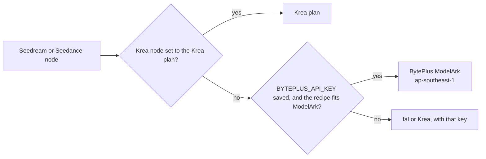

# BytePlus ModelArk in Nebula Nodes

> BytePlus ModelArk is ByteDance's own international API for its Seedream image models and Seedance video models. With a BytePlus key saved, Nebula's Seedream and Seedance nodes run on ByteDance's API and ByteDance bills you, instead of going through fal or Krea.

## Before you start: where BytePlus works

- **Not in the United States.** BytePlus's Service Specific Terms, section "Model Services": "The BytePlus Model Services are not available in the United States." (docs.byteplus.com/en/docs/legal/docs-service-specific-terms, read 2026-10-14). If you're in the US, keep using the fal or Krea key for these nodes. Nebula's first-time setup for them points at the fal or Krea key, never at BytePlus.
- **Asia Pacific keys only.** Nebula calls `https://ark.ap-southeast.bytepluses.com/api/v3` ("Data plane API", base-url-and-authentication). BytePlus says "Platform-level resources, such as API keys and model activation status, are isolated by region", so a key from the EU (eu-west-1) console won't work. There's no region setting yet.
- **Activate each model first.** A new account has to switch on each model on the ModelArk console's Model activation page (https://ai.byteplus.com/ark/region:ap-southeast-1/openManagement). Until then BytePlus answers 404 `ModelNotOpen`: "Your account %s has not activated the model %s. Please activate the model service in the Ark Console." Seedance 2.x video also needs USD 30 of credits, a USD 30 AI Savings Plan or a USD 30 resource pack before it can be activated (seedance-model-activation-usage-and-refund).

## Seedream nodes that can run on BytePlus (5)

| Node | Node ID | Copy | ModelArk model | Runs on BytePlus unless |
|---|---|---|---|---|
| Seedream 4.5 (model 4.5) | `seedream-4-5` | fal | `seedream-4-5-251128` | `seed` is set; the safety checker is switched off; size is `square` (512x512), `auto_3K`, or a custom size outside the limits |
| Seedream 4.5 (model 5.0 lite) | `seedream-4-5` | fal | `seedream-5-0-lite-260128` | `seed` is set; the safety checker is switched off; size is `square` or a custom size outside the limits |
| Cinema Scene (default base) | `cinema-scene` | fal, through `seedream-4-5` | as above | as above, for the scene's computed size. A Character bundle's seed isn't sent on the BytePlus route (BytePlus takes no seed for Seedream 4.5), so the shots run where the price says |
| Krea Seedream 4 | `krea-image-bytedance-seedream-4` | Krea | `seedream-4-0-250828` | Krea plan; `style_images` set; width x height outside the limits |
| Krea Seedream 5 Lite | `krea-image-bytedance-seedream-5-lite` | Krea | `seedream-5-0-lite-260128` | Krea plan; `style_images` set; width x height outside the limits |
| Krea Seedream 5 Pro | `krea-image-bytedance-seedream-5-pro` | Krea | `dola-seedream-5-0-pro-260628` | Krea plan; `style_images` set; width x height outside the limits |

The readiness line under each node says which route a run takes and why. When a setting keeps the run on its copy, the line names the setting. A run never quietly changes a recipe to make it fit BytePlus.

## Setup

1. In the BytePlus console, switch to Asia Pacific (Johor, ap-southeast-1) and create a ModelArk API key (https://ai.byteplus.com/ark/region:ap-southeast-1/apiKey).
2. Activate the Seedream models you'll use on the Model activation page.
3. In Nebula, open **Settings → Providers**, find **BytePlus · ModelArk** (`BYTEPLUS_API_KEY`), choose **Add key**, paste it and save. Nebula doesn't test the key: BytePlus documents no free, read-only check, so the Settings row says "Saved" and node readiness says "Configured · not checked" until a real run.

## How each setting maps (image-generation-api, read 2026-10-14)

Request: `POST /images/generations` with `watermark: false` (BytePlus's default is `true`, an "AI-generated" mark; the fal and Krea copies send none) and `response_format: b64_json`, so images arrive inline rather than as 24-hour URLs.

| Nebula setting | ModelArk field | Notes |
|---|---|---|
| prompt | `prompt` | |
| `image_size` `auto_2K` / `auto_3K` / `auto_4K` (fal) | `size` `2K` / `3K` / `4K` | 3K is 5.0 lite only ("Optional values: 2K, 3K, 4K"; 4.5 is "2K, 4K") |
| `image_size` shaped presets (fal) | `size` `WxH` from ModelArk's 2K table | square_hd 2048x2048; portrait_4_3 1728x2304; landscape_4_3 2304x1728; portrait_16_9 1600x2848; landscape_16_9 2848x1600. fal doesn't publish its presets' pixel sizes, so the shape is exact and the pixel count is ModelArk's. |
| `image_size` `{width, height}` (fal), `width`/`height` (Krea) | `size` `WxH` | Must be whole numbers within the model's limits, below |
| reference images | `image` (URL or `data:image/<fmt>;base64,`) | Up to 10 (the node's port); ModelArk takes 14 on 4.0, 4.5 and 5.0 lite and 10 on 5.0 pro |
| `num_images` (fal) | separate requests | fal: "Number of separate model generations" |
| `max_images` > 1 (fal) | `sequential_image_generation: auto` + `max_images` | "The model determines whether to return multiple images and how many"; references + outputs ≤ 15 |
| `max_images` 1, and every Krea copy | `sequential_image_generation` left out | BytePlus's default is `disabled` (one image), and Seedream 5.0 pro doesn't take the field: "Single image generation: **sequential_image_generation** is not supported" |
| `seed` (fal), `enable_safety_checker` (fal) | none | fal only. A set `seed`, or the safety checker switched off (ModelArk always runs its own content filter), keeps the run on fal. |
| `seed` (Krea) | none | Krea fills a default (1337), so it can't decide the route; it's dropped on BytePlus |
| `style_images` (Krea) | none | Krea's per-image `strength` has no ModelArk field; set ones keep the run on Krea |

Size limits per model ("Total pixels range", "Aspect ratio range: [1/16, 16]"):

| Model | Tiers | WxH total pixels |
|---|---|---|
| Seedream 4.5, 5.0 lite | 2K, 4K (+3K on 5.0 lite) | 3,686,400 (2560x1440) to 16,777,216 (4096x4096) |
| Seedream 4.0 | 1K, 2K, 4K | 921,600 (1280x720) to 16,777,216 |
| Seedream 5.0 pro | 1K, 1.5K, 2K | 921,600 to 4,624,220 |

## Pricing (model-pricing, read 2026-10-14)

Per successfully generated image, in USD: Seedream 4.5 $0.04, 5.0 lite $0.035, 4.0 $0.03, 5.0 pro $0.045 at "≤ 2.61 million pixels (1.5K or lower)" and $0.09 above. Seedream 5.0 pro reference images: "First image: Free; From the 2nd image: 0.003". BytePlus: "For Seedream 5.0 lite, Seedream 4.5, and Seedream 4.0, sequential image generation is billed based on the actual number of generated images" and "Images that are not successfully output due to reasons such as content moderation are not billed."

Nebula's run estimate on the BytePlus route:

- `seedream-4-5`: price × `num_images`, as a range from 1 to `max_images` images when `max_images` > 1 (the model decides how many it returns).
- Krea Seedream 5 Pro: shown as $0.045–$0.09, since the price rows can't read width × height.
- Free-trial quota isn't modelled.

## Seedance video nodes that can run on BytePlus (13)

Runway's Seedance options (`runway-video`) aren't routed: Runway resells them on its own key.

| Node | Node ID | Copy | ModelArk model | Runs on BytePlus unless |
|---|---|---|---|---|
| Seedance 2.0 Text-to-Video | `seedance-2-t2v` | fal | `dreamina-seedance-2-0-260128` | `seed` is set |
| Seedance 2.0 I2V | `seedance-2-i2v` | fal | `dreamina-seedance-2-0-260128` | `seed` is set |
| Seedance 2.0 R2V | `seedance-2-r2v` | fal | `dreamina-seedance-2-0-260128` | `seed` is set |
| Seedance 2.0 Fast T2V | `seedance-2-fast-t2v` | fal | `dreamina-seedance-2-0-fast-260128` | `seed` is set |
| Seedance 2.0 Fast I2V | `seedance-2-fast-i2v` | fal | `dreamina-seedance-2-0-fast-260128` | `seed` is set |
| Seedance V1.5 Pro (model 1.5) | `seedance-v1-5` | fal | `seedance-1-5-pro-251215` | never (all settings map) |
| Seedance V1.5 Pro (model 1.0) | `seedance-v1-5` | fal | `seedance-1-0-pro-250528` | never |
| Seedance 1.0 Text-to-Video | `seedance-1-0-t2v` | fal | `seedance-1-0-pro-250528` | `enable_safety_checker` switched off (ModelArk always runs its own filter; left on, it isn't sent) |
| Krea Seedance 1.0 Pro | `krea-video-bytedance-seedance-1-0-pro` | Krea | `seedance-1-0-pro-250528` | Krea plan; `start_video` or `reference_images` set; a ratio or duration ModelArk lacks |
| Krea Seedance 1.0 Pro Fast | `krea-video-bytedance-seedance-1-0-pro-fast` | Krea | `seedance-1-0-pro-fast-251015` | Krea plan; `start_video` set; a ratio or duration ModelArk lacks |
| Krea Seedance 2.0 | `krea-video-bytedance-seedance-2` | Krea | `dreamina-seedance-2-0-260128` | Krea plan; `seed` or `effects` set; `upscale` or `enhance_prompt` on; a ratio or duration ModelArk lacks |
| Krea Seedance 2.0 Fast | `krea-video-bytedance-seedance-2-fast` | Krea | `dreamina-seedance-2-0-fast-260128` | as Seedance 2.0 |
| Krea Seedance 2.0 Mini | `krea-video-bytedance-seedance-2-mini` | Krea | `dreamina-seedance-2-0-mini-260615` | Krea plan; `seed` set; a ratio or duration ModelArk lacks |
| Krea Seedance 2.5 | `krea-video-bytedance-seedance-2-5` | Krea | `dreamina-seedance-2-5-260628` | Krea plan; `seed` or `effects` set; `enhance_prompt` or `draft` on; a ratio or duration ModelArk lacks |

"A ratio or duration ModelArk lacks" means an `aspect_ratio` outside 16:9, 4:3, 1:1, 3:4, 9:16 and 21:9 (Krea's 9:21, for example), or a duration that isn't a whole number of seconds in the model's range (1.0: 2–12 s; 2.0 series: 4–15 s; 2.5: 4–30 s). These are value checks (`directRoute.accepts`): the readiness line names the setting and says to change it to run on BytePlus.

**Seed on the 2.x models.** BytePlus lists `seed` and `camera_fixed` for "Seedance 1.5 pro, 1.0 pro, 1.0 pro fast" only, so a set seed keeps a 2.x run on its copy, and Nebula never sends one to a 2.x model.

### How each Seedance setting maps (create-video-generation-task-api, read 2026-10-14)

Request: `POST /contents/generations/tasks`, then `GET /contents/generations/tasks/{id}` every 5 seconds until `succeeded`, `failed`, `cancelled` or `expired`. Every task is sent with `watermark: false` and `execution_expires_after: 3600` (BytePlus allows 3600 to 259200 seconds), so a task stuck in the queue expires after an hour instead of waiting up to 48 hours. The finished `video_url` is "valid for 24 hours", so Nebula saves the video as soon as the task succeeds.

| Nebula setting | ModelArk field | Notes |
|---|---|---|
| prompt | text `content` item | |
| `image` / `start_image` | `image_url` with role `first_frame` | Local images are sent as `data:image/<fmt>;base64,` |
| `end_image` | `image_url` with role `last_frame` | Needs a start image. Not on 1.0 pro fast. |
| `images` (fal R2V), `reference_images` (Krea) | `image_url` with role `reference_image` | 2.0 series 1–9, 2.5 1–30; not on 1.0 or 1.5 |
| `reference_videos` (Krea) | `video_url` with role `reference_video` | "Video URL or asset ID" only: a public http(s) URL or `asset://`. A local file is refused before the request. 2.0 series 0–3, 2.5 0–10. |
| `reference_audios` (Krea) | `audio_url` with role `reference_audio` | URL or `data:audio/<fmt>;base64,` (wav or mp3). 2.0 needs an image or video alongside; audio-only is 2.5. |
| `aspect_ratio` | `ratio` | fal's `auto` becomes `adaptive`. Seedance 2.5 frame runs send `adaptive`, the only ratio it takes there. |
| `duration` | `duration` | fal's `auto` becomes `-1` (the model picks a length in its range). A setting the recipe never saved (a node added by the CLI or an agent) uses the node's own default, the value its price is read at, not BytePlus's: `seedance-v1-5` and `seedance-1-0-t2v` run 5 s at 16:9, never `-1` (up to 12 s on 1.5 pro) or `adaptive` (Seedance 1.0 text-to-video "Does not support `adaptive`") |
| `resolution` | `resolution` | 2.0: 480p, 720p, 1080p, 4k; 2.0 fast and mini: 480p, 720p; 2.5, 1.5 and 1.0: 480p, 720p, 1080p |
| `generate_audio` | `generate_audio` | 2.x and 1.5 pro only; 1.0 makes silent video |
| `camera_fixed`, `seed` | `camera_fixed`, `seed` | 1.x only |
| `enable_safety_checker` (fal) | none | fal only; ModelArk always runs its own filter, so switched off it keeps `seedream-4-5` and `seedance-1-0-t2v` on fal (`directRoute.accepts`) |

Local images and audio are read only after the file policy check and BytePlus's own limits (create-video-generation-task-api, read 2026-10-14): "Single image must be less than 30 MB", "Each audio file must not exceed 15 MB", and the request body "does not exceed 64 MB" (Seedream references: "Size: Up to 30 MB"). A file or a request over them is refused before any call. Reference video URLs on this machine (`localhost`, any loopback address) are refused, since BytePlus can't fetch them.

Start/end frames and references can't be combined: BytePlus calls them "mutually exclusive scenarios". A recipe that wires both, or wires in a Krea-only input (`start_video`, `effects`, references on 1.0), gets a clear error before any request is sent instead of a silent fallback.

**Cancelling.** Stopping a run sends `DELETE /contents/generations/tasks/{id}`. BytePlus cancels a task that is still queued; "a running task can't be cancelled", so it finishes and, if it succeeds, BytePlus bills it. Nebula stops waiting after about 65 minutes and sends the same DELETE.

**Poll errors.** A poll that gets a 5xx or loses the connection is retried after 2, 4, 8 and 16 seconds (about 30 seconds in all; `backend/execution/poll_retry.py`, shared by every async video poller). A 4xx isn't retried. If the poll still fails, the run fails and Nebula sends the DELETE, so a task that is still queued doesn't start.

### Seedance pricing (model-pricing, read 2026-10-14)

BytePlus bills video by tokens: "Estimated token consumption = (Input video duration + Output video duration) x Output video width x Output video height x Output video frame rate / 1024", at 24 fps, with width and height from the API's size table for the chosen resolution and ratio. USD per million tokens (online inference, input without video):

| Model | 480p / 720p | 1080p | 4K |
|---|---|---|---|
| Seedance 2.5 | 10.70 | 11.7 | |
| Seedance 2.0 | 7.0 | 7.7 | 4.0 |
| Seedance 2.0 fast | 5.6 | | |
| Seedance 2.0 mini | 3.5 | | |
| Seedance 1.5 pro | 2.4 with audio, 1.2 silent | same | |
| Seedance 1.0 pro | 2.5 | 2.5 | |
| Seedance 1.0 pro fast | 1 | 1 | |

Nebula's run estimate on the BytePlus route:

- Each estimate is a range over the documented ratios' sizes (they differ by a few percent), and with fal's `auto` duration a range from the shortest to the longest length.
- A run with a reference video is left unpriced: BytePlus bills it at a different rate with a minimum token charge.
- With `adaptive`, Nebula assumes the output keeps the tier's pixel count (NOT CONFIRMED).
- The actual `usage.completion_tokens` BytePlus reports is written to the run log, not yet to the cost record.

## Errors and what to do

| BytePlus answer | Meaning | Fix Nebula shows |
|---|---|---|
| 401 `AuthenticationError` | key rejected | Check `BYTEPLUS_API_KEY`; it must be an ap-southeast-1 ModelArk key |
| 404 `ModelNotOpen`, `InvalidEndpointOrModel.*`, 403 `OperationDenied.ServiceNotOpen` | model not activated | Activate it on the Model activation page; Seedance 2.x needs USD 30 of credits first |
| 403 `AccountOverdueError`, `OperationDenied.ServiceOverdue` | overdue balance | Top up in the BytePlus Billing Center |
| 429 `QuotaExceeded` | free-trial quota used up, or too many queued tasks | Activate the model, or wait for tasks to finish |
| 429 other | rate limit | Wait and run again |
| 400 `*SensitiveContentDetected` | content filter | Change the prompt or inputs |
| task `failed` / `expired` | the video task ended without a video | Nebula shows BytePlus's error code and message with the same fixes; an expired task sat in the queue for over an hour |

In a sequential batch, images that failed (`data[].error`) are skipped and the rest are kept.

## Not confirmed yet

- Whether Seedream runs in eu-west-1: the model list says "seedream-5-0-lite models are also supported in the eu-west-1 region", but region-availability lists only seed-2-0-lite there.
- The full JSON shape of a synchronous HTTP error (the docs show only `error {code, message}`); the client parses defensively.
- Seedance: whether the 2.x models take `seed` (not listed for them); whether the `mp3` token in `data:audio/mp3;base64,` is what BytePlus expects (the docs say `data:audio/<audio format>;base64,`); the pixel size of an `adaptive` output.
- Seedance 1.5 pro is marked "Retiring" on the model list ("Recommended replacement: dreamina-seedance-2-0-mini-260615") with no date, so Nebula shows no retirement date for it yet.
- Nothing here was tried against the live API: no keys or paid runs were used while building it.

## Code

- Client and error text: `backend/handlers/byteplus.py` (`request()` is shared by the image and video calls).
- Translations and direct handlers: `backend/execution/maker_routes_byteplus.py` (Seedream) and `backend/execution/maker_routes_byteplus_seedance.py` (Seedance; prices and sizes in `backend/execution/byteplus_seedance_prices.py`).
- Seedance task client: `create_video_task`, `get_video_task`, `cancel_video_task` and `run_video_task` in `backend/handlers/byteplus.py`.
- Route rules: `backend/services/node_route.py` and `frontend/src/lib/directRoute.ts` (`directRoute.size`, `directRoute.accepts`, `directRoute.setup: 'fallback'`).
- Krea copies: generated by `scripts/sync-krea-catalog.py` from its `DIRECT_ROUTES` overlay; don't hand-edit them.
