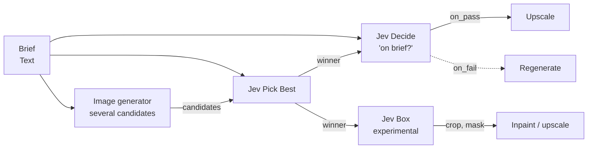

# TypeSafe Jev in Nebula Nodes



> Jev, from TypeSafe, is a decision model. You ask it typed questions (yes or no, pick one, rate on a scale, where is it) and it returns probabilities, never prose. In Nebula it sits between generators as a cheap judge. Vendor docs: [docs.typesafe.ai](https://docs.typesafe.ai).

## Nodes

| Node | ID | Status | Use it for |
|---|---|---|---|
| Jev Decide (judge / classify / yes-no) | `jev-decide` | shipped | One question about text and images: yes/no, pick an option, or a score |
| Jev Pick Best (rank / choose best image) | `jev-pick-best` | shipped | Pick the best of several candidate images |
| Jev Box (experimental) | `jev-box` | shipped, experimental | Find one thing in an image: box, crop and mask |

All three are `analyzer` nodes, `sync` (one request), and need `TYPESAFE_API_KEY`.

## Setup

1. Create a key in the TypeSafe console (`console.typesafe.ai/keys`).
2. In Nebula, open **Settings** → **Providers**, add it on the **TypeSafe** row (`TYPESAFE_API_KEY`) and save. TypeSafe has no free key-check call, so health shows the key as *configured, unverified* until a node runs.
3. Your own key only. Nebula has no hosted or shared Jev key, and always calls `https://api.typesafe.ai/v1/systemone` directly, never through an aggregator.

Whether TypeSafe may analyze your requests to improve its models is an organization setting in your TypeSafe console. Nebula can't see or change it.

## Experimental parts

TypeSafe marks image input and Box questions as not production-ready: the request format, limits and accuracy can change between releases. Nebula sends images anyway, and says so:

- Decide shows a capability note, and its report has an `Images: N (experimental)` line whenever images were sent.
- Box is labelled *(experimental)* in its name.
- Text-only questions are TypeSafe's production surface.

## Jev Decide

Inputs:

| Port | Type | Notes |
|---|---|---|
| `state` (Context) | Text, optional | What to judge, or the brief to judge against |
| `images` (Images) | Image, optional, up to 16 | Sent with the context in one request |
| `through` (Through) | Any, optional | Not sent to Jev. Comes out of `on_pass` or `on_fail` unchanged ([gate](#gate-branching-a-graph)) |

At least one of the two must be connected. With no images the context goes as plain text. With images, the request holds `{"context": ..., "image": ...}` for one image or `{"context": ..., "images": [...]}` for several, so a question can point at `image` or `images[1]`.

Params:

| Param | Default | Meaning |
|---|---|---|
| `model` | `jev-1.14.0` | Pinned ids `jev-1.14.0`, `jev-1.13.0`; aliases `jev-latest`, `jev-preview` move to new versions, so thresholds tuned on one may shift |
| `answer_type` | `yes_no` | `yes_no`, `choice` or `score` |
| `question` | required | One atomic question |
| `yes_means`, `no_means` | empty | Optional definitions of yes and no (yes/no only) |
| `options` | empty | Choice options, one per line (2 to 255) |
| `pass_when` | empty | Choice options that count as a pass, one per line |
| `levels` | empty | Score levels, low to high, one per line (2 to 10) |
| `threshold` | 0.5 | Pass when the yes-probability (yes/no) or normalized score (score) is at least this |
| `min_confidence` | 0.5 | Below this, `pass` is `unsure` |
| `when_unsure` | `fail` | Which gate branch an `unsure` verdict takes: `fail`, `pass`, or `neither` |
| `long_context` | false | Raises the context limit; slower and less accurate |

Choice options go to Jev under neutral keys (`a`, `b`, `c`, ...) with your wording as their description, and come back as your wording. A loaded option name can steer the answer; a neutral key can't.

Outputs (Text, plus the two gate ports):

| Port | Format | Example |
|---|---|---|
| `answer` | `yes` / `no`; the chosen option; or the most likely score level, in your words (ties go to the lower level) | `Product photo` |
| `pass` | `true`, `false` or `unsure` | `unsure` |
| `probability` | number: yes-probability (yes/no), winner probability (choice), score normalized to 0..1 (score) | `0.93` |
| `confidence` | number. Yes/no: `|2p - 1|` (Jev gives no confidence for yes/no). Choice and score: Jev's own | `0.86` |
| `probabilities` | JSON object, label → number, in option order. Yes/no uses `yes` and `no` | `{"yes": 0.93, "no": 0.07}` |
| `report` | report text, below | |
| `on_pass` | gate port: `through`'s value (its own type), or the `pass` text when `through` isn't wired. Withheld unless the verdict takes the pass branch | |
| `on_fail` | gate port: the same, for the fail branch | |

How `pass` is decided:

- yes/no: probability ≥ `threshold`.
- choice: the answer is one of `pass_when`. With `pass_when` empty, `pass` only says whether the answer is confident enough to use (`true` or `unsure`, never `false`).
- score: normalized score ≥ `threshold`.
- Then, for all three, `unsure` whenever confidence < `min_confidence`.

### Gate: branching a graph

Decide can stop the paid steps after it. `true` takes the pass branch and `false` the fail branch; `unsure` follows `when_unsure`. The chosen gate port carries `through`, and the other is withheld (both, for `neither`).

The engine then applies one rule: **a node runs only if none of its inbound edges comes from a withheld port or a skipped node.** Otherwise the node is *skipped*: it never starts, calls no provider, writes no cache entry and costs nothing, and its descendants follow the same rule.

- The reason names the decision: `Jev Decide failed (answered no, 0.12)`, `Jev Decide passed (answered yes, 0.93)`, or `Jev Decide was unsure (confidence 0.2, below 0.5); unsure counts as fail`. The canvas shows it as a *Skipped* chip on the node; `nebula run` prints `<id>: skipped — <reason>`; MCP run results list it under `skipped`; the canvas journal records `run.skipped`.
- Only the gate ports are ever withheld. `answer`, `pass`, `report` and the rest always flow, so nodes reading them run on either branch.
- A node wired to both `on_pass` and `on_fail` is always skipped, because one of them is always withheld. (A "first available" merge node could join branches later.)
- Inside an iterator, each item is gated on its own.
- A cache hit replays the same branch, so the same nodes are skipped.
- The pre-run cost estimate still counts nodes behind the gate. It is an upper bound; skipped nodes are given back from the agent spending limits when the run ends.

The engine side is documented in `docs/contracts/01-node-schema.md` (gate ports).

## Jev Pick Best

Inputs:

| Port | Type | Notes |
|---|---|---|
| `candidates` (Candidates) | Image, multiple, required, 2 to 10 | The images to choose from, in order |
| `brief` (Brief) | Text, optional | What the best one should match. Without it, Jev judges by the question alone |

Params: `model` (as Decide), `question` (default "Which image best matches the brief?"), `min_confidence` (0.5).

Nebula sends one Choice question. Each option is one candidate: a neutral key (`a`, `b`, ...) whose description is only that image, so no option name can steer the pick and each image is sent once.

Outputs:

| Port | Type | Format |
|---|---|---|
| `winner` | Image | The winning candidate's value, unchanged (the same reference that came in, never the resized copy) |
| `index` | Text | 0-based position among the candidates, as an integer: `1` |
| `probabilities` | Text | JSON keyed `"0"`, `"1"`, ... in candidate order: `{"0": 0.08, "1": 0.87, "2": 0.05}` |
| `confidence` | Text | number, Jev's Choice confidence. Low means the candidates are close and any would do |
| `report` | Text | report text. Below `min_confidence` it gets a note that the candidates are close |

Limits:

- At most 10 candidates, until TypeSafe publishes how many tokens an image costs. For more, split them across two nodes and pick again between the winners.
- If TypeSafe answers `max_tokens_exceeded`, Nebula sends the candidates once more at 768 px on the long side and notes it in the report. If that is still too long, the node fails and says to split the set.

## Jev Box (experimental)

Inputs: `image` (Image, required), `target` (Text, optional; overrides the `target` param).

Params:

| Param | Default | Meaning |
|---|---|---|
| `target` | empty | What to find, e.g. `the red car`. One thing per node |
| `model` | `jev-1.14.0` | `jev-1.14.0` or `jev-preview` only: Box needs Jev 1.14 |
| `presence_threshold` | 0.5 | Found when the "is it there?" probability is at least this |
| `min_confidence` | 0.5 | `found` is `unsure` when the presence probability is this close to a coin flip: confidence is twice its distance from 0.5 |
| `pad` | 0.05 | Grows the crop and mask by this fraction of the image on each side, clamped to the image. The `box` output stays unpadded |

Every request pairs the Box question with a yes/no "is it there?" question, because a Box answer always returns a box, even for something that isn't in the image. Both questions share the one image, so it is sent once.

| Port | Type | When | Format |
|---|---|---|---|
| `found` | Text | always | `true`, `false` or `unsure`, from the presence question |
| `box` | Text | always | JSON below when `found` is `true`; otherwise the text `null` |
| `crop` | Image | `found` is `true` | The padded box cut from the original image |
| `mask` | Mask | `found` is `true` | White rectangle (the padded box) on black, original image size |
| `annotated` | Image | `found` is `true` | The original with the box drawn and labelled |
| `report` | Text | always | report text |

`box` JSON:

```json
{"top": 0.25, "bottom": 0.82, "left": 0.44, "right": 0.84, "confidence": 0.92,
 "px": {"x": 450, "y": 192, "w": 411, "h": 438}, "image": {"w": 1024, "h": 768}}
```

- Edges are fractions (0..1, from the top-left) of the **original** image: decoded, first frame, EXIF rotation applied (what a browser shows). Any resizing or padding Nebula did before sending is undone.
- `px` is the integer pixel rectangle in that image; `image` is its size.
- `confidence` is `null` (never 0) when TypeSafe doesn't report one.
- When `found` is `false` or `unsure` there is no box, crop, mask or annotated image, so nothing downstream acts on a box that may point at nothing. The report still shows the presence probability.

## Number and report formats (all nodes)

- Numbers are plain decimals in 0..1 with at most four places and no trailing zeros or exponent: `0.93`, `1`, `0`.
- The report is plain text. Line 1 is the title (`Jev Decide (yes/no)`). Then one `Key: value` per line. `Model:` (the versioned id that answered, plus `(asked for jev-latest)` when you picked an alias) and `Input tokens:` (an integer, or `unknown`) are always there. Optional `Images:` and `Request id:` lines follow, then zero or more `Note: ...` lines.

```
Jev Decide (yes/no)
Question: Is the product on a plain white background?
Answer: yes
Pass: true
Probability: 0.93
Confidence: 0.86
Model: jev-1.14.0
Input tokens: 312
```

`frontend/src/lib/jev.ts` parses all of this (`parseJevOutputs`, `parseJevReport`); `backend/services/jev_outputs.py` writes and checks it. Both test against `backend/tests/fixtures/jev_outputs.json`.

## On the canvas

After a run, a Jev node shows its result on the card instead of the plain Text/Image preview: a Pass / Fail / Unsure chip, the question, the answer with its probability, and a meter (yes/no), option bars (choice) or level track (score). Pick Best shows the winner large and every wired candidate with its share, flagged "Close call" below the node's minimum confidence. Box draws the box over the searched image (or says "Not found"), with its confidence or "No confidence reported". The Inspector adds every probability, the model that answered, input tokens and the run's cost (input tokens at $0.042 per million). If the outputs don't parse, the card falls back to the plain previews. Code: `frontend/src/components/nodes/JevResult.tsx`, `frontend/src/components/panels/JevResultDetails.tsx`, `frontend/src/lib/jevView.ts`.

## Errors

Every message names the fix and never contains the key. TypeSafe's request id is appended when it sends one.

| Status | What you see |
|---|---|
| no key | `TYPESAFE_API_KEY is required` (before any request) |
| 400 `max_tokens_exceeded` | Too long for the context: send fewer or smaller images, shorten the context, or turn on Long context |
| 400 image or asset | An image was rejected: re-export it as PNG or JPEG |
| 400 other | TypeSafe's own message |
| 401 / 403 | The key was rejected: check it in Settings → TypeSafe |
| 413 | Request too large (32 MiB per request, 16 MiB per image) |
| 415 / 422 | Encoding problem / the field TypeSafe says is invalid |
| 408, 429, 5xx (incl. 529) | Retried twice with backoff (Retry-After honoured, up to 10 s), then a clear rate-limit, overloaded or server-error message |

## Images

Nebula prepares every image before sending, because TypeSafe rejects images outside its limits instead of resizing them:

- Loads local files, `/api/outputs/...` references, data URIs and public https URLs through Nebula's usual path and URL checks.
- Applies EXIF rotation, takes the first frame of an animation, and converts WebP, GIF and other formats to PNG (when there is transparency, or the input was PNG) or JPEG.
- Shrinks the long side to 1568 px, and pads (never stretches) small images up to 256 px a side and 78,400 px in total.
- Keeps each image under 16 MiB and the whole request under 32 MiB, re-encoding as smaller JPEGs if it must. Inputs over 64 MiB or 64 megapixels are refused.

## Cost

TypeSafe charges per input token ($0.042 per million) and nothing for output; images count as input tokens, and the per-image count isn't published yet. A request can't be longer than the context limit, so Nebula prices each run at that ceiling: up to **$0.0027** (64k tokens) by default and up to **$0.011** (262k) with Long context. Most questions cost a small fraction of that. Pick Best and Box are priced the same way at the default ceiling; Pick Best's retry after `max_tokens_exceeded` is a second request, and Nebula assumes the rejected first one isn't billed (TypeSafe doesn't say). Re-running an unchanged node replays from Nebula's cache for free.

## Limits

- One question per Decide node. Keep it atomic; ask several narrow questions rather than one compound one.
- Pick Best takes 2 to 10 candidates. Box finds one target per node and needs Jev 1.14 (`jev-1.14.0` or `jev-preview`).
- Pick Best and Box have no Long context switch.
- Rate limits are set per organization in the TypeSafe console.

## For developers

`backend/services/typesafe_client.py` is shared by every Jev node:

- `await prepare_images(values, label="Image", max_images=16, max_side=1568) -> list[PreparedImage]` (a smaller `max_side` shrinks further, for a retry): each has `placeholder` (fresh uuid4), `part`, `data`, `format`, `mime`, `source` and `transform` (`ImageTransform`, with `to_original_box(top=, bottom=, left=, right=)`).
- `await system_one(api_key, *, model, state, questions, images=(), long_context=False) -> JevResult`: every placeholder must appear exactly once in `state` and `questions`. `JevResult` has `model`, `requested_model`, `answers`, `input_tokens`, `output_tokens`, `request_id` and `answer(question_id, kind)`.
- `ChoiceOptions.from_labels(labels)` (`criteria()`, `read(answer)`), `score_criteria(levels)`, `read_score(answer, levels)`, `noul_confidence(p)`, `neutral_keys(n)`, `split_lines(text)`, `check_model(model)`.
- Errors are `TypeSafeError` (a `ValueError`) with `status`, `code` and `request_id`.

`backend/services/jev_outputs.py` writes the formats above (`format_number`, `verdict`, `probabilities_json`, `box_json`, `report`, `text`) and checks them (`validate_outputs(definition_id, outputs)`).

Gate ports: a port with `"conditional": true` in its definition may be withheld. Return `execution.gating.withheld(reason)` for it; `jev_decide.gate_outputs(...)` builds both for Decide.

Pricing: `backend/data/model_pricing.json` prices `jev-decide` `per: "request"` with a `[low, high]` range, a `long_context` row first, `plus: "input images"`, and cases in `backend/tests/fixtures/pricing_cases.json`. A new Jev node copies that entry under its own id.
