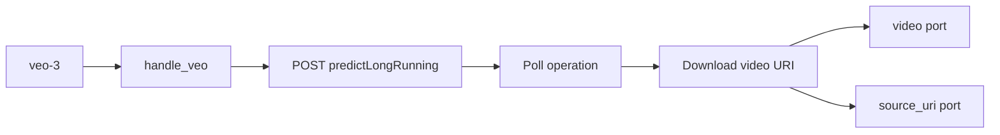

# Contract exemplar: Veo 3.1 (`veo-3`)

Template for porting agents. **Async-poll** video via `predictLongRunning`. Three routes, in order: **Vertex AI** (`GOOGLE_VERTEX_CREDENTIALS`, a service-account JSON key) → **Gemini API** (`GOOGLE_API_KEY`; preview models retire 2026-10-22) → **fal** `fal-ai/veo3.1` (`FAL_KEY`). Veo 3.0, 3.0 Fast and 2.0 were removed (shut down 2026-06-30); saved nodes migrate to the matching 3.1 model.

For conversational video (Interactions API), use [gemini-omni-flash.md](./gemini-omni-flash.md) instead.

**In scope:** single node `veo-3` with T2V, I2V, interpolation, and extension modes (Vertex and Gemini API). `veo-3-flf` reuses the Vertex path (`handle_veo_flf_vertex`) when the Vertex key is set, else runs on fal.

**Out of scope:** Omni Flash conversational edits → [gemini-omni-flash.md](./gemini-omni-flash.md). FAL-only params when no Google key.

---

## References & pricing

Re-check official links when `pricing_verified` is older than `stale_after_days`.

### Official references

| Resource | URL |
|----------|-----|
| Video generation guide | https://ai.google.dev/gemini-api/docs/video |
| Pricing | https://ai.google.dev/gemini-api/docs/pricing |
| Long-running operations | https://ai.google.dev/api/long-running-operations |
| Veo on Vertex AI | https://cloud.google.com/vertex-ai/generative-ai/docs/model-reference/veo-video-generation |

### Nebula references

| Resource | Path |
|----------|------|
| Family rules | [../03-handler-families/google.md](../03-handler-families/google.md) |
| Handler oracle | `backend/handlers/veo.py` |
| Vertex auth (JWT → OAuth token) | `backend/services/google_vertex.py` |
| FAL fallback | `backend/handlers/veo.py::fal_veo_route` + `backend/handlers/fal_universal.py` |

### Pricing (Google Veo, paid tier)

Rates from [official pricing](https://ai.google.dev/gemini-api/docs/pricing) as of `pricing_verified`, per second of video with audio. Vertex runs use the same rows (Vertex lists the same amounts per "count"; read as per second). The fal route is unpriced in Nebula.

| Model | 720p | 1080p | 4K |
|-------|------|-------|----|
| Veo 3.1 (`veo-3.1-generate-preview` / Vertex `veo-3.1-generate-001`) | $0.40 | $0.40 | $0.60 |
| Veo 3.1 Fast (`veo-3.1-fast-generate-preview` / `veo-3.1-fast-generate-001`) | $0.10 | $0.12 | $0.30 (Gemini API only; no 4K on Vertex) |
| Veo 3.1 Lite (`veo-3.1-lite-generate-preview` / `veo-3.1-lite-generate-001`) | $0.05 | $0.08 | — |

**Nebula params that move the bill**

| Param | Effect |
|-------|--------|
| `model` | Switches rate card |
| `duration` | `durationSeconds` — multiplies the per-second rate (default 8) |
| `resolution` | `720p` / `1080p` / `4k` (default 720p) |
| Extension mode | Gemini API: output locked to **720p** regardless of param. Vertex: keeps `resolution` |

---

## 1. How to use this file

| Step | Action |
|------|--------|
| 1 | Read [01-node-schema.md](../01-node-schema.md) + [02-handler-patterns.md](../02-handler-patterns.md) §5 async-poll |
| 2 | Implement Vol 1 from §2 |
| 3 | Implement submit + poll HTTP mapping §4 |
| 4 | Match `test_google_request_body_matches_fixture[veo-3-vertex-request.json]` (Vertex), `[veo-3-text-to-video-request.json]` (Gemini API) or `[veo-3-fal-request.json]` (FAL fallback) |
| 5 | Emit `ProgressEvent` during poll loop; expose `source_uri` for extension chains |

---

## 2. Node contract (Vol 1)

| Field | Value |
|-------|-------|
| `id` | `veo-3` |
| `displayName` | Veo 3.1 |
| `category` | `video-gen` |
| `apiProvider` | `google` |
| `apiEndpoint` | `veo-3.1-generate-preview` |
| `directKeyName` | `["GOOGLE_VERTEX_CREDENTIALS", "GOOGLE_API_KEY"]` (a list: first key set wins) |
| `envKeyName` | `["GOOGLE_VERTEX_CREDENTIALS", "GOOGLE_API_KEY", "FAL_KEY"]` |
| `executionPattern` | `async-poll` |

**Input ports**

| `id` | `dataType` | `required` | `multiple` | Notes |
|------|------------|------------|------------|-------|
| `prompt` | `Text` | yes | no | |
| `image` | `Image` | no | no | First frame (i2v) |
| `last_frame` | `Image` | no | no | Interpolation end frame |
| `video` | `Video` | no | no | **Extension only** — upstream `source_uri` |

**Output ports**

| `id` | `dataType` | Notes |
|------|------------|-------|
| `video` | `Video` | Local `.mp4` path |
| `source_uri` | `Video` | Gemini API: `files/...` URI (~2 days). Vertex: the saved clip (Vertex extends from its bytes; any node's `Video` output works too) |

**Params (Google routes)**

`sharedParams` + `directParams` merge at runtime (`params` array is empty on node):

| Group | Keys |
|-------|------|
| `sharedParams` | `aspectRatio`, `duration`, `resolution`, `personGeneration` |
| `directParams` | `model`, `seed` |
| `falParams` | `negative_prompt`, `seed`, `safety_tolerance`, … (FAL route only) |

| `key` | `type` | `default` | Values |
|-------|--------|-----------|--------|
| `model` | enum | `veo-3.1-generate-preview` | `veo-3.1-generate-preview`, `veo-3.1-fast-generate-preview`, `veo-3.1-lite-generate-preview` (Vertex maps these to `veo-3.1-generate-001`, `veo-3.1-fast-generate-001`, `veo-3.1-lite-generate-001`) |
| `aspectRatio` | enum | `16:9` | `16:9`, `9:16` |
| `duration` | enum | `8` | `4`, `6`, `8` seconds |
| `resolution` | enum | `720p` | `720p`, `1080p`, `4k` (Standard and Fast on the Gemini API and fal; Standard only on Vertex) |
| `personGeneration` | enum | `allow_adult` | `allow_all`, `allow_adult`, `dont_allow` |
| `seed` | integer | random | |

**Handler-pinned**

| Field | Value |
|-------|-------|
| Extension resolution | Gemini API: forced `720p` when `video` port connected. Vertex: not overridden |
| Extension models | Gemini API: `VEO_EXTEND_MODELS` — 3.1 generate/fast only. Vertex: `VERTEX_EXTEND_MODELS` — adds Lite |
| Vertex 4K | `VERTEX_4K_MODELS` — Standard only; 4K + Fast/Lite → `ValueError` |
| Vertex frames | JPEG/PNG pass through; other types (e.g. WebP) converted to PNG (`veo-3` and `veo-3-flf`) |
| Vertex `generateAudio` | Always `true`; `sampleCount: 1` |
| Vertex Lite | Frames are sent as-is; Google's model card is contradictory (modalities: no image input; capabilities: image-to-video), so Vertex decides |
| Reference-image mode | **Not exposed** — live API rejects (verified 2026-06) |

---

## 3. Handler pattern (Vol 2)

| Property | Vertex AI | Gemini API | FAL fallback |
|----------|-----------|------------|--------------|
| Handler | `handle_veo` → `_handle_veo_vertex` | `handle_veo` | `handle_fal_universal` via `fal_veo_route` |
| Auth | Service-account JWT exchanged for an OAuth token (`Authorization: Bearer`) | `x-goog-api-key` | `FAL_KEY` |
| Submit | `POST https://us-central1-aiplatform.googleapis.com/v1/projects/{project}/locations/us-central1/publishers/google/models/{model}:predictLongRunning` | `POST …/models/{model}:predictLongRunning` | `fal-ai/veo3.1` or `fal-ai/veo3.1/fast`, plus `/image-to-video` or `/first-last-frame-to-video` when frames are wired |
| Poll | Vertex operation poll | `GET …/operations/{id}` | FAL queue poll |
| Progress | `ProgressEvent` during poll | `ProgressEvent` during poll | FAL progress |
| Max polls | 300 | 300 × 3s interval | FAL defaults |
| Cancel | Best-effort upstream cancel | Best-effort upstream cancel | — |

On fal, Lite runs as Fast, params are renamed (`aspect_ratio`, `"8s"`), and extension raises `ValueError`. After 2026-10-22, failed Gemini API or fal runs append a hint to add a Vertex key.



---

## 4. HTTP mapping (Vol 3 — Gemini API; Vertex uses the same body plus `generateAudio: true`, `sampleCount: 1`)

### Submit

```http
POST https://generativelanguage.googleapis.com/v1beta/models/{model}:predictLongRunning
x-goog-api-key: <GOOGLE_API_KEY>
Content-Type: application/json
```

### Body (oracle shape — text-to-video)

```json
{
  "instances": [{ "prompt": "<prompt port>" }],
  "parameters": {
    "aspectRatio": "16:9",
    "durationSeconds": 8,
    "resolution": "720p",
    "personGeneration": "allow_adult",
    "seed": 42
  }
}
```

**Forwarding rules**

| Source | Rule |
|--------|------|
| `prompt` port | `instances[0].prompt` when non-empty |
| `image` port | `instances[0].image` — `{ bytesBase64Encoded, mimeType }` |
| `last_frame` port | `instances[0].lastFrame` — same payload shape |
| `video` port (extension) | Gemini API: `instances[0].video.uri` — must be a Veo-generated Gemini `files/...` URI. Vertex: any MP4 (1–30 s, 24 fps, 720p/1080p/4K, 16:9 or 9:16) as bytes from a saved file or a public https URL (≤100 MB), or a `gs://` URI; `files/` URIs are rejected |
| `aspectRatio` param | `parameters.aspectRatio` |
| `duration` param | `parameters.durationSeconds` (strips trailing `s`) |
| `resolution` param | `parameters.resolution` — overridden to `720p` on Gemini API extension |
| `personGeneration` param | `parameters.personGeneration` |
| `seed` param | `parameters.seed` when set |

### Poll

```http
GET https://generativelanguage.googleapis.com/v1beta/{operation_name}
x-goog-api-key: <GOOGLE_API_KEY>
```

When `done: true`, read `response.generateVideoResponse.generatedSamples[0].video.uri` (or `generatedVideos` fallback). Download with same API key → save `.mp4` → return `video` + `source_uri`.

---

## 5. SSE / output / events

No SSE. Async progress via WebSocket:

```typescript
{ type: "progress", node_id: string, value: number }  // 0.0–0.99 during poll
```

Final port output:

```json
{
  "video": { "type": "Video", "value": "/path/to/clip.mp4" },
  "source_uri": { "type": "Video", "value": "https://generativelanguage.googleapis.com/.../files/..." }
}
```

Wire `source_uri` → downstream `video` port for extension (on the Gemini API, not the downloaded file path; on Vertex any saved MP4 works).

---

## 6. Edge cases

| Condition | Behavior |
|-----------|----------|
| No Vertex key and no `GOOGLE_API_KEY` (Google route) | `ValueError("Veo needs GOOGLE_VERTEX_CREDENTIALS (Vertex AI) or GOOGLE_API_KEY")` |
| Extension + `image` or `last_frame` | `ValueError("Veo video extension cannot be combined with a first or last frame")` |
| Extension on Lite (Gemini API) | `ValueError("Video extension requires Veo 3.1 or 3.1 Fast …")` |
| Extension on fal | `ValueError("Extending a clip needs the Google route …")` |
| Vertex 4K with Fast or Lite | `ValueError("On Vertex only Veo 3.1 (Standard) renders 4K; pick 1080p or Veo 3.1")` |
| Vertex extension with a Gemini `files/` URI | `ValueError("Vertex can't read a Gemini API file URI …")` |
| Extension without `files/...` URI (Gemini API) | `ValueError` with wiring hint for `source_uri` |
| Poll timeout | `RuntimeError("Veo timed out after 300 polls")` |
| Operation error | `RuntimeError(f"Veo failed: {error}")` |
| Reference images (“ingredients”) | Not exposed — API rejects |

---

## 7. Parity oracle

**Test:** `backend/tests/test_google_contract_fixtures.py::test_google_request_body_matches_fixture[veo-3-text-to-video-request.json]`

**Fixture (Google direct):** `contracts/fixtures/handlers/google/veo-3-text-to-video-request.json`

**Fixture (Vertex):** `contracts/fixtures/handlers/google/veo-3-vertex-request.json`

**Fixture (FAL fallback, `FAL_KEY` only):** `contracts/fixtures/handlers/google/veo-3-fal-request.json`

| Test | Asserts |
|------|---------|
| `test_google_request_body_matches_fixture[veo-3-text-to-video-request.json]` | Google T2V submit body |
| `test_google_request_body_matches_fixture[veo-3-vertex-request.json]` | Vertex submit body |
| `test_google_request_body_matches_fixture[veo-3-fal-request.json]` | FAL `fal-ai/veo3.1` queue body |
| `test_returns_source_uri_for_chaining` | Full happy path + `source_uri` |
| `test_extension_rejected_on_lite` | Model guard |
| `test_vertex_route_wins_and_maps_to_ga_model` | Vertex preferred, GA model id |
| `test_fal_route_picks_endpoint_and_renames_params` | fal endpoint + param names |

Assertions on fixture body:

- `instances[0].prompt` present
- `parameters.aspectRatio == "16:9"`

---

## 8. Minimal graph (Vol 4)

```json
{
  "nodes": [
    {
      "id": "n1",
      "definitionId": "text-input",
      "params": { "text": "A golden retriever running through a sunlit meadow" },
      "outputs": {}
    },
    {
      "id": "n2",
      "definitionId": "veo-3",
      "params": {
        "model": "veo-3.1-generate-preview",
        "aspectRatio": "16:9",
        "duration": "8",
        "resolution": "720p"
      },
      "outputs": {}
    }
  ],
  "edges": [
    {
      "source": "n1",
      "sourceHandle": "text",
      "target": "n2",
      "targetHandle": "prompt"
    }
  ]
}
```

Extension chain: wire `n2.source_uri` → `n3.video` on a second `veo-3` node.

---

## 9. vs Gemini Omni Flash

| | Veo 3 | Omni Flash |
|--|-------|------------|
| API | `predictLongRunning` | Interactions API |
| Edit | Extension via `source_uri` only | `previous_interaction_id` |
| Last frame interpolation | Supported | Not supported |
| Extension | `video` port + `source_uri` | Not supported |
| Audio | Veo 3.1 native audio | Native in output |
| Routes | Vertex, Gemini API, FAL | Gemini API only |

---

## 10. Parameter matrix (official API vs Nebula)

| Parameter | Official Veo `predictLongRunning` | Nebula (Google routes) |
|-----------|-----------------------------------|------------------------|
| `instances[].prompt` | ✓ | `prompt` port |
| `instances[].image` | ✓ | `image` port |
| `instances[].lastFrame` | ✓ | `last_frame` port |
| `instances[].video.uri` | ✓ | `video` port (extension) |
| `parameters.aspectRatio` | ✓ | `aspectRatio` |
| `parameters.durationSeconds` | ✓ | `duration` |
| `parameters.resolution` | ✓ | `resolution` |
| `parameters.personGeneration` | ✓ | `personGeneration` |
| `parameters.seed` | ✓ | `seed` |
| Reference images | ✓ (API) | **not exposed** |
| `negative_prompt` | FAL route | `falParams` only |

Official reference: [Video generation](https://ai.google.dev/gemini-api/docs/video).

---

## 11. Porting checklist

- [ ] `NodeDefinition` matches §2 (merged `sharedParams` + `directParams`)
- [ ] POST `predictLongRunning` with `x-goog-api-key`
- [ ] Build `instances` + `parameters` per §4 forwarding rules
- [ ] Poll operation until `done`; emit `ProgressEvent`
- [ ] Download `video.uri` → save `.mp4` → `video` port
- [ ] Return original `video.uri` on `source_uri` port
- [ ] Enforce extension guards from §6
- [ ] Unit test loads fixture JSON body shape

---

## Changelog

| Date | Change |
|------|--------|
| 2026-07-01 | Initial exemplar (partial) |
| 2026-07-01 | Gold upgrade — full Vol 1–4, pricing, parameter matrix |
| 2026-10-10 | Veo 3.0/3.0 Fast/2.0 removed; Vertex AI route added; fal moved to `fal-ai/veo3.1`; pricing by model × resolution |
| 2026-10-11 | Vertex rules re-checked (Vertex is now branded Gemini Enterprise Agent Platform): 4K is Standard-only, extension adds Lite, keeps resolution and takes any MP4; non-JPEG/PNG frames converted to PNG |
