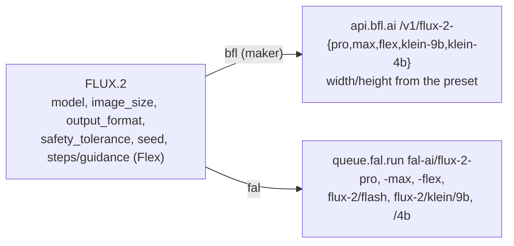

# FLUX.2 on BFL and fal — Audit Note

`flux-2-pro` ("FLUX.2") is one route-table node (provider switcher in the
node; `docs/PROVIDER-ROUTES.md`): Black Forest Labs' own API first, then the
fal route it ran on before PR 4. The id stays `flux-2-pro` because saved
graphs use it. Agent playbook: `.agents/skills/bfl/SKILL.md`. The node
definition in `frontend/src/constants/nodeDefinitions.ts` (and
`backend/data/node_definitions.json`) and the prices in
`backend/data/model_pricing.json` are the truth where this note and the code
differ.

## Sources (all fetched 2026-10-15; no paid calls)

- BFL: https://api.bfl.ai/openapi.json (`Flux2Inputs`, `Flux2FlexInputs`, `Flux2KleinInputs`); https://docs.bfl.ai/flux_2/flux2_overview, flux2_text_to_image, api_integration/errors; https://bfl.ai/pricing (its `pricingCards` CMS data) and https://docs.bfl.ai/quick_start/pricing
- fal: queue OpenAPI per endpoint, `https://fal.ai/api/openapi/queue/openapi.json?endpoint_id=<id>` for `fal-ai/flux-2-pro`, `fal-ai/flux-2-max`, `fal-ai/flux-2/flash`, `fal-ai/flux-2-flex`, `fal-ai/flux-2/klein/9b`, `fal-ai/flux-2/klein/4b`; the model pages under https://fal.ai/models/fal-ai/; preset sizes from https://fal.ai/docs/documentation/model-apis/model-arguments
- Pinned copies: `backend/tests/fixtures/provider_schemas/bfl.json` (`flux-2-*`) and `fal.json` (`fal-ai/flux-2*`), `$ref`s inlined.

## The models on each host

| `model` | BFL | fal |
|---|---|---|
| `pro` (default) | `/v1/flux-2-pro` | `fal-ai/flux-2-pro` (BFL's API resold) |
| `max` | `/v1/flux-2-max` | `fal-ai/flux-2-max` (resold) |
| `flash` | none: the route stops ("doesn't take model flash") | `fal-ai/flux-2/flash` (fal's own) |
| `flex` | `/v1/flux-2-flex` | `fal-ai/flux-2-flex` (resold) |
| `klein-9b` | `/v1/flux-2-klein-9b` | `fal-ai/flux-2/klein/9b` (fal-hosted weights) |
| `klein-4b` | `/v1/flux-2-klein-4b` | `fal-ai/flux-2/klein/4b` (fal-hosted weights) |

## What each route sends

The saved names are fal's (saved graphs carry them). The BFL route translates:

- `model` picks the path and isn't sent (either route).
- `image_size` preset → `width` / `height`: `square_hd` 1024×1024, `square` 512×512, `portrait_4_3` 768×1024, `portrait_16_9` 576×1024, `landscape_4_3` 1024×768, `landscape_16_9` 1024×576 (fal's documented sizes). A node saved without a size sends the default 1024×768: BFL documents no FLUX.2 default (`width`/`height` "default 0").
- `safety_tolerance` `"1"`-`"5"` → the integers 1-5.
- `num_inference_steps` / `guidance_scale` → `steps` / `guidance`, on Flex only.

| Setting | BFL | fal |
|---|---|---|
| `output_format` | jpeg, png | jpeg, png |
| `safety_tolerance` | 1-5 (BFL takes 0-5 on FLUX.2) | 1-5 on Pro, Max, Flex and Flash; Klein has no such field, so only the default `"2"` runs (not sent) |
| `seed` | yes | yes |
| `num_inference_steps` (Flex) | 1-50 (default 50) | 2-50 (default 28) |
| `guidance_scale` (Flex) | 1.5-10 (default 5) | 1.5-10 (default 3.5) |
| `enable_safety_checker` | no field: saved off, the run stops and offers fal | fal's own param (default on) |

- Steps or guidance set on any model but Flex stop the run on both routes.
- **Flash keeps `safety_tolerance`.** `Flux2FlashInput` has no such field, but the fal-only handler sent it on every Flash run, and the fal route keeps saved graphs' requests exactly as they were (`tests/test_flux2_nodes.py` replays all 6,048 saved combinations against the old handler's captured requests).

## Prices (per image; every preset is at most 1 MP and the node takes no image input)

| `model` | BFL | fal |
|---|---|---|
| pro | $0.03 | $0.03 |
| max | $0.07 | $0.07 |
| flex | $0.05 | $0.05 |
| flash | - | $0.005 (unconfirmed) |
| klein-9b | $0.015 | $0.011 (unconfirmed) |
| klein-4b | $0.014 | $0.009 (unconfirmed) |

- BFL: a flat first megapixel, then each extra output and input megapixel (1 MP = 1,048,576 px). Credits (1 = $0.01), first / extra / input: pro 3 / 1.5 / 1.5, max 7 / 3 / 3, flex 5 / 5 / 5, klein-9b 1.5 / 0.2 / 0.2, klein-4b 1.4 / 0.1 / 0.1.
- fal Pro, Max and Flex are rounded up to whole megapixels, so 1024×1024 or less costs the first-megapixel price (fal's own example).
- fal Flash and Klein bill "per megapixel of input and output" with no rounding stated, so a preset under 1 MP may cost less: the 1 MP price is an upper bound, and the switcher marks it `*` (a row-level `unconfirmed`). Klein's own `endpointBilling` says $0.006 (9B) and $0.005 (4B); the price text on the same pages reads $0.011 and $0.009 and may describe the Klein edit and Base cards listed there. The higher is kept.

## Left out

- Input images and editing (BFL `input_image` to `input_image_8`, Klein 4; fal's `/edit` endpoints). The node keeps its prompt-only port.
- BFL's preview endpoints `/v1/flux-2-pro-preview` and `/v1/flux-2-klein-9b-preview`.
- BFL prompt upsampling (`disable_pup` on Pro and Max, `prompt_upsampling` on Flex): fal doesn't expose it; BFL's default (on) applies.
- `safety_tolerance` 0 on BFL, exact width/height on either host, Flash and Klein steps or guidance on fal, fine-tuned endpoints, webhooks.
- FLUX.2 [dev] and the Klein Base models: not on BFL's public API.

## Open checks

- That fal's safety tolerance 1 is BFL's 1 (both run strictest to most permissive; fal doesn't state the mapping).
- That fal's resold Pro, Max and Flex render presets at fal's documented sizes (the size table is written for fal's own models).
- fal Flash and Klein rounding below 1 MP, and Klein's two price figures. A billed run would settle each.
- BFL's FLUX.2 safety cap of 5 is from the errors page; the OpenAPI types it 0-7, set per organization.
